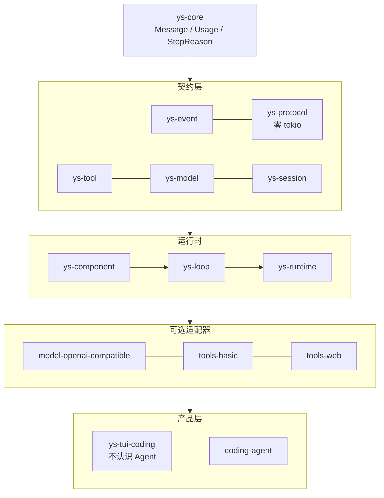

# YuShan · 嵛山

<p align="center">
  <em>YuShan（嵛山）是一座中国海岛的名字。</em>
</p>

<p align="center">
  <a href="LICENSE"></a>
  
  
  
</p>

<p align="center">
  <b>一个用 Rust 写的 agent 运行时。<br>
  23 MiB 内存，10 MB 一个文件，没有 Node，没有 JVM，没有 Python。</b>
</p>

---

## 这是什么

说人话：**它只负责让一个 AI 会干活的那部分**——叫模型、记对话、让模型调工具、把过程用事件流吐出来。

它不自带一个完整产品该有的全部东西。沙箱、权限、审批、多租户安全由上层负责
（本项目配套的是 [seabox](https://github.com/zsdfbb/seabox)）。

同类工具都在往「大而全」走：语音、代码模式、插件市场、IDE 集成。**本项目反着走**：
只做骨架，把重量留给别人。但仓库里有一个**能直接用的命令行 agent**，叫 `ys-coding-agent`——
有 TUI，能读写文件、跑 shell、联网搜索，能开子 agent，能装 skill。
不是 Demo，是日常真能拿来干活的工具。本项目已经使用 ys-coding-agent 开发.

```console
$ ys-coding-agent                       # 交互界面
$ ys-coding-agent -p "解释这个仓库"      # 一次性输出
$ ys-coding-agent --json "跑一遍测试"    # 事件流，给别的程序吃
```

## 内存占用

内存现在很贵。手机、平板、边缘盒子常见就是 4 GB / 8 GB，还要分给系统、相机、浏览器。
一个 agent 开局就吃掉 300 MiB，意味着在这类设备上它只能当个备选项，不能当常备工具。

同一个机器上，各家 CLI 启动到空闲界面之后常住多少（RSS 合计，含子进程，不含模型调用）：

| 项目 | 常驻 | 是 YuShan 的 | 进程数 | 技术栈 |
|---|---|---|---|---|
| **YuShan** | **23 MiB** | **1×** | 1 | Rust |
| codewhale | 132–169 MiB | 6–7× | 3 | Rust |
| Pi | 142–145 MiB | 6× | 1 | TypeScript |
| Claude Code | 262–263 MiB | 11× | 1 | TypeScript |
| Codex CLI | 349–357 MiB | 15× | 4–5 | Rust + Node |
| OpenCode | 820–849 MiB | 36–37× | 1 | TypeScript |

**最省的那个，也是本项目的 5 倍以上。**

<details>
<summary><b>怎么测的（点开看，可以自己复现）</b></summary>

同一台机器（Ryzen 9 7945HX，Linux 7.0），每个 CLI 在伪终端里起来，等 6 秒，
按进程名把相关进程的 `VmRSS` 加起来，每种跑 3 遍取范围。
脚本在 [`scripts/ram-compare.py`](scripts/ram-compare.py)，一遍不到 10 秒：

```console
$ python3 scripts/ram-compare.py --rounds 3 -v
```

两个容易被测错的地方，脚本里都处理了：

- **辅助进程会脱离进程树**。Codex 起一个 `app-server` 常驻后台（200 MiB 左右），
  这个进程会挂到 systemd 下——只看父子关系会漏掉它，数字少一半。
- **匹配要带边界**。`pi` 这个裸词会撞上 `pipewire`。

**这不是公平比赛。** 它们比本项目多很多东西（语音、代码模式、IDE 集成、插件市场）。
这张表只说一件事：**光跑一个 agent 循环，不需要几百兆内存**。

</details>

## 特点

- **小。** 单文件 10 MB，跑起来 23 MiB。不需要装 Node、JVM、Python 任何运行时——
  所以能塞进手机、平板这类设备。
- **干净。** 十来个 crate，每个只做一件事，依赖只能从上往下走。
  渲染层（`ys-tui-coding`）**根本不认识 `Agent`**——这条靠 `Cargo.toml` 卡住，写错了编译不过，不靠自觉。
- **能换。** 模型后端、工具集、界面都是可插拔的 crate。接自己的模型？写个 `Model` 实现。
  不想要 TUI？用 `--json` 直接吃事件流，自己画。
- **不做安全。** 不是疏忽，是分工。沙箱那层交给我的另一个项目 [seabox](https://github.com/zsdfbb/seabox)——
  Landlock + seccomp + namespace 的 OS 级限制，同样不需要 Docker。
  YuShan 负责「能干活」，seabox 负责「越界就拦住」。

<details>
<summary><b>分层图</b></summary>



依赖只能向下，不能向上。唯一的跨层通话是 `ys-protocol` 的纯数据类型和三条有界信道。

</details>

## 快速开始

```console
$ git clone https://github.com/zsdfbb/YuShan.git && cd YuShan
$ ./scripts/cargo-build.sh build --release
$ ./target/release/ys-coding-agent
```

首次启动在界面里输入 `/login` 选 provider 并填入 key（`deepseek` / `minimax` 已内置端点，
其他填自定义 base URL）。登录后直接说话即可。

不想开界面：

```console
$ ./target/release/ys-coding-agent -p "这个项目是做什么的"
```

## 现在能做什么

**模型**
- 多 provider：`/login` 登录、`/logout` 登出、`/model` 运行中换模型
- 思考档位可调（minimal → max）
- 拉不到模型列表时也能降级启动，不会卡住

**干活**
- 12 个工具：9 个基础（`read` `write` `edit` `bash` `grep` `find` `ls` `websearch` `webfetch`）
  + `bash_bg` + `subagent` + `subagent_async`（后三者追加在末位，顺序即契约）
- 搜索后端可配多个（SearXNG / DeepSeek / Tavily / Bocha / Firecrawl），配了哪个用哪个
- **子 agent**：派一个出去干子任务，父回合会等它回来接着干，不会半路把活丢了
- **Skill**：把 `SKILL.md` 丢进 `.yushan/skills`，模型需要时才读正文——不占上下文
- **git worktree**：一个需求一棵树，`worktree create / attach / list / remove`

**用起来**
- 三种模式：TUI / `-p` 边生成边打印 / `--json` 事件流
- 会话：默认开新的，`--resume` 恢复旧的，`/new` 再开一个，`/compact` 压上下文，`/export` 导出
- TUI：滚轮、拖选、输入历史、命令和 skill 补全
- 结构化日志默认开着，`--stats` 能看背压

## 后面要做的

已经写好设计、只差实现的：

- **追问** —— 让系统能在回合结束后自己接着说话。协议槽已留好
- **长程 todo** —— agent 自己维护跨回合的任务清单，配合上面那个追问才跑得起来
- **子 agent 分角色** —— 现在子 agent 的工具和父 agent 一模一样，应该按角色给不同的表
- **跨会话输入历史** —— 现在 `↑` 只能翻当前这次会话，退出就没了

有意不做的：

- **PTC（让模型写代码调工具）** —— 唯一能大幅减少对话轮数的办法，但需要执行边界。等上层给出边界再说
- **动态插件热插拔** —— 第一版不做，静态组装够用
- **沙箱、权限、审批** —— 不归这里管，见 [seabox](https://github.com/zsdfbb/seabox)

## 目录

```
crates/      运行时核心，10 个 ys-* crate
adapters/    可选的模型和工具实现
apps/        可执行程序（coding-agent）
skills/      仓库自带的 skill
docs/        设计、决策记录、现状文档
```

## 开发

```console
$ ./scripts/cargo-build.sh     # 构建（别直接用 cargo build，有增量垃圾清理）
$ ./scripts/par-test.sh        # 跑全部测试，约 7 秒
$ cargo clippy --all-targets && cargo fmt
```

想深入了解：

| 想看什么 | 去哪 |
|---|---|
| **怎么用 `ys-coding-agent`**（CLI / 内置命令 / 键位） | [`apps/coding-agent/README.md`](apps/coding-agent/README.md) |
| 约定和硬性约束 | [`AGENTS.md`](AGENTS.md) |
| 架构图（分层 / 信道 / 时序 / 数据流） | [`docs/architecture.md`](docs/architecture.md) |
| 现在实际是什么样（含与设计的分歧） | [`docs/design-final/`](docs/design-final/) |
| 每个决策为什么这么定 | [`docs/adr/`](docs/adr/) |
| 还没做什么 | [`docs/TODO.md`](docs/TODO.md) |
| 怎么贡献 | [`CONTRIBUTING.md`](CONTRIBUTING.md) |

仓库自带 5 个开发用 skill（架构探索 / 设计 / 校验、诊断、顺序工作流），外加 `pdf-analysis` 示例。
clone 后跑 `./scripts/install-skills.sh` 即可在 agent 里通过 `/` 调用 —— 这个项目本身就是用它们迭代的，
哪种任务用哪个、在本 runtime 下怎么落地（无 plan mode）见
[`CONTRIBUTING.md`](CONTRIBUTING.md#用本项目自己开发)。

## 状态

`v0.0.1`，接口还会动。核心循环和 CLI 已经能日常使用，其余按 [`docs/TODO.md`](docs/TODO.md) 推进。
配套的沙箱 [seabox](https://github.com/zsdfbb/seabox) 同为 `v0.0.1`。

## License

[MIT](LICENSE)
