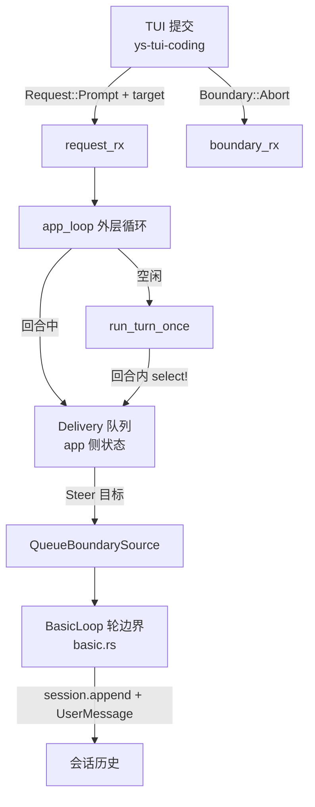

# 回合中输入的投递通路 — 架构设计

> 产出：`/arch-design`。前置：[`context.md`](./context.md)（现状调查与根因）。
> 决策记录：[`docs/adr/0047-input-delivery-target-and-queue.md`](../../adr/0047-input-delivery-target-and-queue.md)
> （另有 [ADR-0049](../../adr/0049-final-answer-boundary-drain.md) 修了本文的一个假前提）。
>
> ⚠️ **本文的 as-built 叙述写于 2026-10-22 上午，当日傍晚代码已变**：
> 「`Steer` 无生产者」已不成立（`8a08bd6` 接上了），
> 「回合头部排空无差别丢弃」也已不成立（同 commit 改为只丢 `Abort`、保留 `Steer`），
> 「轮边界总是存在」经 ADR-0049 修正为**真不变量**（收场前也拉一次）。
> **仍成立的那一半**：**「下一回合」语义缺协议格与队列**（`Boundary` 无 `NextTurn` 格、
> app 侧无跨回合队列）⇒ 系统发起的 follow-up 无处可去。
>
> ⚠️ **本文与评审的裁决状态不一致（F9，尚未消解）**：
> 评审（[`review.md`](./review.md)）判 **「Request changes —— 暂不可实现」**，
> 列出六项闸门 **G1–G6**（G2 已由 ADR-0049 落地、G4 已随 `8a08bd6` 解决，
> **G1 / G3 / G5 / G6 未做**）；
> 而本文 §7 仍有 **3 项「待用户确认」**（命令与消息谁先 / 回合中命令是否即时拒绝 /
> 投递状态显示落点）⇒ **并非「全部裁决」**。
> 评审给了「先命令后消息」的取舍（§7），但那只是**建议**，未获确认。
> ⇒ **本文描述的是「尚未实现、且仍有未裁项」的目标形态**。

## 概述

让**回合进行中**提交的用户输入有一个**明确的生效时机**，而不是被动等到整个回合结束。

核心结论：把「投递到哪一格」做成**协议的一等公民**（`DeliveryTarget`），
由 `app_loop` 在**回合边界**统一消费；`Boundary` 枚举**不动**（`Steer` / `Abort` 两格保持不变），
`BasicLoop` 的**每轮开头**那处轮边界拉取点不动（⚠️ **收场前新增了一处**，见 ADR-0049）。

## 1. 问题的准确形状

用户输入在当前实现里只有**两个**去处：

| 去处 | 消费者 | 生效时机 | 生产者 |
|---|---|---|---|
| `Request::Prompt(Message)` | `app_loop` 外层循环（`apps/coding-agent/src/app_loop.rs:375`） | **整个回合结束后** | TUI `submit()`（`crates/ys-tui-coding/src/events.rs:307`） |
| `Boundary::Steer(Message)` | `BasicLoop` 轮边界（`crates/ys-loop/src/basic.rs`） | 下一轮模型调用前 | ✅ **已接上**（`8a08bd6`） |

回合内的 `select!`（`apps/coding-agent/src/app_loop.rs:1039` 附近）只监听
`sink_rx` 与 `boundary_rx`，**不监听 `request_rx`** ⇒ 回合中提交的 `Request::Prompt`
在信道里排队，直到回合结束才被取出。

`Boundary::Steer` 这条通路**完全实现了**（拉取点、`session.append`、`UserMessage` 事件
都齐备）。**「下一回合」那一路**（`NextTurn`）缺的不是性能，是**协议格**与**投递去向的可见性**。

## 2. 三种投递语义的边界（先划清，再设计）

这三个概念此前被混在一起谈，本设计先把它们分开：

| 语义 | 发起方 | 时机 | 载体 | 消费者 | 会话连续性 |
|---|---|---|---|---|---|
| **Steer**（轮内插话） | 用户 | 下一轮模型调用**前** | `Boundary::Steer` | `BasicLoop`（`basic.rs`） | 插入**当前**会话历史 |
| **NextTurn**（下一回合） | 用户 | 本回合**结束后** | `Delivery` 队列 | `app_loop` 外层循环 | **新**回合，接在同一会话上 |
| **Follow-up**（ADR-0014） | **系统** | 本回合**结束后** | `Delivery` 队列（`origin = System`） | `app_loop` 外层循环 | **新**回合，接在同一会话上 |

**关键判断**：

1. **`Steer` 与 `NextTurn` 不是一回事。** `Steer` 把消息插进**当前**回合的会话历史 ——
   模型在同一轮里就能看到它（下一轮模型调用的 `messages` 里已经有它）。
   `NextTurn` 是**另起一个回合**，本回合的模型从头到尾看不到它。
   这决定了「用户想中途改方向」与「用户想追加一个问题」是两种意图。

2. **用户发起的 NextTurn 与系统发起的 Follow-up 共享「回合后执行」这一时机**，
   但**协议意图不同**（前者是用户输入，后者是代码触发的自动轮次）。
   ⇒ 本设计让它们**共用同一条队列**（时机相同），用 `origin` 字段区分意图与可见性。

3. **不新造第四种语义。** 按 `docs/arch/hooks-and-plugins/notes.md:81` 的准入规则
   「落既有桶则复用」：`Steer` 复用 `Boundary::Steer`；「下一回合」复用 ADR-0014
   follow-up 已经占住的「回合后另起一轮」这个桶 —— 本设计是**给它补上协议格与队列**，
   不是另开一条路。

## 3. 方案对比（三个候选）

三个候选由三个独立 subagent 按不同设计哲学产出（最小复杂度 / 语义显式 / 独立投递层）。

### 方案 A — 最小复杂度：只补 `Steer` 生产者

TUI 回合中提交 ⇒ 改发 `Boundary::Steer`；app 侧把 `Steer` 注入当回合的
`QueueBoundarySource`；回合末把 source 里**未被消费**的 `Steer` 取回，携带到下一回合。

**优点**：协议变体 **+0**；改动 4 个文件；概念最少。
**致命缺陷**：boundary 信道是**回合内的瞬时信箱**，生命周期与回合绑定，且有**多个丢弃点**：

| 丢弃点 | 位置 | 后果 |
|---|---|---|
| 回合末未被轮边界消费 | 模型直接给最终答复 ⇒ 不再有下一次 `take()` | 消息滞留，下一回合头部排空时被丢 |
| 头部排空 | `apps/coding-agent/src/app_loop.rs:952` | 同上，**静默丢失** |
| 命令期间 | `cancel_on_abort`（`app_loop.rs:745`）收到 `Steer` **直接丢弃** | 静默丢失 |
| 回合已结束但 TUI 仍认为在跑 | 消息落在回合边界之外 | 同上 |

⇒ 方案 A **不能保证「绝不丢失」**，而「用户输入丢失」比「用户输入晚点生效」严重得多。
**否决**。

### 方案 B — 语义显式：协议一等公民

新增 `DeliveryTarget { Steer, NextTurn }`，`Request::Prompt` 携带目标；
`app_loop` 维护跨回合的 `Delivery` 队列（用户发起 + 系统发起共用）；
回合边界统一消费。`Boundary` **不新增第三格** —— 因为 `Boundary` 是**轮边界**语义
（`BasicLoop` 消费），「下一回合」是**回合边界**语义（`app_loop` 消费），**两者错层**：
把 `NextTurn` 塞进 `Boundary` 会迫使 `BasicLoop` 理解「回合」这个它不该管的概念。

**优点**：投递去向显式；投递状态可回执；复用 follow-up 的时机。
**代价**：新增 3 个协议类型（`Delivery` / `DeliveryTarget` / `DeliveryOrigin`）；
`Request::Prompt` **保持不变**（投递目标由 app 侧推导，见 §5.2）⇒ **零协议破坏**。
（初版曾含 `DeliveryStatus` + `DeliveryAck` 回执，**在 ADR-0047 决策 7 里被砍掉** ——
回执多余，`AgentEvent::UserMessage` 已是唯一的「已生效」信号。）

### 方案 C — 独立投递层

把「用户输入投递」抽成独立于回合生命周期的组件（`SteerQueue`），
位于 `ys-protocol`（零 tokio），状态机独立，最终仍桥接成 `Boundary::Steer`。

**优点**：概念上最接近 pi / Claude Code / Codex（`docs/arch/hooks-and-plugins/notes.md:60`）。
**致命缺陷（两个）**：

1. **双消费者争抢。** 方案 C 提出「回合内 `select!` 加一支 `request_rx`」——
   这会让**外层循环（`app_loop.rs:337`）与回合内 `select!` 同时消费同一个 `request_rx`**。
   tokio 的 `mpsc::Receiver` 是**单消费者**语义；两个 `recv()` 交替会随机抢走消息
   （一个 `Request` 可能被外层循环在回合中途取走并另起回合）。
   ⇒ 必须引入**独立信道**（`delivery_tx/delivery_rx`）⇒ 已经多了一个协议载体。
2. **两处真相。** `Boundary::Steer` 已是投递语义，投递层再维护一套状态机 ⇒
   同一条消息有两个状态源，「是否已生效」要在两处对账。

方案 C 的 subagent 自己也承认：**在 MVP 阶段做独立的 `ys-protocol` 组件是过度设计**，
「投递层 = app_loop 里的一个 `Vec`」才是诚实结论。⇒ **否决**（其 MVP 形态并入方案 B）。

### 对比矩阵

| 维度 | A 最小复杂度 | B 语义显式 | C 独立投递层 |
|---|---|---|---|
| 协议变体新增 | **0** | +3 类型（`Delivery` / `DeliveryTarget` / `DeliveryOrigin`） | +5（投递层 + 状态 + 模式） |
| 改动文件数 | 4 | **5–7** | 6–8 |
| 新增概念数 | 2 | **3** | 4 |
| 消息丢失保证 | **否**（4 个丢弃点） | **是**（队列跨回合存活） | 是 |
| 回合内生效延迟 | 下一轮（≈1 轮） | 下一轮（Steer）/ 回合后（NextTurn） | 下一轮 |
| 投递去向可见 | 弱（隐式） | **强**（显式 target + 状态回执） | 强 |
| 复用 follow-up 桶 | 否 | **是**（同队列，`origin` 区分） | 部分 |
| 状态机数量 | 1（隐式） | **1** | **2**（两处真相） |
| 依赖方向风险 | 低 | 低（`ys-protocol` 零 tokio） | 中（新增 `ys-protocol` 组件） |
| 与 ADR-0013 相容 | 相容 | **相容** | 相容 |
| 运维/排障负担 | 低 | 中（多一个状态面） | **高**（两处状态面对账） |
| 主要风险 | **静默丢消息** | 协议面扩大 | 双消费者争抢 + 过度设计 |

**Back-of-envelope**：投递本身零成本 —— 一条 `Vec` push / pop，无分配增长
（每条消息一个 `Message`）。延迟上界由**轮边界**决定：一条消息从提交到被模型看到，
最坏 = 当前模型调用剩余时间（`reasoning_effort=high` 时可达数十秒），
最好 = 下一个轮边界（毫秒级）。**投递机制不引入新延迟** —— 它只是把「等整个回合」
缩短到「等当前这一轮」。

## 4. 决策：方案 B

**选择方案 B（语义显式）**，理由按重要性排序：

1. **「绝不丢失」是硬需求，而方案 A 不满足。** 方案 A 的四个丢弃点都是**静默**的
   （用户看到输入框里的文字消失了，没有任何提示）。方案 B 的队列**跨回合存活**，
   不存在「回合末清空」这类隐式丢失。
2. **投递去向必须显式，否则用户无法预期。** 「我这句话是插进当前这轮，还是等下一轮？」
   是用户必须能回答的问题。方案 A 的答案是「隐式取决于模型这轮还调不调工具」——
   不可预期。方案 B 让它成为协议字段。
3. **复用而非新建。** 方案 B 让用户发起的 NextTurn 与 ADR-0014 follow-up 共用
   「回合后另起一轮」这条既有路径 ⇒ 顺带补上 follow-up 缺的协议格
   （`docs/TODO.md` §B 记录「Follow-up 代码零落地」的根因之一）。
4. **不把复杂度花在错的地方。** 方案 C 的投递层是**概念正确但落地过早**：
   单仓单人维护，第二个「跨回合投递队列」的状态机没有真实消费者。

**代价（诚实记录）**：协议面从 2 个投递概念（`Request::Prompt` / `Boundary::Steer`）
扩到 4 个（加 `Delivery` / `DeliveryTarget`）；多出一个状态面需要排障。
若将来 ADR-0014 follow-up 落地，`Delivery.origin = System` 即可直接复用 ——
**这笔预付是划算的，因为它有真实消费者**（follow-up 已是 accepted 决策，只差实现）。

## 5. 详细设计

### 5.1 模块划分



| 模块 | 职责 | 变更 | crate |
|---|---|---|---|
| `Delivery` / `DeliveryTarget` | 投递条目的形状与去向 | **新增** | `ys-protocol`（纯数据，零 tokio） |
| `DeliveryQueue` | 跨回合存活的投递队列 | **新增**（app 侧持有） | `apps/coding-agent` |
| `app_loop` | 回合内收投递、回合边界消费、回合末兜底 | 修改 | `apps/coding-agent` |
| `Boundary` | 轮边界通道 | **不动** | `ys-protocol` |
| `BasicLoop` | 轮边界拉取 | **不动** | `ys-loop` |
| TUI `submit` / `dispatch` | 附带投递目标 | 修改 | `ys-tui-coding` |
| TUI `App` | 投递状态显示 | 修改 | `ys-tui-coding` |

### 5.2 协议改动清单

```rust
// crates/ys-protocol/src/delivery.rs（新增文件）

/// 一条待投递的用户/系统输入及其去向。
pub struct Delivery {
    pub message: Message,
    /// 去向：`Steer` 下一轮生效；`NextTurn` 下一回合生效。
    pub target: DeliveryTarget,
    /// 发起方：用户输入 vs 系统发起（ADR-0014 follow-up）。
    pub origin: DeliveryOrigin,
}

pub enum DeliveryTarget { Steer, NextTurn }

pub enum DeliveryOrigin { User, System }
```

**兼容性**：`Delivery` 是**新类型**，不改动 `Request` / `Boundary` 任何既有变体的 serde 形态
⇒ **零协议破坏**。`Request::Prompt(Message)` 保持不变 ——
**投递目标由 app 侧决定，不由 UI 传**（见 §5.6）。

> **为什么 UI 不传 target**：`Request` 是「UI → app 的能力请求」，
> 投递目标是**app 侧根据「当前是否在回合中」推导**的运行时事实
> —— UI 知道的 `is_turning` 是**本地推测**（它靠事件推断，可能滞后一个 poll 周期，
> 见 `crates/ys-tui-coding/src/app.rs:394` 的注释「UI 的 `is_turning` 复位最长滞后一个 poll 周期」）。
> 让 UI 猜「我现在该不该 steer」会引入**错判窗口** —— 猜错就是消息插错回合。
> ⇒ **app 侧是唯一权威**：它知道回合是否真的在跑。

### 5.3 关键数据流

**正常路径（回合中提交 ⇒ 下一轮生效）**

```
TUI submit()  events.rs:307
  │  is_turning == true ⇒ 仍发 Request::Prompt（UI 不预判目标）
  ▼
request_rx（容量 64，main.rs:2250）
  │
  ▼
app_loop 回合内 select!（app_loop.rs:1039 一带）**新增一支 request_rx 分支**
  │  收到 Request::Prompt ⇒ 转成 Delivery{target: Steer, origin: User}
  │  ⇒ 立即 boundary.push(Boundary::Steer(msg))  ★ 当回合的下一轮即生效
  ▼
BasicLoop 轮边界（`basic.rs`）take() ⇒ session.append + emit(UserMessage)
  ▼
TUI 收到 UserMessage ⇒ 渲染用户行（app.rs:280 分支已就位）
```

**回合内提交 ⇒ 「下一回合」生效（`NextTurn`）—— **本版不向用户开放**

```
回合内 select! 收到 Request::Prompt
  │  app 侧判定：本回合的轮次是否还有下一次模型调用？
  │  不可预知 ⇒ 统一按 Steer 处理（见下方取舍）
```

> **本设计的取舍**：UI **不提供**「下一回合」的显式选择。
> 理由：模型这轮还调不调工具**不可预知**，让用户选「下一轮 / 下一回合」会产生
> 一个**撒谎的承诺**（说了「下一回合」，模型这轮又调了 5 次工具，实际等了几分钟）。
> 用户真正要的是「别让我等到整个回合结束」⇒ **统一 Steer**。
> 「下一回合」这一格留给**系统发起的 follow-up**（那里时机由代码决定，不由用户选）——
> 即 `Delivery{origin: System, target: NextTurn}`。

**回合中提交 `/命令`**

```
TUI dispatch() → Action::Request(Request::SetModel{..}) 等
  ▼
request_rx ⇒ 回合内 select! 收到
  │  命令**不是消息**，没有轮边界可装 ⇒ 不能 Steer
  ▼
app 侧：记入 pending_commands 队列 ⇒ 回合结束后按提交顺序执行
  ▼
（UI 侧显示「已排队，回合结束后执行」）
```

**回合末兜底（`Steer` 未被轮边界消费）**

```
回合结束（run_turn_once 返回）
  │  本回合的 QueueBoundarySource 里可能还躺着未被 take() 的 Steer
  │  （模型直接给最终答复 ⇒ 不再有下一次 take()）
  ▼
app 侧：从 source 取回残留 Steer ⇒ 转成 Delivery{target: NextTurn} 放回队列
  ▼
下一回合开始时消费 ⇒ 消息不丢，只是晚一轮
```

### 5.4 投递状态机

| 状态 | 含义 | 迁移触发 | 终态 |
|---|---|---|---|
| `Queued` | app 已接收，尚未交给 `BasicLoop` | app 收到 `Request::Prompt` | 否 |
| `Injected` | 已 `push` 进当回合 boundary source | app 回合内 `select!` 处理 | 否 |
| `Delivered` | `BasicLoop` 已 `take()` 并写进会话 | `UserMessage` 事件 | **是** |
| `Deferred` | 本回合未被消费，降级到下一回合 | 回合末取回残留 | 否（转 `Queued`） |

**终态条件**：`Delivered`。

**没有 `Rejected` 态**：回合被取消（`Boundary::Abort`）**不清空投递队列** ——
取消的是「当前回合」，不是「用户已表达的那个意图」⇒ 已提交未生效的消息
**下一回合仍然生效**（场景 S5）。

**状态归属**：**app 侧是权威**（它知道 `BasicLoop` 是否真的消费了）。
UI 侧**不维护独立状态机** —— 它只根据收到的 `UserMessage` 事件把本地行从
「已提交」标为「已生效」。⇒ **单处真相**（对比方案 C 的两处真相）。

### 5.5 关键接口概要

```rust
// crates/ys-protocol/src/delivery.rs
pub enum DeliveryTarget { Steer, NextTurn }
pub enum DeliveryOrigin { User, System }
pub struct Delivery { pub message: Message, pub target: DeliveryTarget, pub origin: DeliveryOrigin }

// apps/coding-agent/src/app_loop.rs
impl DeliveryQueue {
    fn push(&mut self, d: Delivery);
    /// 回合边界消费：取出所有 `NextTurn` 条目（按提交顺序）。
    fn take_next_turn(&mut self) -> Vec<Delivery>;
    /// 回合末兜底：把未被消费的消息放回队列。
    fn requeue(&mut self, d: Delivery);
}

// crates/ys-tui-coding/src/app.rs
impl App {
    /// 投递状态显示：pending 数 / 已生效标记。
    fn delivery_status(&self) -> Option<String>;
}
```

### 5.6 语义边界表（最终版）

| 语义 | 发起方 | 时机 | 载体 | 消费者 | 可见性 | 会话连续性 |
|---|---|---|---|---|---|---|
| 用户输入（回合中） | 用户 | **下一轮** | `Boundary::Steer` | `BasicLoop`（`basic.rs`） | 提交即知「下一轮生效」 | 插入当前会话 |
| 用户输入（空闲） | 用户 | 立即起回合 | `Request::Prompt` | `app_loop` 外层循环 | 已有 | 新回合 |
| 系统 follow-up | 系统 | 回合结束后 | `Delivery{origin:System}` | `app_loop` 外层循环 | 「系统已排队」 | 新回合 |
| 回合中 `/命令` | 用户 | 回合结束后按序 | `pending_commands` | `app_loop` 外层循环 | 「已排队（命令）」 | 不涉及 |
| 回合中取消 | 用户 | 立即 | `Boundary::Abort` | `BasicLoop`（`Cancelled`） | 已有 | 已投递的消息**保留**（取消的是当前回合，不是用户意图） |

### 5.7 场景行为表

| 场景 | 期望行为 | 落点 |
|---|---|---|
| **S1** 空闲时提交 | 立即起一个回合 | 既有路径，不变 |
| **S2** 回合中提交，等下一轮生效 | 下一轮模型调用即可见 | 回合内 `select!` 收 `request_rx` ⇒ `boundary.push(Steer)` |
| **S3** 回合中提交，用户想知道状态 | 状态行显示「已提交，下一轮生效」 | TUI 本地行标记（提交即知） |
| **S4** 回合中提交 `/命令` | 排队，回合结束后按序执行；UI 显示「已排队」 | `pending_commands` 队列 |
| **S5** 回合中取消 | 及时收场（100ms 量级）；已提交未生效的消息**保留** | `Boundary::Abort` 既有语义；投递队列不随取消清空 |
| **S6** 回合中插话（中途改方向） | 下一轮生效 | 与 S2 同路径 |
| **S7** 回合末未消费的 `Steer` | 不丢，降级到下一回合 | 回合末从 source 取回残留 |
| **S8** 并发提交多条 | 按提交顺序进入队列，模型按该顺序看到 | FIFO 队列 |
| **S9** 回合中提交 `/skill-name args` | skill 展开在**投递点**发生（与今天同位置） | `expand_skill_invocation` 现有位置 `app_loop.rs:1195` |

### 5.8 关键时序（正常 / 竞态）

**T1 正常（回合中提交 ⇒ 下一轮生效）**

```
TUI            app_loop                 BasicLoop
 │ submit("改用 grep")  │
 │ ── Request::Prompt ──▶│
 │                       │ 回合内 select! 收 request_rx
 │                       │ delivery = Delivery{Steer, User}
 │                       │ ── boundary.push(Steer) ──▶│
 │                       │                            │ 轮边界 take()
 │                       │                            │ session.append + emit(UserMessage)
 │◀── UserMessage ───────│────────────────────────────│
 │ 渲染用户行
```

**T2 竞态（回合已结束，TUI 仍认为在跑）**

```
TUI 状态滞后：is_turning 仍为 true，但 app 侧回合已结束
 │ ── Request::Prompt ──▶│ 外层循环 request_rx.recv()（app_loop.rs:337）
 │                       │ 空闲 ⇒ 正常起一个回合（当作新输入）
 │                       │ ★ 绝不丢
```

**T3 竞态（回合末 `Steer` 未被消费）**

```
回合结束；source 里躺着未被 take() 的 Steer
 │                       │ 回合末：从 source 取回残留
 │                       │ ⇒ Delivery{NextTurn, User} 放回队列
 │                       │ 下一回合开始 ⇒ 消费
```

**T4 竞态（回合中取消）**

```
TUI Ctrl-C ──▶ Boundary::Abort
 │                       │ 回合内 select! 收到 ⇒ boundary.push(Abort)（标志位永久置位）
 │                       │ BasicLoop 以 Cancelled 收场
 │                       │ 投递队列**不清空** ⇒ 已提交的消息下一回合仍生效
```

## 6. 实现要点（供后续执行计划参考，非本设计承诺）

1. **回合内 `select!` 新增一支 `request_rx` 分支**（`app_loop.rs:1039` 一带）。
   **注意**：这是**同一个** `request_rx` 的**第二个消费者** ——
   但**不是并发**：外层循环在 `run_turn_once` 期间**根本不在 `recv()`**
   （它 `await` 在 `run_turn_once` 上），⇒ **不存在争抢**。
   回合内 `select!` 收走的只会是**回合期间**到达的请求；回合结束后外层循环接着收。
   ⇒ **不需引入独立信道**（这是方案 C 的顾虑，在**顺序**消费下不成立）。
   ⚠️ **但**：回合内收到的**非 `Prompt`** 请求（命令）必须**单独记账**，
   不能直接在外层循环外执行 —— 它们要在回合结束后按序执行。
2. **头部排空改为「分类丢弃」**（`app_loop.rs:952`）：
   当前 `while ctx.boundary_rx.try_recv().is_ok() {}` **无差别丢弃**。
   改为：丢弃 `Abort`（其标志位随新 source 作废，丢弃是安全的），
   **保留** `Steer`（转成 `Delivery{NextTurn}` 放回队列）。
   ⚠️ 这一步是「绝不丢失」的关键 —— 排空必须**分类**，不能无差别。
3. **`cancel_on_abort` 改为不丢 `Steer`**（`app_loop.rs:745`）：
   当前收到 `Steer` 直接 `continue`（丢弃）。改为转成 `Delivery{NextTurn}` 放回队列。
   ⚠️ 有既存测试 `test_cancel_on_abort_ignores_steer`（`app_loop.rs:1937`）断言「丢弃」——
   该测试需随语义更新。
4. **TUI 侧**：`submit`/`dispatch` 在回合中提交时**仍发 `Request::Prompt`**
   （不改 UI 的投递判定），只调整**本地行的状态标记**（新增「已提交，下一轮生效」）。
   `pending_echo_texts`（`app.rs:117`）的认领机制**必须保留** ——
   它防的是「排队提交的回声被误标 System」；Steer 路径下回声**在本回合内**抵达
   （`is_turning == true` ⇒ 走 `app.rs:280` 的用户行分支），
   与 `pending_echo_texts` 的场景**不重叠**，但两套机制并存需测试覆盖。
5. **状态可见性**：投递状态**由 TUI 本地维护**（提交即知），
   **不新增回执事件**（不发 `DeliveryAck`）——
   理由：`Delivered` 的唯一信号是 `UserMessage` 事件（已有），
   UI 收到它即可把本地行标为「已生效」。⇒ **不需要新协议往返**。
   （对比候选 B/C 提出的 `DeliveryStatus` + `DeliveryAck`：在本设计里是**多余的一层**。）

## 7. 已知风险与待验证项

- [ ] **TUI 的 `is_turning` 滞后窗口**：UI 以为在跑、实际已结束 ⇒ 消息被当回合中提交
      （T2）。后果是**多起一个回合**而非丢失，可接受，但需测试覆盖。
- [ ] **回合内 `select!` 收 `request_rx` 与 `expand_skill_invocation` 的位置**：
      skill 展开今天在 `Request::Prompt` 分支（`app_loop.rs:1195`）发生；
      回合内路径必须**也**做展开，否则 `/skill-name` 在回合中提交会走成裸文本。
- [ ] **`Steer` 插话的会话位置**：`Steer` 把消息 append 到**会话尾部**
      （`basic.rs:308-313`），即**插在模型回答之后**。这是既有语义，本设计不改。
- [ ] **回合中提交命令的顺序保证**：`pending_commands` 与投递队列**是两套顺序**，
      需定义「命令与消息谁先」。本设计的取舍：**先命令后消息**（命令是控制面，
      应先于依赖其结果的消息）。**待用户确认**。
- [ ] **`Request` 非 `Prompt` 变体在回合内到达**：`/login` 有网络往返（5s 超时），
      回合中提交 ⇒ 排队到回合结束 ⇒ 用户等很久才看到登录结果。**是否应即时拒绝**
      （提示「回合进行中，暂不可执行」）？**待用户确认**。
- [ ] **死锁风险**：`request_rx` 容量 64；回合内 `select!` 持续消费 ⇒ 不会满。
      但若 TUI 在回合内连续提交 >64 条 ⇒ `blocking_send` 阻塞 TUI 线程（UI 卡顿，非丢失）。
- [ ] **投递状态显示的落点**：状态行（`crates/ys-tui-coding/src/draw.rs:533` `status_text`）
      与 transcript 行的取舍。状态行更不显眼、transcript 更持久。**待用户确认**。

## 8. 相关文档

- [`context.md`](./context.md) — 现状调查、根因、5 个未决问题（**裁决情况见下**）
- [`docs/adr/0047-input-delivery-target-and-queue.md`](../../adr/0047-input-delivery-target-and-queue.md) — 决策记录
- `docs/adr/0013-cancel-token-removal-boundary-source.md` — 取消即消息（`Abort` 永久置位）
- `docs/adr/0014-follow-up-without-hook-system.md` — follow-up（系统发起）与「不建 hook 系统」
- `docs/arch/hooks-and-plugins/notes.md:60` — 竞品调研（pi 的 `deliverAs` 三路）
- `docs/TODO.md` §B / §C — Follow-up 缺协议格的根因登记
