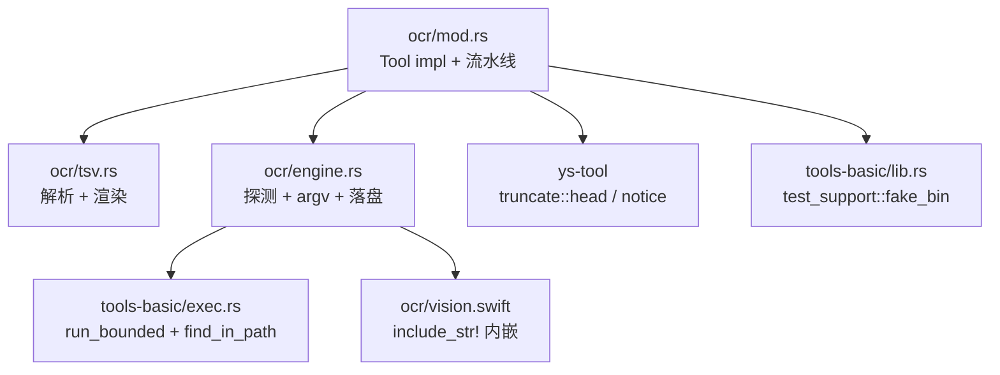

# OCR 工具 — 架构设计

> 版本：v2（2026-11-04）。相对 v1 的改动见文末「修订记录」；质量分析见 [review.md](./review.md)。

## 概述

新增 `ocr` 工具：把图片里的文字**连同位置信息**取成文本交给模型。这是当前仓库唯一的图片输入通道
（`ContentBlock` 只有 `Text`/`ToolUse`/`ToolResult`，`ChatMessage.content` 是 `Option<String>`，
均无多模态字段）。

范围限定为**中英文**。PDF 不做，留给 `pdf-analysis` skill。

## 设计方案

### 模块划分



| 模块 | 职责 | 核心抽象 |
|---|---|---|
| `ocr/mod.rs` | spec、参数校验、流水线编排、notice 拼装、可观测性字段。**不含后端细节** | `OcrTool` |
| `ocr/tsv.rs` | TSV → `Vec<OcrLine>` → 渲染。**纯函数、零 IO、零 tokio** | `parse_tsv`、`render`、`OcrLine` |
| `ocr/engine.rs` | 后端探测（注入式）、argv 构造、候选链、落盘 | `OcrEngine`、`Kind`、`spill` |
| `ocr/vision.swift` | Vision 调用 → 归一化坐标 → 输出 TSV | — |

`ys-tool` / `ys-core` **一行不改**。不新增任何 Rust 依赖——引擎一律 spawn 外部进程。

`exec.rs::find_in_path`（`:113`，现为私有）**提为 `pub(crate)`**，由 `engine.rs` 直接用。
理由与 `SearchBackends` 当初被提取时相同（`exec.rs:52-60`）：路径探测只能有一个实现，
复制一份就是第二个可能漂移的真值——而「不 fork、不跑 `--version`」这条约束（ADR-0015）
必须对 OCR 同样成立。

### 关键数据流

```text
模型: ocr(path="shot.png")            # 可带 lang / word_boxes
  │
  ├─① 校验（mod.rs）
  │    扩展名白名单 png/jpg/jpeg/webp/gif/bmp/tiff → 否则 InvalidInput（早失败）
  │    lang 字符集 [A-Za-z0-9_+-]{1,64}           → 否则 InvalidInput
  │    lang 在校验后的**有效值集**内              → 见 §2.3（非 Vision 忽略）
  │    metadata：不存在 / 非文件 / >20 MB         → 否则 InvalidInput
  │    像素上限：header 读出的 w*h > 40 MP        → 否则 InvalidInput（防解压炸弹）
  │
  ├─② detect_from(PATH)（启动期一次，纯路径扫描，不 fork）
  │    候选链按平台得出（mac = [Vision, Tesseract]，其余 = [Tesseract]）
  │    链为空 ⇒ ToolError::Execution（含两平台安装命令）
  │
  ├─③ 逐候选 spawn（链长 ≤ 2，成功即停；无 OSD）
  │    Tesseract: run_bounded(tesseract [img, -l, lang, --psm, 6, tsv])
  │    Vision:    run_bounded(<compiled|swift> [img])
  │
  ├─④ 解析 + 渲染（tsv.rs，纯函数）
  │    滤纯空白 + width < 6 → 行级渲染 → 头行
  │
  └─⑤ 用量控制
       渲染后 < 8 KiB 且非 word_boxes ⇒ 内联返回（保头 2000 行 / 50 KiB，超出落盘）
       否则 ⇒ 落盘 + 给路径
```

## §1 接口

输入 schema **只有 3 个字段**——每多一个都在工具表里常驻付费：

```json
{
  "path": "string (必填)",
  "lang": "string (默认 chi_sim+eng；Vision 后端下被忽略)",
  "word_boxes": "boolean (默认 false，强制落盘；Vision 后端退化为行框)"
}
```

`--psm`、`--oem`、`dpi` **不暴露**。参数是「意图」，不是「引擎旋钮」——加第三后端时接口不变。

### 输出格式（**唯一真值**）

本节是输出格式的唯一定义。**其余处的示例若与本节冲突，以本节为准。**

**头行**（三种粒度恒有，`#` 开头避免与坐标行混淆）：

```text
# <basename> <W>x<H> via=<tesseract|vision> lang=<生效值> lines=<N> filtered=<M>[ degraded=<原因>]
```

- `via=` 是**实际成功**的后端；`lang=` 是**实际生效**的语种参数。
- Vision 后端下 `lang=n/a`（该后端不消费 `lang`，见 §2.3）。
- `lines=` 保留行数，`filtered=` 被 `width<6` / 纯空白滤掉的行数（§3.3 的空结果判定靠它）。
- `degraded=` 只在发生降级时出现，原因三选一：`vision-failed` / `lang-missing` / `word-boxes-unsupported`。

**行级**（默认，`word_boxes=false`）：

```text
<line_no> (<x>,<y>,<w>,<h>) conf_min:<conf> <text>
```

- `line_no` 是**本结果序号**（从 1 递增），不是 tesseract 的 `line_num`。
- 坐标为**原图像素**，左上原点；`w,h` 恒保留（「按钮在 812,40」不知道尺寸就说不出「右上角」）。
- `conf_min` 是该行 `level 5` 词的**最小**置信度，整数 0–100。**恒出现**，不过滤、不省略。

**词级**（`word_boxes=true`）：

```text
<line_no>.<word_no> (<x>,<y>,<w>,<h>) conf:<conf> <text>
```

**内联与落盘的格式完全相同**——落盘只是换了投递方式，不换格式。这条是承重的：
模型从内联形态学到的形状必须能直接用到 `read` 回来落盘文件上。

逐字节样例（测试基线，改动即红）：

```text
# shot.png 1200x900 via=tesseract lang=chi_sim+eng lines=2 filtered=0
1 (62,49,890,28) conf_min:96 第三章 配置文件说明
2 (61,116,906,26) conf_min:91 应用程序启动时会依次读取以下三个位置的配置文件，
```

```text
# shot.png 1200x900 via=vision lang=n/a lines=1 filtered=0 degraded=word-boxes-unsupported
1.1 (62,49,890,28) conf:0 第三章
```

（Vision 无词级输出 ⇒ `word_boxes=true` 退化为**行框按空格切词**，`conf:0` 表示"该后端不提供
置信度"。`degraded=` 让退化可见，模型据此知道不能按置信度过滤。）

## §2 后端

### 2.1 `enum Kind` + 三条穷尽 `match`，不建 trait

`tools-web/src/backends.rs:3-10` 的判据是「差异全是数据不是算法」。OCR 的两个解析器签名同形
（`fn parse_tsv(&str) -> Result<Parsed, ParseError>`：零状态、零生命周期、唯一调用点）。

`dyn OcrBackend` 只会把两行变成「两个 impl 各一行方法 + 一个只在唯一调用点被 `dyn` 化的字段」，
换来的是**丢掉 `match` 的穷尽性**——`Vec<Box<dyn>>` 漏填会静默少一个后端，`match` 漏臂是编译错误。

判据补精确一条（写进模块头注释）：

> 差异若落在「有界输入 → 有界输出的纯函数」里，即使代码形状不同，仍按数据差异处理
> （表 + 穷尽 `match`）；只有当差异跨出纯函数（持状态 / 需签名 / 需 crate 外实现 /
> 需在单次调用内多态派发）时，才升级为 trait。

**加第三后端的改动面**（与 ADR-0068 决策一一致）：1 个枚举变体 + 3 个 `match` 臂 +
1 行顺序表。**零个新解析函数**——线上格式统一为 TSV（§4），新后端自己的脚本负责吐同列序 TSV。

### 2.2 候选链：mac 有降级，其余单臂

```rust
const ORDER_MACOS: &[Kind] = &[Kind::Vision, Kind::Tesseract];
const ORDER_OTHER: &[Kind] = &[Kind::Tesseract];
```

macOS 上 `swift` 存在 ≠ Vision 能用：TCC 权限、沙箱、`VNRecognizeTextRequest` 在部分系统版本上
对部分格式直接失败——**探不到**（探测是纯路径扫描，不 fork）。故需一条长度 ≤ 2 的链。

链的语义：按顺序试，**成功即停**；全部失败才报错，错误正文**拼接每个候选的失败原因**
（否则 Vision 挂了 + tesseract 没装时，模型只看到后者，永远查不出前者）。

### 2.3 `lang` 的作用域（**Vision 下忽略**）

| 后端 | `lang` | 头行 | 缓存键含 lang |
|---|---|---|---|
| Tesseract | 生效，拼进 `-l` | `lang=<值>` | 是 |
| Vision | **忽略**（Vision 自动识别，无语言旋钮） | `lang=n/a` | **否** |

三处必须一致，否则模型会误判参数生效：① schema 描述写明「Vision 下被忽略」；
② 头行打 `n/a` 而不是回显入参；③ 缓存键在 Vision 下不含 lang（否则同一张图按 lang 落多份
内容完全相同的文件）。

**ADR-0068「负面」里「纯英文图慢 1.9×，可由模型传 `lang="eng"` 规避」只在 Linux 成立**——
mac 走 Vision，本来就快，无需规避。该句已在该 ADR 中修订。

### 2.4 默认 `chi_sim+eng`，不做 OSD

逐图 CER 实测（中英文范围，7 张图）：

| 图 | `-l eng` | `-l chi_sim` | `-l chi_sim+eng` |
|---|---:|---:|---:|
| 9 行中文正文 | **86.5%**（乱码） | 0.0% | **0.0%** |
| 4 行中英混排 | **41.0%** | 0.9% | **0.0%** |
| 单行中文 | **58.3%** | 0.0% | **0.0%** |
| 英文 prose / 短块 / 单行代码 / 代码块 | 0.0% | 3.4–6.3% | **0.0%** |

**`chi_sim+eng` 7/7 不劣于 `eng`，对拉丁文本无损。** 三个候选方案「默认 `eng`」的前提实测不成立
——「`chi_sim+eng` 伤代码」是**纯 `chi_sim`** 的行为。

唯一例外：密集代码截图（`^^^^` + `|` 边框）`eng` 44.8% vs `chi_sim+eng` 46.6%，逐行 `diff`
只差 `E0308`→`E9308` 一个字符，两边绝对值都在 45% 量级（瓶颈是非文本字符）。不足以牺牲中文能力。

**删 OSD 的三个理由**：

1. **失败率 3/8**（小图/单行即失败），失败只能回退到 `chi_sim+eng` = 新默认值，毫无增量。
2. **开销 +43%~87%**；中文页判 `Han` ⇒ 选 `chi_sim`（比 `+eng` **更差**）⇒ 800 ms 完全白花。
3. **混排页原理上无解**：OSD 只报一个主导 script，必然丢一半；而 `chi_sim+eng` 在混排上 0.0%。

删掉后省一次 spawn、一条 `osd.traineddata` 安装依赖、一条失败回退分支——**这是零代价**。

### 2.5 `--psm` 固定 6，不进参数面

`psm 7`（整图当一行）在多行图上**静默吐空**：9 行中文页 CER 100%、7 行代码块 96.4%、
3 行短块 100%——而在单行图上与 `psm 6` 逐字相同（换不来收益）。这是读图工具最坏的失败模式：
模型判定「图里没字」而非「参数错了」。

`psm 3` vs `6` 差异在噪声级（< 2 个百分点且方向不稳定）。固定 6 的理由是「对单行图安全、
对多行图不崩」，不是「更准」。

## §3 运行期语义

### 3.1 超时：内层 deadline 必须严格早于外层预算

这是本设计最容易埋雷处，仓里已有教训（`bash.rs:21` `DEADLINE_MARGIN`）。

- **`OcrTool` 不实现 `Tool::timeout()`**，与 `grep` / `find` / `ls` 同口径：外层回落到
  `RunLimits::bash_timeout`（默认 300s，`ys-loop/src/basic.rs:113`），内层用
  `search::DEADLINE`（60s，`bash.rs` 同源常量在 `tools-basic/src/lib.rs:192` 起）。
  60s ≪ 300s，余量天然成立。
- **若将来实现 `timeout()`，必须从 `ctx.tool_budget` 推导内层**（照 `bash.rs:effective_deadline`
  的形态，外层 − 5s），绝不能直接返回与 `DEADLINE` 相等的值。

为什么这条是硬的：外层预算到点时 `ys-loop` 的 `tokio::time::timeout` 是把工具 future
**drop** 掉，届时只有 `kill_on_drop` 生效——它**只杀直接子进程**，进程组不清理。
杀组逻辑（`exec.rs:186-200`）只在内层超时路径上跑。内外层相等 ⇒ 外层先赢 ⇒ `swiftc` 编译出的
`swift-frontend` 孙进程漏网成 `ppid=1` 孤儿。

`swiftc` 首次编译 +2–4s 与 OCR 争的是同一份 60s，正常规模下无风险；但**若编译与 OCR 串行后
总耗时逼近 60s，错误文案必须区分「编译超时」与「OCR 超时」**，否则模型无从判断该重试还是换个后端。

### 3.2 空结果三分（**不可合并**）

三种「没有输出」的成因必须给不同文案，`lines=` / `filtered=` 头行字段是判据：

| 成因 | 判据 | 返回 |
|---|---|---|
| 图里真的没字 | `lines==0 && filtered==0` | `NoTextDetected`（`is_error=false`，**不是**空结果） |
| 全被滤掉（细笔画 / 竖排单字） | `lines==0 && filtered>0` | `NoTextDetected` + notice「N 行因宽度<6 被滤，可用 `word_boxes=true` 复取」 |
| 语言包缺失（`rc=0` 静默降级） | stderr 含 `Failed loading language` | **成功结果** + `degraded=lang-missing` + 一行安装提示 |

第二种最危险：`real3` 实测就从 62 B 降到 36 B，说明窄碎片成片存在。若把「全滤」报成「图里没字」，
模型会判定「图里没字」而非「过滤太狠」——这正是 `psm 7` 被证伪时同款的失败模式。

**空结果不能是空字符串**：它会被误读成「文件为空 / 读取失败」。`is_error=false` 是刻意的
——「没识别到字」是**有效观测**，不是工具故障。

### 3.3 失败的分层

| 情形 | 类型 | 是否换后端 |
|---|---|---|
| 文件不存在 / 不是文件 / >20 MB / 扩展名不在白名单 | `InvalidInput` | 否（早失败） |
| 像素 > 40 MP | `InvalidInput` | 否（解压炸弹防线） |
| 全部候选不可用（PATH 无 `tesseract` 也无 `swift`） | `Execution`（含两平台安装命令） | — |
| 候选 1 运行失败（TCC / 解码 / 崩溃） | 试候选 2；全失败则 `Execution`（**拼接每个候选的原因**） | 是 |
| 内层 deadline 到点 | `Timeout`（注明是编译还是 OCR） | 否 |
| 渲染结果为空 | 见 §3.2（不是错误） | 否 |

### 3.4 落盘

- 目录：`<temp>/yushan-ocr/`（`std::env::temp_dir()`）。**不建 `YUSHAN_OCR_DIR`**：
  配置走**构造器注入**，比 env 强（无 `env_lock`、无并行污染、无 `EnvRestore`）。
- 命名：`<stem>-<fnv1a64(image_bytes ‖ lang ‖ granularity):016x>.txt`，**内容哈希** ⇒
  同图同参幂等覆盖。Vision 下 lang 不参与哈希（§2.3）。
- 原子写：唯一 tmp 名（含 `pid` + 进程内原子序号）+ `rename` ⇒ 读者永不见半个文件。
  这也是 `is_concurrency_safe = true` 的前提。FNV-1a 手写的理由同 `store.rs:26`：
  `DefaultHasher` 跨 Rust 版本不保证稳定。
- **路径必须自述临时性**：工具回给模型的路径**附一句**「临时文件，可能已被系统清理；
  需要保留请先 `read` 或 `cp`」。macOS 的 `<temp>` 在 `/var/folders/…`，Linux 的 `/tmp`
  常被 tmpfiles 清 —— 否则 `--resume` 后 `read` 该路径得到 `not found`，模型无法区分
  「被清」与「OCR 失败」。
- **v1 不做 sweep**（理由同 v1 设计：落盘主要发生在 `word_boxes=true` 的有意动作上）。
  触发条件写明：收到目录膨胀反馈或目录内 > 1000 文件时，照 `store.rs::sweep` 加进来。

### 3.5 `swiftc` 缓存（S5 切片）

- **产物目录 = `<temp>/yushan-ocr/bin/`**，与结果同根：两者都是「下一轮就可能失效」的派生物，
  分两个根只会让清理语义分叉。代价诚实登记：系统清 temp ⇒ 下次多付 2–4s 重编。
- **失效条件**：二进制名 = `vision-<fnv1a64(vision.swift 源码):016x>`（编译期由
  `include_str!` 得出）⇒ 源码一改，旧名自然不再命中，无需版本号字段，也无需清理旧文件。
- 实现约 50 行：`include_str!` → 哈希命名 → 存在即用 → 缺则 `swiftc -O -o <path> <src>` 到
  唯一 tmp 名后 `rename`（并发两个进程同时首编不互相截断）。
- **首次编译失败不换后端**：它是基础设施故障（缺 Xcode CLT），换 tesseract 会掩盖真实原因。
  报 `Execution`，文案含 `xcode-select --install`。
- 无 CI 覆盖：所有可测逻辑（路径推导、哈希命名、「缺则重铺」判定）做成**纯函数**，
  真编译只留 `#[ignore]` e2e。

## §4 输出格式与渲染

### 4.1 TSV 统一（Vision 也吐同列序）

Vision 原生是行级（`VNRecognizedTextObservation`），tesseract 是词级——粒度不同。让 Swift 造
同列序 TSV（+约 10 行），Rust 侧只留**一个**解析器。否则是两个可能漂移的真值。
TSV 是瞬态不进上下文，字节代价为零。代价：Swift 输出里的 `\t` / `\n` 需 sanitize（1 行兜底）。

### 4.2 过滤只丢碎片，**绝不按 conf 过滤**

只丢**纯空白 + `width < 6` px** 的行（行号竖线 `1`、引号）。实测省 5–20%。被滤行数进头行
`filtered=`（§3.2 的判据）。

**绝不按 `conf` 过滤**——实测 `conf: 0` 的行是真文本。

### 4.3 用量控制只做**头截断**，绝不落盘成半个文件

v1 的「内联 vs 落盘」二选一有个洞：8 KiB 是**软**阈值，而 `SOFT_RESULT_BYTES` 之上还有硬闸门
`truncate::MAX_BYTES`（50 KiB）/ `MAX_LINES`（2000）。一张整页密集长文若渲染后落在
8 KiB–50 KiB 之间，v1 说「落盘」，但落盘是**可选路径**；落在 >50 KiB 时若走内联，结果会被
硬闸门截断——而它同时是**唯一的一份**（不落盘 ⇒ 模型既有半个文件，又无路径可续读）。

故：

```
渲染后 < 8 KiB 且非 word_boxes  ⇒ 内联
否则                            ⇒ 落盘，回「头 2000 行 / ≤ 50 KiB」+ 续读提示
```

- 落盘**必是全量**（先写文件再截断回显；顺序写反就成半个文件）。
- 内联截断走 `ys_tool::truncate::head` + `head_lines`（纯函数，零 IO），文案由 `mod.rs` 拼
  （照 `truncate.rs` 的分工：算截断在 `ys-tool`，拼文案在工具里）。
- `word_boxes=true` **恒落盘**，即使很小——词级输出是给「精确回填坐标」用的，内联 6 行会让
  模型误以为词表只有 6 行。

**8 KiB 软阈值几乎永不触发**：单图行级实测最大 **1253 B**（`cn_page`，12 行中文正文）。
落盘只为 `word_boxes` 与整页密集长文存在。`SOFT_RESULT_BYTES` 不用调。

## §5 装配面（**加工具的完整清单**）

漏一项就是一次红的 CI 或一次静默的契约漂移。

| # | 位置 | 改动 | 断言后果 |
|---|---|---|---|
| 1 | `apps/coding-agent/src/toolset.rs:94-106` `build_tools` | 在 `base_tools` **段内**追加 `ocr` | 子表必须是父表 JSON 的**字节前缀**（`toolset.rs:673`） |
| 2 | `toolset.rs:40-50` `EXPECTED_ORDER` | 9 元 → 10 元 | 顺序即工具清单顺序 |
| 3 | `toolset.rs:228 / :318 / :495 / :630` | 4 处 `assert_eq!(…, 9)` → `10` | 4 条用例同时变红 |
| 4 | `toolset.rs:~700` `fp_tools` 锚 | 重算 | 「工具表指纹漂移」 |
| 5 | `toolset.rs:~715` `fp_parent` 锚 | 重算 | 覆盖追加段 |
| 6 | `apps/coding-agent/src/assembly.rs:145-152` | 见下「explore 子表的决策」 | explore 表 7→8 元 |
| 7 | `apps/coding-agent/src/prompt.rs:249` `tool_snippet` | 加 `"ocr" => …` | 无 arm 则编译错误（`match` 穷尽） |
| 8 | `docs/design.md` §12 | 「9 基础 + 3 追加 = 12」→「10 + 3 = 13」；explore 条目 7→8 | 文档契约 |

### explore 子表：`ocr` **进**，但必须显式而不是副作用

`assembly.rs:152` 的 explore 表由 `child_specs.filter(!matches!("write"|"edit"))` 派生——
`ocr` 在 `base_tools` 里就**自动**进去（7→8 元）。这是**决策**，不是装配副作用：

- **进**：explore 的典型任务正是「这张截图里的错误是什么」，禁掉 OCR 会让它退化成
  「我只能告诉你有个 png」，而它已能用 `bash`（如 `sh -c '…'`）绕过一切工具级禁令。
- 准入条件：`ocr` 是**只读 + 幂等落盘 + 自带 8 轮/300s 硬预算**，不写 workspace 文件。

实现上**显式列出**允许集（而不是靠「除 write/edit 之外全进」的补集推导）：
`const EXPLORE_DENY: &[&str] = &["write", "edit"];` 的补集推导必须配一条注释
「新增工具默认进 explore，否决须加进 DENY」，否则下一个人加 `ocr2` 时会以为要额外登记。

## §6 可观测性

工具的 debug 记录沿用既有 `tool_call` 形态（`apps/coding-agent/src/debug_log.rs:1068`）：

- `command_fp`：**`is_command_tool` 加 `ocr`**（现为 `matches!("bash"|"bash_bg")`）。
  `ocr` spawn 外部进程、外部进程的输出决定结果内容 ⇒ 与 `bash` 同类。**它是唯一没有
  `command` 键的命令类工具**，故需两处小改：
  ① `is_command_tool` 加 `"ocr"`；② `command_fingerprint` 的取值键对 `ocr` 用
  `fnv1a64(path_bytes ‖ lang ‖ granularity)`（该值就是落盘名的同一哈希 ⇒ 一个数字同时索引
  「重复输入」与「落盘产物」）。
- `summarize_tool_args` 的 `match` 加 `"ocr"` 臂：`path` / `lang` / `word_boxes` 三键
  （`path` 走既有敏感键规则；`word_boxes=false` 为默认值时不写，省字节）。
- 理由：`swiftc` 命中与不命中差 10×（250–650 ms vs 2.8–6.4 s）。**没有读数，
  「−75%」永远只是实验室数字**——这与 `subagent_*` / `bash_bg` 各自补可观测性的先例同源。

## §7 安全与资源

| 面 | 措施 |
|---|---|
| 命令注入 | `lang` 字符集 `[A-Za-z0-9_+-]{1,64}`；**不走 shell**（argv 直传，`run_bounded`） |
| 解压炸弹 | 文件 >20 MB 拒绝（`metadata`）+ **header 读出的 `w*h` > 40 MP 拒绝**（只读头，不解码） |
| 内存 | 解码交给外部进程（不进 agent 地址空间）——这是「引擎独立进程」硬约束的附带收益 |
| 路径穿越 | `path` 由模型给，`run_bounded` 的 `cwd` 是 workspace，但 `path` 可为任意绝对路径。读图是**只读**操作，与 `read` 同权限边界，不额外收紧 |
| 落盘 | 只写 `<temp>/yushan-ocr/`，**不碰 workspace**（先例 `store.rs:1-10`） |
| 并发 | `is_concurrency_safe = true`：只读输入 + 内容哈希幂等落盘 + 原子写 |
| 取消 | `run_bounded` 的 `boundary` 每 100ms 探一次 ⇒ 用户中止会杀进程组 |

> `--list-langs` 要 1161 ms ⇒ **绝不能在启动期探测**。语言包缺失改为按调用 stderr 惰性发现
> （`rc=0` 时扫 `Failed loading language`），**不缓存到进程状态**：与
> `is_concurrency_safe = true` 的无状态前提一致，代价只是每次调用重复同一句 notice
> （而这正是「每次都该提醒」的语义）。

## §8 测试

| 层 | 内容 |
|---|---|
| `tsv.rs` 纯函数 | 解析（正常 / 空 / 畸形列数 / 非 UTF-8 边界）、过滤（空白 / `width<6`）、渲染（行级 / 词级 / 头行三形态）、**§1 的逐字节 golden fixture** |
| `mod.rs` 流水线 | 参数校验矩阵；空结果三分（§3.2）；`lang` 在 Vision 下不进哈希（§2.3）；8 KiB 边界两侧；`>50 KiB` 时「文件是全量、回显被截断」（§4.3） |
| 假二进制 | `test_support::fake_bin`（`tools-basic/src/lib.rs:262` 起）注入假 `tesseract` / 假 `swift`：**开发机不装任何引擎也能跑全部用例**，Linux CI 不可能有 `swift` |
| 装配 | `EXPECTED_ORDER` / 4 处 `len()` / 两个指纹锚 / explore 表 8 元且含 `ocr` |
| `#[ignore]` e2e | mac 上真 `swiftc` 编译 + 真 Vision；Linux 上真 tesseract |

**变异测试**（关键逻辑必须注入 bug 验证用例能抓到）：

1. 头行去掉 `filtered=` ⇒ §3.2 的「全滤 vs 无字」用例变红。
2. `command_fingerprint` 对 `ocr` 返回 `None` ⇒ 「命令类工具必有指纹」用例变红。
3. `Tool::timeout()` 返回 `Some(60s)` ⇒ 加一条断言 `timeout().is_none()`（承重，见 §3.1）。
4. 落盘改成「先截断再写」⇒ 「文件是全量」用例变红。
5. Vision 缓存键保留 `lang` ⇒ 「同图不同 lang 落同一文件」用例变红。
6. 过滤条件改成 `width < 6 || conf == 0` ⇒ golden fixture 变红。

## §9 Swift ↔ Rust 契约

- `vision.swift` 经 `include_str!` 内嵌（无 asset 目录、无打包步骤）。它输出**同列序 TSV**
  （§4.1），列序与 `parse_tsv` 的期望是**同一份契约**。
- 防线三道：① golden fixture（真机抓的 TSV）钉住列序；② `case` 改名 / 列序调换即红；
  ③ 编译期哈希（§3.5）保证跑的是当前源码编译出的二进制。
- 坐标归一化：Vision 返回 `[0,1]` 归一化、原点左下 ⇒ 脚本负责转原图像素、左上原点。
  **换算只在 Swift 侧发生一次**，Rust 侧不做第二次变换（否则两个可能漂移的真值）。

## 已知风险与待验证项

- [x] **语种默认值**——7 图 CER 实测钉死 `chi_sim+eng`。
- [x] **`psm` 选择**——`psm 6` 固定；`psm 7` 多行图静默吐空（CER 100%），已证伪。
- [x] **`lang` 在 Vision 下的语义**——忽略 + 头行 `n/a` + 不入哈希（§2.3）。
- [x] **内外层超时关系**——不实现 `timeout()`，沿用 60s/300s（§3.1）。
- [x] **空结果三分**——`lines=` / `filtered=` / stderr 三判据（§3.2）。
- [ ] **`swiftc` 缓存无 CI 覆盖**——靠纯函数测 + golden fixture + `#[ignore]` e2e。
- [ ] **缺语言包静默降级**（`rc=0`）——成功分支必须扫 stderr，只判退出码会漏。
- [ ] **40 MP 像素上限**是估计值，未实测解码峰值；首个真实超大图反馈时校准。
- [ ] **工具表指纹重算**——§5 的 8 项，改一处必须改齐。

## 相关文档

- [context.md](./context.md) — 全部实测数据与方法
- [review.md](./review.md) — 架构质量分析（本版的改动来源）
- [ADR-0068](../../adr/0068-ocr-tool.md) — 决策记录

## 修订记录（v1 → v2）

来源：`review.md` 的 P0/P1/P2 项。

| 改动 | 来源 | 落在 |
|---|---|---|
| 输出格式定为唯一真值节 + 逐字节 golden fixture（含 `conf_min:`） | review I1（P0） | §1 |
| 装配面扩成 8 项清单；explore 子表改为显式决策（进） | review M1（P0） | §5 |
| `Tool::timeout()` 明确「不实现」+ 余量理由 | review R1（P1） | §3.1 |
| `lang` 在 Vision 下忽略、头行 `n/a`、不入哈希 | review I2（P1） | §2.3 |
| 空结果三分（无字 / 全滤 / 缺语言包） | review R3（P1） | §3.2 |
| 修正「超长文本落盘成半个文件」的漏洞（截断只做头截断） | 本版新发现 | §4.3 |
| 落盘路径自述临时性 | review R2（P2） | §3.4 |
| 语言包惰性发现**不缓存**（无状态） | review M3（P2） | §7 |
| `swiftc` 产物目录 = `<temp>/yushan-ocr/bin`，源码哈希即失效判据 | review M4（P2） | §3.5 |
| 像素上限 40 MP（防解压炸弹） | review 可行性 1（P2） | §7 |
| 可观测性：`command_fp` 认 `ocr` + `summarize_tool_args` 加臂 | review R4（P1） | §6 |
| `find_in_path` 提为 `pub(crate)` | review M2（P3） | 模块划分 |
| 加后端改动面统一为「1 变体 + 3 臂 + 1 行表」（无新解析函数） | review I3（P3） | §2.1 |

## 修订记录（v2 → as-built 对账，2026-11-04）

来源：W3 / W4 执行期的回查（产物见 [`docs/design-final/ocr-tool.md`](../../design-final/ocr-tool.md)）。

| 改动 | 来源 | 落在 |
|---|---|---|
| 元数契约确认：子表 **10** / 父表 **13** / explore 子表 **8**（`ocr` 排在 `ls` 之后、`websearch` 之前） | W3 装配 + 4 处 `len()` + 两个指纹锚重算 | §5 #1–#8、`docs/design.md` §10/§12 |
| 真机验证通过：macOS 27.0.1 / arm64，`tesseract 5.5.4`（leptonica 1.87.0）+ `chi_sim`/`chi_sim_vert`/`eng`/`osd`；1200x400 中英混排图识别正确，TSV 12 列与 `parse_tsv` 契约一致 | W4 真机实测 | `docs/design-final/ocr-tool.md`「真机验证」 |
| `swiftc` 编译缓存（§3.5）与本版 §7 的 40 MP 像素上限均**未落地**；`degraded=` 实际只产 `lang-missing` | W4 回查 | `docs/design-final/ocr-tool.md`「与设计的偏差」 |
