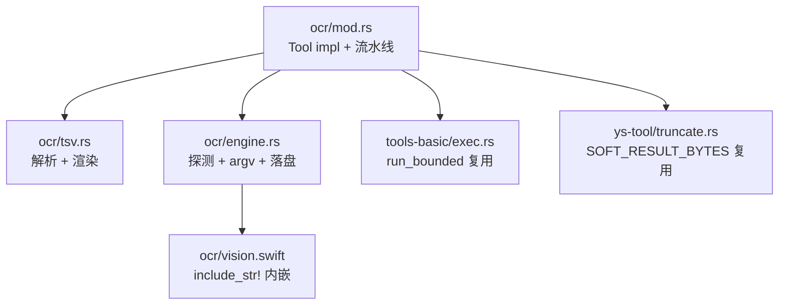

# OCR 工具 — 架构设计

## 概述

新增 `ocr` 工具：把图片里的文字**连同位置信息**取成文本交给模型。这是当前仓库唯一的图片输入通道
（`ContentBlock` 只有 `Text`/`ToolUse`/`ToolResult`，`ChatMessage.content` 是 `Option<String>`，
均无多模态字段）。

范围限定为**中英文**。PDF 不做，留给 `pdf-analysis` skill。

## 设计方案

### 模块划分



| 模块 | 职责 | 核心抽象 |
|---|---|---|
| `ocr/mod.rs` | spec、参数校验、七步流水线编排、notice 拼装。**不含后端细节** | `OcrTool` |
| `ocr/tsv.rs` | TSV → `Vec<OcrLine>` → 渲染。**纯函数、零 IO、零 tokio** | `parse_tsv`、`render`、`OcrLine` |
| `ocr/engine.rs` | 后端探测（注入式）、argv 构造、落盘 | `OcrEngine`、`spill` |
| `ocr/vision.swift` | Vision 调用 → 归一化坐标 → 输出 TSV | — |

`ys-tool` / `ys-core` **一行不改**。不新增任何 Rust 依赖——引擎一律 spawn 外部进程。

### 关键数据流

```text
模型: ocr(path="shot.png")            # 可带 lang / word_boxes
  │
  ├─① 校验（mod.rs）
  │    扩展名白名单 png/jpg/jpeg/webp/gif/bmp/tiff → 否则 InvalidInput（早失败）
  │    lang 字符集 [A-Za-z0-9_+-]{1,64}           → 否则 InvalidInput
  │    metadata：不存在 / 非文件 / >20 MB         → 否则 InvalidInput
  │
  ├─② detect_from(PATH)（启动期一次，纯路径扫描，不 fork）
  │    空 ⇒ ToolError::Execution（含两平台安装命令）
  │
  ├─③ 单次 spawn（每种后端只跑一次，无 OSD）
  │    Tesseract: run_bounded(tesseract [img, -l, lang, --psm, 6, tsv])
  │    Vision:    run_bounded(<compiled|swift> [img])
  │
  ├─④ 解析 + 渲染（tsv.rs，纯函数）
  │    滤纯空白 + width < 6 → 行级渲染 → 头行
  │
  └─⑤ 用量控制
       渲染后 < 8 KiB 且非 word_boxes ⇒ 内联返回
       否则 ⇒ 落盘 + 给路径
```

### 接口概要

输入 schema **只有 3 个字段**——每多一个都在工具表里常驻付费：

```json
{
  "path": "string (必填)",
  "lang": "string (默认 chi_sim+eng)",
  "word_boxes": "boolean (默认 false，强制落盘)"
}
```

`--psm`、`--oem`、`dpi` **不暴露**。参数是「意图」，不是「引擎旋钮」——加第三后端时接口不变。

输出（内联形态）：

```text
# shot.png 1200x900 lang=chi_sim+eng via=tesseract
1 62,49,890,28 第三章 配置文件说明
2 61,116,906,26 应用程序启动时会依次读取以下三个位置的配置文件，
```

行号是**本结果序号**（从 1 递增），不是 tesseract 的 `line_num`。头行以 `#` 开头避免与坐标行混淆。

## 候选方案对比

三个候选按不同倾向并行产出，均不写文件、只返回正文。

### 方案 A — 最小复杂度

3 文件（`mod` / `tsv` / `engine`），~550 Rust + 70 Swift。

三个简化：**① 线上格式统一为 TSV**——Vision 的 Swift 脚本也输出同列序 TSV，于是 Rust 侧
只有一个解析器，后端差异退化为「谁是 prog、argv 是什么」= 纯数据；**② 行框不推导**——
直接用 `level 4` 的行框，`conf_min` 从 `level 5` 单趟状态机聚合；**③ 不做 OSD**，改默认
`eng` + 低产出提示；落盘用 `<temp>/yushan-ocr-<pid>/`，不引入 env。

### 方案 B — 可扩展优先

6 文件（`mod` / `backend` / `tesseract` / `vision` / `render` / `spill`），~880 Rust + 130 Swift。

主张：**不建 trait**，用 `enum Kind` + 三条穷尽 `match`（加后端漏臂 = 编译错误）；但把
`OSD` 提升为**流水线里的一步**，其「跑不跑」是 `LangPolicy` 数据位而非分支语句；**加元信息头行**
（`# img 1200x900 lang=eng via=vision`）；保留 mac 的**运行期降级链**（Vision 因 TCC 权限
挂掉 → 退 tesseract）；落盘走 `<HOME>/.yushan/ocr` → temp 兜底。

### 方案 C — 性能/资源优先

4 文件 + `assets/ocr.swift`，~520 Rust + 90 Swift。

三个数字主导：**① 不做 OSD**（−108~808 ms，spawn 2→1）；**② 行级渲染**而非 TSV 直出
（9036 B → 1253 B）；**③ `swiftc -O` + 内容 hash 缓存**（mac 1.1~3.4 s → 250~650 ms）。
另主张**去掉输出里的 `w,h` 与 `conf_min:` 标签**（前缀 25 B → 12~14 B/行）。明确否决结果级缓存。

### 对比矩阵

| 维度 | A 最小复杂度 | B 可扩展 | C 性能 | **采纳** |
|---|---|---|---|---|
| Rust 生产行数 | ~550 | ~880 | ~520 | **A 的形态**（~650） |
| 文件数 | 3 | 6 | 4+asset | **4** |
| 后端抽象 | enum + match | enum + match | enum + match | **三方一致：enum + match** |
| 线上格式 | TSV 统一 | 各自 JSON/TSV | TSV 统一 | **TSV 统一**（A/C） |
| 默认语种 | `eng` | OSD 探测 | `eng` | **`chi_sim+eng`**（实测推翻三方） |
| OSD | 不做 | 做 | 不做 | **不做**（A/C，实测支持） |
| mac 降级链 | 无 | 有（≤2 元素） | 无 | **有**（B） |
| `swiftc` 缓存 | 无 | 无 | 有 | **有**（C，后置切片） |
| 元信息头行 | 无 | 有 | 无 | **有**（B） |
| 落盘目录 | `<temp>/yushan-ocr-<pid>` | `~/.yushan/ocr` | 未定 | **`<temp>/yushan-ocr`**（A 简化） |
| 输出字段裁剪 | 全量 | 全量 | 去 `w,h` | **全量**（见下） |
| 加第三后端改动面 | 1 变体 + 3 臂 | 1 变体 + 3 臂 + 1 行表 | 同 A | **1 变体 + 3 臂 + 1 行表** |

## 选择理由

**采纳 A 的形态，吸收 B 的降级链与头行、C 的 `swiftc` 缓存；三方对语种的判断全部证伪。**

### 为什么是 enum + 穷尽 match（三方一致，无需裁决）

`tools-web/src/backends.rs:3-10` 的判据是「差异全是数据不是算法」。OCR 的两个解析器签名同形：

```rust
fn parse_tsv(raw: &str) -> Result<Parsed, ParseError>;
fn parse_vision_json(raw: &str) -> Result<Parsed, ParseError>;
```

零状态、零生命周期、唯一调用点。`dyn OcrBackend` 只会把两行变成「两个 impl 各一行方法 +
一个只在唯一调用点被 `dyn` 化的字段」，换来的是**丢掉 `match` 的穷尽性**——`Vec<Box<dyn>>`
漏填会静默少一个后端，`match` 漏臂是编译错误。

判据补精确一条（写进模块头注释）：

> 差异若落在「有界输入 → 有界输出的纯函数」里，即使代码形状不同，仍按数据差异处理
> （表 + 穷尽 `match`）；只有当差异跨出纯函数（持状态 / 需签名 / 需 crate 外实现 /
> 需在单次调用内多态派发）时，才升级为 trait。

### 为什么 TSV 统一（采纳 A/C）

Vision 的原生输出是**行级**（`VNRecognizedTextObservation`），tesseract 是**词级**——粒度不同。
若各写一个 Rust 解析器，就是两个可能漂移的真值。让 Swift 造同列序 TSV 多花约 10 行，
换 Rust 侧唯一解析器。TSV 是瞬态（不进上下文），字节代价为零。

代价：Swift 输出里的 `\t`/`\n` 需 sanitize（1 行兜底）。

### 为什么不做 OSD、且默认是 `chi_sim+eng`（实测推翻三方）

三个候选里 A/C 主张不做 OSD、B 主张做，但**它们对默认语种的判断都错了**。限定中英文后逐图
测 CER（字符错误率）：

| 图 | `-l eng` | `-l chi_sim` | `-l chi_sim+eng` |
|---|---:|---:|---:|
| 9 行中文正文 | **86.5%** | 0.0% | **0.0%** |
| 4 行中英混排 | **41.0%** | 0.9% | **0.0%** |
| 单行中文 | **58.3%** | 0.0% | **0.0%** |
| 3 行英文 prose | 0.0% | 3.7% | **0.0%** |
| 3 行英文短块 | 0.0% | 6.3% | **0.0%** |
| 单行代码 | 0.0% | 5.3% | **0.0%** |
| 7 行代码块 | 0.0% | 3.4% | **0.0%** |

**`chi_sim+eng` 7/7 不劣于 `eng`，对拉丁文本无损。** A 与 C 主张默认 `eng` 的前提
（「`chi_sim+eng` 会伤代码」）**实测不成立**——那是纯 `chi_sim` 的行为。

唯一例外是密集代码截图（带 `^^^^` 波浪线与 `|` 边框）：`eng` 44.8% vs `chi_sim+eng` 46.6%，
逐行 `diff` 只差 `E0308`→`E9308` 一个字符，且两边绝对值都在 45% 量级——瓶颈是非文本字符，
不是语种。**不足以支持为它牺牲中文能力。**

不做 OSD 的三个理由：

1. **失败率 3/8**（图稍小或单行即失败），而失败只能回退到 `chi_sim+eng`——即新默认值。
   OSD 对失败的那一半毫无贡献。
2. **开销 +43%~87%**（中文页 +800 ms 占 OCR 耗时 87%），且中文页判 `Han` ⇒ 选 `chi_sim`
   （比 `+eng` 更差）⇒ 800 ms 完全白花。
3. **混排页原理上无解**：OSD 只报一个主导 script，`mixed` 无论报哪个都必然丢一半，
   而 `chi_sim+eng` 在它上面是 0.0%。

删掉 OSD 省一次 spawn、一条 `osd.traineddata` 安装依赖、一条失败回退分支。**这是零代价**。

代价：纯英文图慢 1.9×（186→357 ms、291→714 ms）。需要压这一档时由模型显式传 `lang="eng"`。

### 为什么保留完整的 `x,y,w,h`（否决 C 的裁剪）

C 主张去掉 `w,h` 与 `conf_min:` 标签，实测省 12%（1257→1101 B）/ 22%（400→313 B）。

**但在本仓库的阈值上下文里这是优化不存在的问题**：单图行级实测**最大 1253 B**，
8 KiB 软阈值几乎永不触发；省下的 150 B ≈ 40 token。而 `w,h` 是定位能力的载体
（「按钮在 812,40」不知道尺寸就说不出「右上角」）。**保留全量，也就少一个 `Fmt` 枚举和一条分支。**

### 为什么落盘用固定 temp 目录（A 的简化）

- **不用 pid 子目录**：`yushan-ocr-<pid>` 每次重启换目录，积累反而更快。
- **不用 `~/.yushan/ocr`**（B）：OCR 产物是「下一步就被 `read` 消费」的瞬时物，
  而 HOME 档是为用户想长期留存的网页（`store.rs`）才付的代价。
- **不建 `YUSHAN_OCR_DIR`**：它唯一的实用理由是测试，而本工具配置走**构造器注入**——
  比 env 强（无 `env_lock`、无并行污染、无 `EnvRestore`）。
- **v1 不做 sweep**：落盘只在 `word_boxes=true` 时发生，那是模型的有意动作。
  触发条件写明：收到目录膨胀反馈或 > 1000 文件时，照 `store.rs::sweep` 加进来。

命名 `<stem>-<fnv1a64(image‖lang‖level):016x>.txt`，**内容哈希** ⇒ 同图同参幂等覆盖；
原子写（唯一 tmp 名 + rename）⇒ 读者永不见半个文件，也是 `is_concurrency_safe = true` 的前提。

### 为什么保留 mac 运行期降级链（采纳 B）

macOS 上 `swift` 存在 ≠ Vision 能用：TCC 权限、沙箱、`VNRecognizeTextRequest` 在部分系统版本上
对部分格式直接失败——**这些探测阶段看不见**（探测是纯路径扫描，`exec.rs:59` 明确不 fork、
不跑 `--version`）。所以需要一条长度 ≤ 2 的候选链：

```rust
const ORDER_MACOS: &[Kind] = &[Kind::Vision, Kind::Tesseract];
const ORDER_OTHER: &[Kind] = &[Kind::Tesseract];
```

约 15 行，买的是 mac 上 Vision 运行期挂掉时工具不至于整体失效，且**失败必定带 notice**（不静默）。

### 为什么采纳 `swiftc` 缓存（C，后置切片）

`swift script.swift` 是**解释执行**，每次 1.1–3.4 s，远大于 OCR 本身。
`swiftc -O` 出二进制 + 内容哈希缓存后降到 250–650 ms（−75%）。首次编译 +2–4 s，几次调用即回本。
实现约 50 行：`include_str!` → 哈希命名 → 原子写 → 缺则重编。

**这是 mac 专属路径，Linux CI 跑不了真编译**——所有可测逻辑（路径推导、哈希命名、
「缺则重铺」判定）做成纯函数，真编译只留 `#[ignore]` e2e。列在切片 S5。

## 已知风险与待验证项

- [x] **语种默认值**——已用 7 图 CER 实测钉死为 `chi_sim+eng`，不再是假设。
- [x] **`psm` 选择**——`psm 6` 固定；`psm 7` 在多行图上**静默吐空**（CER 100%），已证伪不用。
- [ ] **工具表指纹**——`EXPECTED_ORDER` 9→10，两个锚（`fp_tools` / `fp_parent`）必须重算；
      新工具须插在 `base_tools` 段内（子表必须是父表 JSON 的**字节前缀**，`toolset.rs:673`）。
- [ ] **`swiftc` 缓存路径无 CI 覆盖**——靠三道护栏：纯函数测路径推导、golden fixture 钉 TSV 契约、
      `#[ignore]` e2e 在 mac 真跑。
- [ ] **Swift ↔ Rust 契约漂移**——用 golden fixture（真机抓的 TSV）反向钉住，脚本改名即红。
- [ ] **缺语言包静默降级**——`-l chi_sim+eng` 在只有 `eng` 时 **`rc=0`**、
      stderr 有 `Failed loading language`。只判退出码会漏，必须扫 stderr。
- [ ] **`--list-langs` 要 1161 ms**——绝不能在启动期探测；改为按调用 stderr 惰性发现。
- [ ] **Vision 没有词框**——`word_boxes=true` 在 mac 退化为行框 + notice。

## 相关文档

- [context.md](./context.md) — 上下文、约束与全部实测数据
- [adr-0068-ocr-tool.md](../../adr/0068-ocr-tool.md) — 决策记录
