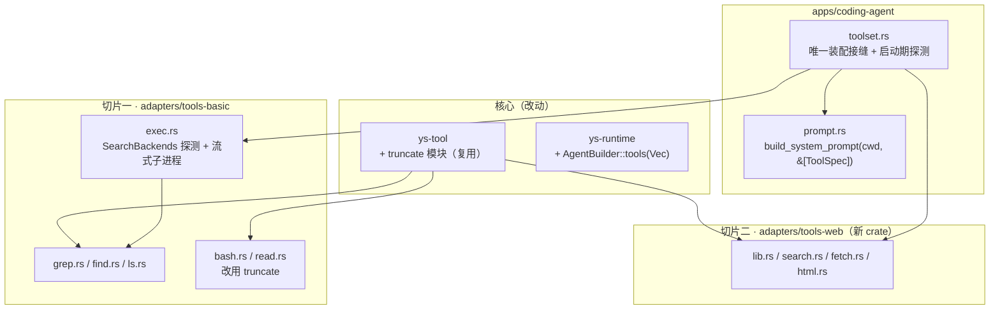

# tools-align-pi — 架构设计

> 日期：2026-09-15 ｜ 上游：`context.md`（现状/约束）｜ 决策记录：[ADR-0015](../../adr/0015-search-tools-via-external-binaries.md)
> 概述：给 coding agent 补 5 个工具（`grep`/`find`/`ls` + `websearch`/`webfetch`），分两切片。
> 底座为**外挂环境已有的 `rg`/`fd`**，缺失降级 POSIX `grep`/`find`，**绝不下载**。

---

## 0. 三个候选独立发现的既有问题（**先修，否则本设计不成立**）

三个 subagent 各自读码后**独立**报了同样的三件事。它们不是本需求引入的，但会被本需求**踩爆**：

| # | 问题 | 证据 | 为什么挡住本需求 |
|---|---|---|---|
| **B1** | `ToolRegistry::specs()` 顺序来自 `HashMap::values()` → **不确定** | `crates/ys-tool/src/registry.rs:32` | 提示词一旦「registry 驱动」，工具清单**逐进程抖动** → **prompt cache 前缀全废**（`ModelRequest.tools` 同源，也是前缀）。**必须先修**：`build()` 里按输入顺序（或按 name 排序）收集 `specs` |
| **B2** | `-p` / `--json` 下 **`boundary` 恒为 `None`**（`wiring.rs:120` 硬编码） | `Wiring::ports()` | 一次性模式**没有任何中止通道** → 搜索工具**必须**自带兜底 timeout，否则一次挂死的搜索把 CLI 挂到天荒地老 |
| **B3** | 超时只 drop future，`tokio::process::Child` **默认不杀进程** → `bash.rs` 在 300s 超时后**泄漏子进程** | `crates/ys-loop/src/basic.rs:313` + `bash.rs` 无 `kill_on_drop` | 新工具全部 spawn 子进程；不修就是**泄漏面 ×4**。顺手给 `bash` 补 `kill_on_drop(true)` |

> B1 是 **prompt 缓存**问题（性能/成本），B2 是**正确性**问题（挂死），B3 是**资源泄漏**问题。三者都在本需求的主路径上。

---

## 1. 设计方案（推荐：**融合**，骨架取方案 A，正确性补丁取方案 C）

### 1.1 模块划分



| 模块 | 职责 | 核心抽象 |
|---|---|---|
| `crates/ys-tool/src/truncate.rs`（新） | 截断**唯一**实现：`head` / `tail` / `line` + `Truncation` 元数据。纯函数、零依赖、无 IO | `fn head/tail/line` |
| `crates/ys-tool/src/registry.rs`（改） | **B1 修复**：`specs` 按输入顺序收集 | — |
| `crates/ys-runtime/src/builder.rs`（改） | `pub fn tools(Vec<Box<dyn Tool>>)`（`.tool()` 保留） | — |
| `adapters/tools-basic/src/exec.rs`（新） | ① `SearchBackends::detect()`（**纯 PATH 查找**，零 spawn）；② `run_bounded()`：spawn + 并发排空双管道 + 达上限杀进程 + abort/deadline 轮询 | `SearchBackends`（值） |
| `adapters/tools-basic/src/{grep,find,ls}.rs`（新） | 工具主体：参数 → argv → `run_bounded` → 解析 → 限流 → `truncate::head` → `ToolResult`。**`ls` 不起子进程** | 三个 `Tool` impl |
| `adapters/tools-basic/src/{bash,read}.rs`（改） | 改用 `truncate::{tail,head}`（**输出逐字节不变**，既有测试是锚点）；bash 补 `kill_on_drop` | — |
| `adapters/tools-web/`（新 crate） | `websearch` / `webfetch`。**`tools-basic` 保持无网络**（crate 边界强制） | `SearchHit` + provider 映射函数 |
| `apps/coding-agent/src/toolset.rs`（新） | 唯一装配接缝：启动期探测一次、降级提示 stderr、`build_tools()` | — |
| `apps/coding-agent/src/prompt.rs`（改） | 签名改 `(cwd, &[ToolSpec])`，清单从 spec 派生 | — |

> **偏离 context.md 一处**：截断模块落 **`ys-tool`** 而非 `adapters/tools-basic`（三方案一致）。理由：切片二的 `tools-web` 也要用它，放 `tools-basic` 会让 adapter 依赖 adapter 并把 tokio 拖进网络 crate。`ys-tool` 本就零新增依赖。

### 1.2 关键数据流

**启动期（每进程一次，三模式共用）**

```
main → toolset::build(workspace)
   ├─ SearchBackends::detect()            // PATH 扫描，零 fork、不探 --version
   ├─ 若降级 → eprintln! 一行提示          // 启动期 → stderr（TUI 未起，符合输出三分）
   ├─ tools: Vec<Box<dyn Tool>>           // read,write,edit,bash,grep,find,ls(,webfetch)(,websearch)
   ├─ specs = tools.map(spec)             // ★ 顺序 = 上面书写顺序（依赖 B1 修复）
   └─ prompt::build_system_prompt(cwd, &specs)
        → AgentBuilder::new().tools(tools).system_prompt(prompt)
```

**grep 一次调用**

```
call(input, ctx)
 ├─ 参数校验（pattern 必填）；路径 = workspace.join(path)（默认 "."）
 ├─ bins.rg ? ──有──► argv = rg --json --line-number -g '!<6 dirs>' [-i][-F][-C N] -- P root
 │            └─无──► argv = grep -r -n -I --exclude-dir=<6 dirs> [-i][-F][-C N] -- P root
 ├─ exec::run_bounded(prog, argv, cwd=workspace, byte_cap=1MiB, deadline=60s, ctx.boundary)
 │     spawn(kill_on_drop) → 并发排空 stdout/stderr（不排空必死锁）
 │     → 达 byte_cap / abort / deadline → 杀子进程 → wait() 收尸
 ├─ 退出码（**先看 stop 再看 code**，详见 §1.4）：
 │     stop != Eof（我们杀的）→ **忽略 code**，已得结果照样渲染
 │     0=有命中 / 1=无命中(is_error=false) / 2=出错
 │     ★ stop==Eof 且 code==0 却零 match 事件 → 格式漂移 → **报错**（不静默当"无命中"）
 ├─ 解析（rg: JSON Lines 取 match；grep: path:line:text）→ 归一（剥 "./"、统一分隔符）
 ├─ limit（默认 100）截断 + 长行 truncate::line(500)
 └─ truncate::head(2000 行 / 50KB) + notice → ToolResult
```

**webfetch 一次调用**

```
call({url})
 ├─ 校验 scheme ∈ {http,https} → 否则 InvalidInput
 ├─ 进程级 reqwest::Client（连接池/keep-alive，懒建一次）GET，30s timeout，redirect≤5
 ├─ 非 2xx → is_error 结果（附 code + reason 前 200 字）    ← ADR-0001：模型可见的失败
 ├─ 流式收 body，cap=5MiB（先信 Content-Length 快速失败，再流中强校验）
 ├─ Content-Type 分派：
 │     html/xhtml        → ① 跳 script/style/nav/header/footer/aside/svg/form
 │                          ② 转 Markdown，**写入字节计数的 Write 适配器**（超 50KB 即停转换）
 │     text/*, json, xml → 原样文本
 │     其它/二进制        → is_error（附 content-type + 字节数）—— ToolResult 无二进制通道
 ├─ 首行回显最终 URL（重定向可见）
 └─ truncate::head → ToolResult
```

> **为什么"先跳 boilerplate 再截断"**：导航/页脚在 HTML **开头**，先截断会把菜单原样喂给模型——那才是真正的 token 灾难。

### 1.3 接口概要

```rust
// ① 截断（ys-tool，纯函数、零依赖；通知文案由调用方拼，故 bash/read 的既有文案与测试不动）
pub enum Limit { Lines, Bytes }
pub struct Truncation { pub content: String, pub hit: Option<Limit>,
                        pub total_lines: usize, pub shown_lines: usize }
pub fn head(text: &str, max_lines: usize, max_bytes: usize) -> Truncation;  // read/grep/find/ls/webfetch
pub fn tail(text: &str, max_lines: usize, max_bytes: usize) -> Truncation;  // bash
pub fn line(text: &str, max_chars: usize) -> (Cow<'_, str>, bool);          // grep 单行 500

// ② 探测结果（值，注入；不用 OnceLock —— 否则降级路径无法确定性测试）
pub struct SearchBackends { rg: Option<PathBuf>, fd: Option<PathBuf> }
impl SearchBackends {
    pub fn detect() -> Self;                 // PATH 扫描 + 可执行位；不 spawn
    pub fn posix_only() -> Self;             // 测试 / 强制降级
    pub fn degraded_hint(&self) -> Option<String>;
}

// ③ 有界子进程原语（切片一地基）
pub enum Stop { Eof, Cap, Aborted, TimedOut }
pub struct Bounded { pub stdout: Vec<u8>, pub stderr: Vec<u8>, pub code: Option<i32>, pub stop: Stop }
pub async fn run_bounded(prog: &Path, args: &[String], cwd: &Path, byte_cap: usize,
                         deadline: Duration, boundary: Option<&dyn BoundarySource>)
    -> Result<Bounded, ToolError>;

// ④ 提示词接线（改签名；**ToolSpec 不加字段**，见 §1.5）
pub fn build_system_prompt(cwd: &Path, tools: &[ToolSpec]) -> String;

// ⑤ 搜索命中统一形状（切片二）
pub struct SearchHit { pub title: String, pub url: String, pub snippet: String }
pub fn parse_<provider>(body: &serde_json::Value) -> Vec<SearchHit>;  // 每 provider 一个纯函数 = 唯一耦合点
```

> **刻意不做 trait**：切片一的 `rg`/`grep`、`fd`/`find` 只差 **argv 构造 + 输出解析**，控制流（spawn/排空/早杀/截断）完全相同 → 用 `match bins.rg { Some => .., None => .. }` 两个分支，比 trait 更直白（本项目「不设计假想未来需求」）。切片二的 `SearchProvider` 今天只有 MockProvider 一个第二实现者，**真实第二家是未来** → 只留一个「每 provider 一个映射函数」的缝，不建 trait。

---

### 1.4 语义写死（解 review R1 / R2 / R3 / R4）

**三个上限 —— 单位不同，必须分清**

| 上限 | 值 | 单位 | 作用 | 触发时 |
|---|---|---|---|---|
| `limit` | 100 | **条命中** | 模型可读的上限（工具参数，可被覆盖） | `[100 matches limit reached. Use limit=200 for more]` |
| `byte_cap` | 1 MiB | **读入字节** | 防子进程刷爆内存/CPU（内部常量） | 见下 |
| `truncate::head` | 2000 行 / 50KB | **输出行/字节** | 进上下文的最终上限（与 read/bash 一致） | `[Truncated N lines]` |

**关系**：`limit` 先于 `byte_cap` 生效（正常情况 limit 命中即早杀）；但 `-C N` 把每条命中放大成
`2N+1` 行 → **`byte_cap` 可能先于 `limit` 触发**。两者各自的 notice **都要报出来**，不得静默。

**退出码 —— 先看 `stop`，再看 `code`**

| `stop` | `code` | 处理 |
|---|---|---|
| `Cap` / `Aborted` / `TimedOut`（**我们自己杀的**） | 任意（多为 `None`） | **忽略 code**，用已解析到的结果渲染 + notice。**不是错误** |
| `Eof` | 0 | 有命中 |
| `Eof` | 1 | **无命中**：`is_error=false`，内容 `No matches found` |
| `Eof` | 0，但**零 match 事件** | **格式漂移 → 报错**（不静默当"无命中"） |
| `Eof` | ≥2 | `is_error=true` + stderr 前 4 KiB |

> **变异测试首选**：删掉「`stop != Eof` 时忽略 code」→ 测试必须变红（否则「数够 100 条主动停」会被当成失败）。

**`ls` 扫描上限**：`read_dir` 边读边计数，**超 20000 条即停**（防超大目录无界读），再排序取 `limit`（500）。

**`--hidden`：不加**。加它会把 `.git/` 对象也纳入扫描（token 灾难）；代价是搜不到 `.github/workflows/*.yml`
一类隐藏路径 —— **记为已知取舍**（需要时用 `find`）。

### 1.5 提示词来源（解 review R5）

**`ToolSpec` 不加字段。** 工具清单与一句话描述由 `prompt.rs` 的 snippet 表按 **name** 提供，
并加**漂移测试**：*「每个已注册工具都必须有 snippet，否则回退 `description` 首句并测试变红」*。

**理由**：给 `ToolSpec` 加 `prompt` 字段 = 把**产品级提示措辞**塞进**核心 crate `ys-tool`**，
与已定的「提示词是产品层知识」相悖（`tools-basic` 是通用适配器，`ys-tool` 更核心）。
**用一个测试锁住漂移，比改核心接口便宜。**

> 不直接用 `description` 渲染清单：它是面向 API 的完整长句（含 limit/截断细节），每轮重复进 prompt 是浪费。

### 1.6 测试计划（解 review R7）

映射 `docs/design.md` §12 测试矩阵（在既有行之外**新增「外部工具」一行**）。

**变异测试点（必须能抓到）**

| 注入的 bug | 期望 |
|---|---|
| 去掉「`stop != Eof` 时忽略 code」 | 主动早杀被当失败 → **变红** |
| 把退出码 1 当错误 | 「无命中」变错误结果 → **变红** |
| 去掉 stderr 排空任务 | 用往 stderr 狂写的假子进程 → **测试死锁变红** |
| 去掉 `kill_on_drop` | 进程泄漏 → **变红** |
| 降级排除目录漏 `node_modules` | 搜进依赖树 → **变红** |
| `ls` 去掉扫描上限 | 超大目录测试超时/OOM → **变红** |

**测试资产**
- 降级路径用 `SearchBackends::posix_only()` **注入**复现（不依赖开发机 PATH，符合并行安全）。
- 网页层用**本地 `TcpListener` 假服务器**，不打外网（CI 无网）。
- 临时目录名含**进程内原子序号 + `process::id()`**；进程级 env 改写走 `test_env::env_lock()`。

---

## 2. 候选方案对比

| | **方案 A · 最小复杂度** | **方案 B · 可扩展优先** | **方案 C · 性能优先** |
|---|---|---|---|
| 切片一结构 | `exec.rs` + 3 工具 | `search/{mod,toolchain,ripgrep,posix_grep,fd,posix_find}.rs` + 3 工具 | `backends.rs` + `child.rs` + 3 工具 |
| 后端抽象 | 无 trait（`if rg.is_some()`） | **2 个 trait**（Line/FileFind） | 无 trait（值 + 共享函数） |
| 探测 | `OnceLock` 静态 | 注入值 `SearchToolchain` | 注入值 `SearchBackends` |
| 子进程原语 | `run_search`：有界 `read_to_end` + 达字节上限杀 | `proc.rs`：抽 bash 有 boundary 分支 | `stream_child_lines`：**逐行流式**，达 **limit 条数**即杀 |
| 死锁防护 | 并发排空双管道 | 并发排空 | stdout 本任务消费 + stderr 排空任务 |
| 截断落点 | `ys-tool` | `ys-tool` | **新 crate `ys-text`** |
| HTML→MD | `htmd` | `htmd`（查过 index） | `html2text`（流式、无 DOM） |
| 默认搜索 | Brave | Tavily（**自认未核**） | Brave |
| 无 key 时 | **不注册** | **不注册** | 注册但调用报错 |
| 缓存 | 无 | 无 | 有界 16 条/1MiB |
| 估算代码量 | **~610 行** | ~1000+ 行 | ~800 行 |

### 对比矩阵

| 维度 | A | B | C |
|---|---|---|---|
| 实现复杂度 | **低** | 高（6 文件 + 2 trait） | 中（流式原语 + 计时器槽） |
| 概念数量 | **少** | 多 | 中 |
| 可测性（降级路径） | 差（OnceLock 不可注入） | **好**（注入 + Mock） | **好**（注入 + `posix_only()`） |
| 输出有界（正确性） | ✅ 字节 cap | ✅ | ✅ 条数 + 字节双闸 |
| 早杀 | 达**字节**上限杀 | 达 limit kill | 达 **limit 条数** kill（更早） |
| 峰值内存 | ≤cap（1MiB） | ≤cap | **单行** |
| 演进（加第三后端） | 改 `if` 分支 | impl trait，局部化 | 改 `match` 分支 |
| 依赖面 | 最小 | 最小 | +1 crate（ys-text） |
| 风险 | 降级路径难测 | **过度设计**（trait 只有 1 个真实实现者时也立了抽象） | 流式复杂度；计时器槽/排空细节易写错 |

---

## 3. 选择理由

**推荐：融合 —— 骨架取 A，正确性补丁取 C。**

- **取 A 的骨架**（`exec.rs` + 3 工具、无后端 trait、`ys-tool` 放 truncate）：概念最少，与 ADR-0014 刚立下的「不设计假想未来需求」一致；`rg`/`grep` 只差 argv，用 `match` 分支比 trait 直白。
- **取 C 的三处**（这些是**正确性/工程**，不是优化）：
  1. **子进程一律 `kill_on_drop(true)`** —— 修 B3，且防 `-p`/`--json` 外层超时后泄漏。
  2. **`rg --json` 格式漂移检测** —— exit 0 却零 match 事件 → **报错而非"无命中"**（静默错答案是最危险的失败形态）。
  3. **搜索工具自带兜底 timeout（60s）** —— 因 B2（一次性模式无 boundary）。
- **取 B/C 的先决项**：**B1 修复**（`specs` 保序）必须先行，否则提示词驱动 = prompt cache 全废。
- **不取 B 的后端 trait**：今天 `rg`/`grep` 是**同一控制流的两组 argv**，不是两套实现；trait 会让调用方为一个 2 分支付出动态分派与 6 个文件的阅读成本。
- **不取 C 的 `ys-text` 新 crate**：`ys-tool` 本就零新增依赖，且 truncation 是「`ToolResult.content` 怎么格式化」，属工具契约；为一个纯模块切第 9 个 crate 不划算。
- **不取 C 的响应缓存**：v1 不做（状态 + 失效语义 + 内存常驻）；留口即可。但**连接池（reqwest Client 复用）必做**（免费）。
- **不取 A 的 `OnceLock`**：本项目「关键逻辑必须变异测试」，降级路径必须能在同进程内确定性复现 → **注入式 `SearchBackends`**。

**代价（诚实）**：
- 降级路径与原生路径**行为不等价**（`.gitignore` vs 6 个硬编码目录；ERE vs Rust regex；`glob` 含 `/` 不支持）—— 同一提问在不同机器出不同质量的答案，**这是本设计最大的体验裂缝**，靠启动期一行提示 + 输出尾部 `[degraded]` 标注缓解，**不能消除**。
- 工具数 4 → 9，每轮多 5 行工具描述（≈40–80 token/轮），是**净负外部性**。
- `spec.description` 仍进 `ModelRequest.tools`（面向 API、需完整）；**prompt 里的清单另用 snippet 短表**（§1.5）。两处都要为 9 个工具写准 —— 写砸了模型变笨。
- **安全（明确范围外，但必须留痕）**：① `webfetch` **不防 SSRF** —— `http://127.0.0.1:8080/admin`、云元数据 `169.254.169.254` 全可达（本项目「不做安全」，但这是最大的悬空项）；② 抓回的网页内容进上下文，**构成提示注入面**；缓解：输出带 `[fetched from <url>]` 归因标注。

---

## 4. 未决 / 待验证

- [ ] **默认搜索 provider 未定**：A/C 推 **Brave**（单一 GET + 单 header + `web.results[].{title,url,description}`，Bing API 已于 2025-08 退役）；B 推 Tavily（**自认未核实 API 形状**）。用户选了「可配置、默认一家」但未指定 —— **实现前需定**（考虑国内可用性）。
- [ ] **HTML→Markdown crate 需 prototype 验证两件事**：① 能否**跳过 boilerplate 标签**；② 能否**写入字节计数的 `Write` 适配器**（转换期截断的前提）。候选 `html2text`（无 DOM、流式解析）vs `htmd`（turndown 语义、skip-tags）。**注意**：HTML 解析器需要**完整输入**，只有**输出**是流的 → 内存下界 = 输入的 5 MiB cap（本文早前「流式」的表述不准确，以本条为准）。
- [ ] `rg --json` 的 `context` 事件是否随 `-C N` 发出（C 用它替代 Pi 的「回读文件」方案）—— 实现第一步验证；不成立则退回回读文件（设计已隔离成纯函数）。
- [ ] 降级 grep 在 macOS **BSD grep** 无 `--include`/`--exclude-dir` 时的兜底（需手写 glob 或客户端过滤）。
- [ ] 需在真实 Linux + macOS 各验一遍降级路径（GNU vs BSD grep 差异）。
- [ ] **9 个工具的 `description` 应先出草稿并评审**（它进 `ModelRequest.tools`，写砸了模型变笨）。
- [ ] **切片一可独立 merge**：切片一（离线、零新依赖）的验收标准独立于切片二；
      **切片二在 crate 与 provider 两个待决项落定前不启动**。

## 5. 相关文档

- [context.md](./context.md) — 现状、约束、未决问题
- [ADR-0015](../../adr/0015-search-tools-via-external-binaries.md) — 为什么外挂外部二进制而非内建 `ignore` crate
- 参考实现（只读）：`tmp/pi/packages/coding-agent/src/core/tools/{grep,find,ls,truncate}.ts`
