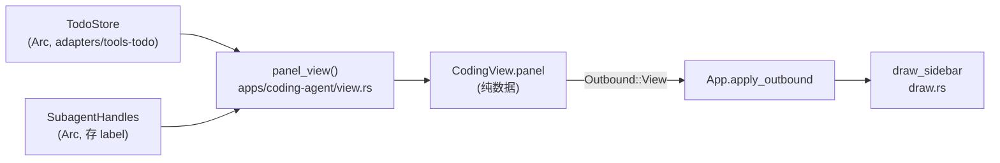

# TUI 右侧双栏（todo 清单 + subagent 运行状态）— 架构设计

> 需求与已澄清决策见同目录 [`context.md`](context.md)（Q1/Q2/Q2b/Q3/Q3b/Q4/Q4b/Q6/Q6b/Q8 已定）。
> 本文回答**怎么实现**，并记录三个候选架构的对比与取舍。
> 术语按 `docs/CONTEXT.md`：**轮**（round，一次模型调用）⊂ **回合**（turn，一次 `run_turn_chain`）。
> 决策记录见 [`docs/adr/0075`](../../adr/0075-tui-right-panel.md)。

---

## 0. 一句话

右侧加一条**固定宽度、默认隐藏**的窄栏，栏内纵向切成**固定 50/50** 的两个横栏（todo / subagent）；
数据经 `CodingView` 的**新字段（纯数据，非 trait object）**由 app 侧投影；几何收敛成**一个纯算术函数**，
让今天三处各抄一遍的切分只剩一处；`truncate_to_width` 是唯一的截断路径。

**没有**新 crate、**没有** `ys-protocol` 改动、**没有** hook/注册表/生命周期。

---

## 1. 候选方案对比

三个候选按不同设计哲学独立产出，均要求只返回正文、不写文件。它们在四个地方给出了不同答案，
其中**两个是真正的分岔**（§1.2），另两个是取舍。

### 1.1 三个候选的形状

| | **A：最小复杂度** | **B：可扩展优先** | **C：性能/资源优先** |
|---|---|---|---|
| 线上数据 | `PanelView { todos: Vec<TodoLine>, subagents: Vec<(String,String)> }` 直接进 `CodingView` | `SidebarView { sections: Vec<SectionView> }` + 生产侧 `trait SidebarSectionSource` | `Arc<PanelModel>`（`Vec<TodoRow>` + `Vec<RunningRow>`） |
| 侧栏渲染 | 新增 `draw_side` / `draw_todo_pane` / `draw_subagent_pane`（~110 行，留 `draw.rs` 内） | 新文件 `sidebar.rs`，`draw_sidebar` 按 `sections.len()` 均分 | `PanelCache` + `Block::render_widget` + `Buffer::set_line` |
| 几何 | `FrameAreas { chat, input, status, side }`，**删** `chat_area` | `split_columns` + `main_panes`，保留 `chat_area` | `Shell { chat, input, status, sidebar }`，`shell()` 纯算术 |
| 侧栏覆盖范围 | **整屏通到底**（Input 也变窄） | **只切 Chat 带**（Input/Status 全宽） | **只切 Chat 带** |
| 回合中刷新 | **不做**，明记风险 | 复用同一 `CodingView` 只改 `sidebar` 字段，300ms 节流 | 事件转发处顺带 `panel.refresh()`，`Arc::ptr_eq` 脏键 |
| `description` 传递 | `spawn` 加 `_label: &str` | 同 + `Arc<str>` 存表 | 同 + `Arc<str>` |
| 开关 | `/sidebar [on|off]`，`App.panel_visible` | 同，`App.sidebar_visible` | `/panel [on|off]`，`App.show_panel` |
| 代码量（生产/测试） | ~300 / ~200 | ~440 / ~300 | ~455 / ~370 |
| 自陈的最大弱点 | 回合中侧栏冻住 | 生产侧 trait 是「今天只有一个消费者的间接层」 | `Arc`/缓存的并发面 + 截断串的入口封顶 |

### 1.2 真正的分岔

**分岔一：侧栏只切 Chat 带，还是整屏通到底？**（对应 context.md 未答的 **Q1b**）

这是唯一有**正确性**后果的分岔，不是排版偏好。因为 `input_height`（`draw.rs:202-206`）与
`input_inner_width`（`draw.rs:209-211`）都以**整屏宽**为入参（`draw.rs:172`、`:178` 传的都是 `area.width`）：

- **整屏通到底** ⇒ 开关改变输入框可用宽度 ⇒ 可能改变输入框折行行数（1..=5，`INPUT_MAX_LINES`）
  ⇒ 改变 `input_height` ⇒ 改变 Chat 高度 ⇒ 改变栏高。**闭合的反馈环**：栏宽影响输入框高度。
- **只切 Chat 带** ⇒ `app.input.wrap_width`、`input_height`、`status_text` 的入参**逐字节不变**，
  既有输入/状态行用例零改动，环不存在。

⇒ **采纳「只切 Chat 带」（B/C 的做法），否决 A 的整屏通到底。** 这不是审美判断：
A 的方案要额外保证「输入框高度不随开关变化」，而那条保证在几何上本来就不成立。

**分岔二：回合中要不要刷新？**

已核实（`rg -n "Outbound::View" apps/coding-agent/src/app_loop.rs`）：**`run_turn_chain`
（`app_loop.rs:1841-2800`）区间内零 `Outbound::View`**，回合中只发 `Outbound::Event`
（`:2203`、`:2288`）。而 todo 变更（`todo` 工具在回合内被调用）与 subagent 起落**都发生在回合中**。

⇒ 只靠现有快照节奏，用户在回合进行中打开侧栏会看到**回合开始前**的内容。这与场景
**S2**（回合内派发 2 个子 agent 要看得见）与 **S3**（回合已结束、子 agent 仍在跑）**直接冲突**。

A 选择接受这个限制并记为风险；B 与 C 都选择修。**采纳修**，理由：S2/S3 是用户明确点名的场景
（`context.md:328-329`），一个看不到「正在跑」的「运行状态栏」不成立。

**采纳 B 的形态**（复用当前视图、只换 `sidebar` 字段再发、`PartialEq` 变更检测 + 节流），
**不采纳 C 的 `Arc<PanelModel>`**（见 §1.3 过度设计一条）。

### 1.3 过度设计的识别

三个候选都主动评估了别人的方案，结论一致且值得写下来：

- **`Arc<PanelModel>`（C 的核心）**：C 的成本模型是真实的 —— 一次 `Outbound::View` 确实克隆
  ~150 次分配，而 `Arc` 把它压到 1 次原子自增。但本需求**每回合只推十几次**，省下的是
  「每回合几 µs」。代价是引入跨线程共享模型、一套失效协议、以及「UI 什么时候重读」这个新问题。
  ⇒ v1 记为**过度设计**，不进。
  但它的一条**采纳**：`PanelModel` 的**上界**思想（条目数封顶）必须留，见 §4。
- **`SidebarSectionSource` trait（B 的核心）**：B 自己承认它是「今天只有一个消费者的间接层」。
  需求已把 section 数钉死为 2；为一个 2 元素栈写 trait + `dyn` 分发 + 装配表，是把 v2 的成本提前付。
  ⇒ v1 记为**过度设计**，但**采纳它的几何**（`sections.len()` 均分 ⇒ 加第三栏只需改数据，不改几何）。
- **`PanelCache` + `Buffer::set_line`（C 的渲染路径）**：此优化在「稳态每帧」上成立，但它优化的前提
  是「每帧都重建」。而本方案每帧最多画 20 行文本，`Paragraph` 的逐行 `Clone` 约 20 次分配 —— 与本帧
  已有的 ~1 ms（`selection.rs:2018-2020` 的实测锚点：`compute_max_scroll` + `chat_viewport` 合计
  ≈1 ms/拍）相比是噪声。⇒ 不引入缓存层，**采纳**「侧栏行在**入口处**就截好、渲染只拼接」这一条
  （它才是省掉每帧 `truncate_to_width` 的关键，且零架构成本）。

### 1.4 对比矩阵

| 维度 | A 最小复杂度 | B 可扩展优先 | C 性能/资源 | **推荐（融合）** |
|---|---|---|---|---|
| 新增文件 | 0 | 4 | 0 | **0**（v1 放 `draw.rs`） |
| 生产代码量 | ~300 | ~440 | ~455 | **~330** |
| 测试代码量 | ~200 | ~300 | ~370 | **~240** |
| 几何正确性 | 差（Input 反馈环） | 好 | 好 | **好** |
| 回合中可见（S2/S3） | ✗ | ✓ | ✓ | **✓** |
| 每帧增量成本 | 噪声 | 噪声 | +0.1~0.25 ms | **噪声**（~20 行 `Paragraph`） |
| 每回合快照增量 | 每次克隆 ≤32 条 | 同（`PartialEq` 变化才推） | 1 次原子自增 | **变化才推** |
| 加第三个 section 成本 | 5 处 + 重做几何 | 2 处 | 改数据 + 重做缓存 | **3 处**（数据 + 一行装配 + 测试） |
| 概念数量 | 4 | 9 | 11 | **6** |
| 主要风险 | 侧栏在回合中冻住 | 间接层为空壳 | 并发面 + 缓存失效 | 出站节奏多一个例外 |

**推荐 = A 的改动面纪律 + C 的有界性与几何收敛 + B 的回合中推送。**

---

## 2. 模块划分与职责

| 位置 | 职责 | 改动 |
|---|---|---|
| `crates/ys-tui-coding/src/draw.rs` | **几何唯一来源** `frame_areas()`；侧栏两栏绘制；`MIN_WIDTH` 旁新增宽度常量 | +~180 |
| `crates/ys-tui-coding/src/view.rs` | `PanelView` / `TodoLine` / `RunningLine`（自建投影类型，owned `String`）+ `CodingView.panel` | +~45 |
| `crates/ys-tui-coding/src/app.rs` | `panel_visible: bool`；`set_theme` / `reset_for_replay` 补失效 | +~15 |
| `crates/ys-tui-coding/src/commands.rs` | `COMMANDS` 加一条、`LocalAction::Panel(Option<bool>)`、`apply_local` 一臂 | +~30 |
| `apps/coding-agent/src/view.rs` | `build_view_with_loop` 加 `panel` 形参；新增 `panel_view()` 投影 | +~70 |
| `apps/coding-agent/src/app_loop.rs` | 六处调用点补 `panel`、同步写 `last_view`；回合中事件臂加变更检测推送；`TurnCtx` + `run_turn_chain` 加四形参（§5.1） | +~85 |
| `apps/coding-agent/src/subagent.rs` | `SubagentHandles` 存 `(Weak, Arc<str>)` + `live_labels()`；`spawn` 透传 label | +~60 |
| `crates/ys-tool/src/subagent.rs` | `spawn` 加一个 `&str` 形参（默认实现不动） | +2 |

**零改动**（列出是为了守住边界）：`ys-protocol`（全部）、`layout.rs`（`width` 失效判据已覆盖）、
`app.rs:743` 的增量补偿（`!width_changed` 恰好抑制）、`chat_viewport` / `chat_inner_rect` 的
8 个消费者（`app.rs:718`、`selection.rs:914`、`events.rs:373/430/828` 等）、`chat_block()` 的逐项扣减。



**关键边界**：`ys-tui-coding` **不依赖** `ys-tools-todo` / `ys-runtime` / `ys-model`。
侧栏数据一律在 app 侧拍平成 owned `String`（`LoopView.next_label` 就是既有范例：`"14 分后"` 已是成品串）。

---

## 3. 几何方案（本设计最硬的部分）

### 3.1 一个来源取代三处复算

今天有三份「同一条纵向 `Layout::vertical`」：

| 位置 | 形态 |
|---|---|
| `draw.rs:169-174` | `Layout::vertical([Min(3), Length(input_h), Length(1)])` —— 画面 |
| `draw.rs:246-253` `chat_area` | **同一数组复算一遍** —— `chat_inner`(`:274`) → `chat_viewport` / `chat_inner_rect` |
| `draw.rs:220-245` `input_geom` | **第三次复算** —— 输入框内区 + 鼠标命中 |

`docs/adr/0054` 的否决理由就是这条：「二者不同步会让滚动与画面错位」。

```rust
// crates/ys-tui-coding/src/draw.rs

/// 侧栏固定宽度（含左右边框）。
///
/// 30 列 = 内区 28 列 ≈ 14 个汉字。实测：80 列终端下 Chat 从 80 → 50，折行行数 +74%；
/// 120 列下 120 → 90，+39%。这是「静态大小」这一已定取舍的代价上界。
const SIDE_WIDTH: u16 = 30;

/// 侧栏的**最小可用宽度**。低于它就干脆不画 —— 宁可整屏归主列，也不产出无意义的碎条。
///
/// 12 列 = 内区 10 列（`Block::bordered` 左右各占 1）≈ 5 个汉字。实测 ratatui 0.30：
/// 栏宽 1–2 列时 `Block::inner` 的内区宽为 **0**，侧栏只剩一根边框、`truncate_to_width`
/// 只吐出 `…` —— 既占位置又什么都不说。
const SIDE_MIN_WIDTH: u16 = 12;

/// 栏宽：`saturating_sub` 保 Chat 优先；不足 [`SIDE_MIN_WIDTH`] 则归 0（不画栏）。
///
/// **不用** `Layout::horizontal([Min(1), Length(30)])`：实测 ratatui 0.30 会优先满足
/// `Length`，把 Chat 压到 1 列（W=20 ⇒ chat 宽 1 / 栏宽 19）。保 Chat 才是意图。
///
/// 两个下界各管一件事：`total_width - MIN_WIDTH` 保 Chat 有 10 列可用，
/// `SIDE_MIN_WIDTH` 保侧栏自己不低于可读下限。W < 22 时两条都不满足 ⇒ 不画栏。
fn side_width(total_width: u16) -> u16 {
    let w = SIDE_WIDTH.min(total_width.saturating_sub(MIN_WIDTH));
    if w < SIDE_MIN_WIDTH { 0 } else { w }
}

/// 一帧全部几何的**唯一来源**。纯算术、零分配，同一帧内可多次调用（结果恒等）。
struct FrameAreas {
    chat: Rect,
    input: Rect,
    status: Rect,
    /// `None` = 侧栏关闭（或屏宽不足）⇒ 整屏归主列，画面与今天逐字节相同。
    side: Option<Rect>,
}

fn frame_areas(app: &App, total: Rect) -> FrameAreas {
    // 纵向切分用**整屏宽**：Input / Status 的入参与今天逐字节相同 ——
    // 这是决策 2（只切 Chat 带）能成立的全部理由。若这里改传 `main.width`
    // （即先横切再竖切），输入框会随开关变窄、折行行数变、高度变 ⇒ 反馈环复现。
    let v = Layout::vertical([
        Constraint::Min(3),
        Constraint::Length(input_height(app, total.width)),
        Constraint::Length(1),
    ])
    .split(total);

    // 横向让位**只发生在 Chat 带**（`v[0]`）上：侧栏高度 = Chat 高度。
    let w = if app.panel_visible { side_width(total.width) } else { 0 };
    let (chat, side) = if w == 0 {
        (v[0], None)
    } else {
        let cw = v[0].width - w;   // `w ≤ total.width - MIN_WIDTH` ⇒ `cw ≥ MIN_WIDTH`，不会下溢
        (
            Rect { width: cw, ..v[0] },
            Some(Rect {
                x: v[0].x + cw,
                width: w,
                ..v[0]   // 高度与 y 随 Chat 带
            }),
        )
    };
    FrameAreas { chat, input: v[1], status: v[2], side }
}
```

改造点（`chat_viewport` / `chat_inner_rect` / `input_geom` 的**签名与全部调用点不动**）：

| 原处 | 改为 |
|---|---|
| `draw.rs:169-174` 的 `chunks` | `let a = frame_areas(app, area);` |
| `draw.rs:180-183` 的 `chunks[0]/[1]/[2]` | `a.chat / a.input / a.status` |
| `draw.rs:195` 补全浮层盖 `chunks[0]` | 盖 **`a.chat`** —— 否则浮层压到栏上 |
| `draw.rs:246-253` `chat_area` 体 | `frame_areas(app, area).chat` |

> ⚠️ **执行顺序不能反**：先**整屏宽上纵向切分**，再把 `v[0]` 横向让位。
> 若写成「先横切出主列、再在主列上竖切」，`input_height` 拿到的是变窄后的宽 ⇒
> 决策 2 声称消除的反馈环以更隐蔽的形式复现。这是本设计最易写反的一处。
| `draw.rs:229-236` `input_geom` 内的 `Layout` | `frame_areas(app, Rect::new(0,0,width,height)).input`（**仍传整屏 `width`**） |

**注意 `chat_area` 保留而不是删除**（A 主张删）：它是 `chat_inner` 的唯一上游，删掉就要改
`chat_inner` 的签名与 `chat_viewport` / `chat_inner_rect` 的 8 个消费者 —— 那是与需求无关的扩散。

### 3.2 两栏 50/50（实测定论，不写奇偶补偿）

context.md 要求「不能靠手算假设」，我实测了 ratatui 0.30（`probe` 跑了 60+ 组）：

| H | `Percentage(50)`×2 | `Fill(1)`×2 | `Ratio(1,2)`×2 | 结论 |
|---|---|---|---|---|
| 5 | 3 / 2 | 3 / 2 | 3 / 2 | 上多一行 |
| 7 | 4 / 3 | 4 / 3 | 4 / 3 | 上多一行 |
| 25 | 13 / 12 | 13 / 12 | 13 / 12 | 上多一行 |
| 26 | 13 / 13 | 13 / 13 | — | 整除 |

**三种写法逐格相同，且两栏和恒等于 H。** ⇒ 用 `Layout::vertical([Percentage(50), Percentage(50)])`，
**不写奇偶补偿、不写 `H/2` 各算一次**（后者才会漏行）。上栏（todo）在奇数高度时多占一行——写进测试固定下来。

### 3.3 溢出与空态

- **空态**（用户已定 Q6b）：框常驻。两栏都空时仍画两个带标题的框，内区空白。
- **溢出**：内容级裁断，**不滚动**（右列是纯静态，`draw.rs:4`「唯一可滚动」的 Chat 地位不变）。
  截断公式：`可见行数 = 栏内区高 - 1`（末行留给 `+N` 提示）。**那条 `+N` 必须保留**
  （否则用户以为清单只有 N 项）—— 仅当被截掉的项数 > 0 时才画。

### 3.4 截断必须按显示列

侧栏必然要截断（todo 内容最长 240 字符 `MAX_CONTENT_CHARS`，description 可能是整句）。
**唯一允许的路径**是 `draw.rs:1610` 的 `truncate_to_width`（CJK 算 2 列、落在字符边界）。

⚠️ **它是私有 `fn`**（`draw.rs:1610`），`display_width` 也只是 `pub(crate)`（`:1605`）——
`apps/coding-agent` **用不了**。两个选项，**选后者**：

1. 提升可见性 ⇒ 新增公开 API，需 doc 与稳定性考虑；
2. **显示列截断放在 UI 侧**（`draw_sidebar` 画每一行时调一次 `truncate_to_width`）。
   app 侧只封「条数」与「字符数」两维上界（§4），不碰显示列 —— 显示列本就只有 UI 知道。

选项 2 更干净：**「字符数」与「显示列」是两个不同的量**（CJK 一字 = 2 列），
而只有 UI 知道内区宽。每帧多做 ~20 次 `truncate_to_width`，对既有 ~1 ms/帧是噪声。

**绝不**用 `<str>::split_at`：既有前科在 `commands.rs:482-487` —— `split_at(len - 1)` 落在多字节
字符内部会 **panic**，而 TUI 的 `install_panic_hook` 有意不 `catch_unwind` ⇒ 丢全部会话现场。

---

## 4. 有界性

**这条是从 C 采纳的核心**：`TodoStore` 自身只有 `MAX_CONTENT_CHARS = 240`（`render.rs:27`），
**没有条目数上限** ⇒ 侧栏必须自己封顶，否则一个长清单能把每帧绘制摊成任意成本。

| 常量 | 值 | 位置 | 理由 |
|---|---|---|---|
| `SIDE_WIDTH` | 30 | `draw.rs` | 内区 28 ≈ 14 汉字 |
| `SIDE_MIN_WIDTH` | 12 | 同上 | 内区 10 列 ≈ 5 汉字；栏宽低于此 ⇒ 不画栏（1–2 列时 `Block::inner` 内区为 0，只剩边框） |
| `PANEL_TODO_MAX` | 24 | `view.rs` | 一屏（~40 行）可见上限的 2 倍；更长时靠 `+N` 提示（§3.3） |
| `PANEL_RUNNING_MAX` | 8 | 同上 | 与侧栏内区高匹配：40 行屏 ⇒ 每栏 ~19 行，扣标题与 `+N` 后 8 条能完整显示（不挂派发上限） |
| `MAX_TODO_CONTENT_CHARS` | 96 | `apps/coding-agent/view.rs` | ≤288 B/项（CJK 3 B） |
| `MAX_DESCRIPTION_CHARS` | 120 | 同上 | 8 只在跑 × 120 = 960 B |
| `PANEL_THROTTLE` | 300 ms | `app_loop.rs` | 合并一次批量 `apply` 的连跳 `revision`（不是「与心跳对齐」—— 本设计不新增定时器） |

前两个是**两条上界**（条数），后两个是**每条的长度**（字符数）—— 两维正交：
前者管「能进多少行」，后者管「一行能有多重」。两者都必须在 `panel_view()` 入口封顶。

**入口封顶原则**：`panel_view()` 封**条数**与**每条的字符数**；UI 侧封**显示列**（`truncate_to_width`）。
两者是正交的：字符数管「一个中文字算几个」，显示列管「屏幕上占多宽」。这样 UI 每帧的成本
只由 `SIDE_WIDTH × 栏高` 决定，与 todo 表大小无关。

---

## 5. 数据流与刷新时机

```text
todo 工具在回合内被调用 → TodoStore.apply → revision += 1
                                              │
回合中事件转发臂（app_loop.rs:2203 旁）─────────┤
  next = panel_view(&todo_store, subagent)    │
  if next != last_panel { 发 Outbound::View } │
  （300ms 节流，合并批量 apply 的连跳）         │
                                              ▼
回合收尾（app_loop.rs:1486）→ build_view_with_loop(..., panel)
                                              │
                        Outbound::View（既有有界信道）
                                              ▼
                  run.rs:423  app.apply_outbound(View)  ← 整表替换
                                              ▼
                        draw::ui(frame, app)  ← 仅当帧到期（≈1 Hz 空闲）
```

**三条性质**（这是本设计唯一新增的出站节奏，必须钉死）：

1. **只推「变了」的**：`PanelView: PartialEq` 做变更检测 ⇒ 无变化零流量，**包括侧栏关着时**
   （app 侧不知道开关，开关是 UI 本地状态）。
2. **不重建整视图**：复用上次已发的那份 `CodingView`，**只替换 `panel` 字段**再发。
   其余字段与 UI 手上那份逐字相同 ⇒ 状态行 / 所有权衡不会跳变。
   **不得**在事件臂里改调 `build_view_with_loop` —— 那会把读 `Instant` / `state_store` 的路径
   搬进事件热路径（也正是 A 认为做不到的原因：`ctx.agent` 在回合执行期被借走）。
3. **节流 300ms**：避免一次批量 `apply`（`revision` 连跳）转成连串整快照。

### 5.1 通达性：被复用的那份 `CodingView` 从哪来

「复用上次已发的视图」需要一个**活得比回合长**的载体。今天没有：

- `run_turn_chain`（`app_loop.rs:1841`）函数体内**没有任何 `CodingView` 局部量** ——
  视图在 `run()`（`:383`）里构造（`:548`/`:608`/`:646`/`:687`/`:713`/`:1486`），
  而 `run_turn_chain` 的出参只有 `TurnOutcome`。
- `TurnCtx`（`:1656-1693`）字段里**没有 `state_store`**，也没有 `todo_store`。
- `todo_store`（`:473`）活在 `run()` 里，没传进 `run_turn_chain`。

⇒ 必须显式加通路。**最小改动**（形参 + 字段，不新增类型、不新增信道）：

| 位置 | 变化 |
|---|---|
| `TurnCtx` 字段 | 加 `todo: &TodoStore`、`last_view: &mut CodingView`、`last_panel: &mut Option<PanelView>`、`last_push: &mut Instant` |
| `run_turn_chain` 形参 | 同名四项（形参已 16 个，但保持与 `ctx` 一致的转递惯例） |
| 六个调用点（`:526`/`:586`/`:664`/`:822`/`:934`/`:970`） | 传 `&factory.todo()`（`:473` 已持有）与四个 `&mut` 循环局部量 |

`last_view` 在 `run()` 里声明一次，**每次发出 `Outbound::View` 时同步写入**
（包括已有的六处 `build_view_with_loop` 调用点）—— 否则回合中复用的是陈旧基线。
这是本设计唯一需要改**顺序语义**（非纯形参穿透）的地方。

事件臂内推送（`app_loop.rs:2203` 旁，紧跟 `send(Event)` 之后）：

```rust
// app 侧只做**数据投影**，不涉渲染：主题是渲染参数，不进投影结果。
let next = crate::view::panel_view(todo, subagent);
if ctx.last_panel.as_ref() != Some(&next) && ctx.last_push.elapsed() >= PANEL_THROTTLE {
    ctx.last_view.panel = next.clone();
    *ctx.last_panel = Some(next);
    *ctx.last_push = Instant::now();
    send(ctx.out_tx, Outbound::View(ctx.last_view.clone())).await?;
}
```

四个局部量声明在 `run()` 里、按引用传下 —— 与 `last_injected_rev`（回合边界注入的既有范例）同形。

> **为何不把 `build_view_with_loop` 搬进事件臂**：它的形参含 `&Agent`，而回合执行期
> `ctx.agent` 已被 `run_turn_once` 借走（`&mut Agent`）；同时它会读 `Instant` / `state_store`，
> 把两类 IO 搬进每个事件的路径。两项都是本方案必须绕开的。

**已知副作用（诚实记录）**：`apply_outbound` 收到**任何**出站消息都会清 `command_in_flight`
（`app.rs:270-271`）。回合中多推 `View` 会让它在回合期间反复被清。该标志的读者只有 Esc 的取消分支
（`events.rs:659`），且回合中该分支走 `app.is_turning` 那一条 ⇒ **无实际影响**，但要在 ADR 里写明，
否则将来有人往 `command_in_flight` 上加语义时会撞到一个幽灵。

**`-p` / `--json` 零成本**：它们消费的是 `Envelope`（`consume_events`，`main.rs:2213`），
根本不读 `Outbound::View` ⇒ 新增字段对它们**不可见**，不必改任何一行。

**剧情已核实的反例**：`run_turn_chain`（`app_loop.rs:1841-2800`）区间内**零 `Outbound::View`**。
这就是为什么必须有上面 §5 的推送 —— 而不是像 A 那样「接受冻住」。

---

## 6. 开关

- **命令**：`/panel [on|off]`，无参 = toggle。`COMMANDS: [CommandSpec; 19]`（`commands.rs:53`）→ `; 20]`。
  补全浮层 / `/help` / 解析三者都从这张表派生（`commands.rs:42-47` 的注释），一处加、三处自动可见。
- **`LocalAction::Panel(Option<bool>)`**（`commands.rs:185`），解析臂照抄 `Thinking`
  （`commands.rs:294-303`）的三分：无参 = 翻转 / `on|off` = 显式 / 其它 = `Hint("用法：…")`。
- **`apply_local`**（`commands.rs:1068`）加一臂，与 `Thinking`（`:1094`）同形。
- **`App.panel_visible: bool`**，`App::new` 写 `false` 字面量。

**与 `/thinking`、`/theme` 的关键区别：`CodingView` 里不给启动初值字段。**

那两个都是**长期偏好**（真值归 app、要落盘），故必须有初值通道。侧栏开关是**纯 UI 本地、默认 false、
不跨重启**（Q3b）⇒ 视图里给字段只会制造「谁写谁」的歧义。`CodingView.panel` 是**数据**，
与开关**语义相反**，名字必须写死注释区分。

**`events.rs` 零改动**：`Action::Local`（`:975`）已把动作交给 `apply_local`，而「本地生效 + 单向同步落盘」
的同步段（`:995`）对侧栏**没有对应的 `Request`** ⇒ 不加分支，正面兑现「不动 `ys-protocol`」。

**打开/关闭时哪些缓存必须动**（精确清单）：

| 缓存 | 处置 | 理由 |
|---|---|---|
| `app.layout`（折行记忆） | **不动** | `sync` 已把 `width` 入失效判据（`layout.rs:186`），宽度一变全清（`:193-196`）；手写 reset 是把同一次重算做两遍 |
| `app.last_total_rows` | **不动** | 每帧由 `sync_scroll_state` 覆写；`app.rs:743` 的 `!width_changed` 已抑制增量补偿 ⇒ 视窗不跳 |
| `app.selection` | **必须 `clear()`** | 全局视觉行号空间因重折行整体作废；`events.rs:373/430` 用 `chat_inner_rect` 做行映射，残留锚点会高亮到无关文字 |
| `app.md_cache` / `layout.structural_rev` | 不动 | 由 `sync` 的宽度判据自己处理 |

`set_theme`（`app.rs:335`）**不需要**补失效（本方案侧栏不缓存已上色行）。
`reset_for_replay`（`app.rs:358`）**不需要**补（`panel` 随下一份快照整体替换，且 `TodoStore::retarget`
已清空清单）。

---

## 7. `description` → UI 的最小通路

主题 = 派发工具入参里**已有**的 `description`（spec 里是 `required`，原文「3-5 word label for the user
(shown in the tool line)」，`subagent.rs:2015`）—— 它就是为展示造的词，`transcript.rs` 的
`SUMMARY_KEYS` 也已把它当工具行摘要候选。

**它今天断在两层**：`Tool::call` 拿得到（`subagent.rs:2036` 附近），但 `SubagentRunner::spawn`
（`crates/ys-tool/src/subagent.rs:76-81`）四个形参里没有位置。

```rust
// crates/ys-tool/src/subagent.rs —— 紧跟 prompt（两者都是「这一次派发的内容」）；
// model / mode / boundary 是执行参数，排在其后。
fn spawn(
    &self,
    _prompt: &str,
    _label: &str,
    _model: Option<&str>,
    _mode: SubagentMode,
    _boundary: Option<&dyn BoundarySource>,
) -> Result<String, String> {
    Err("本实现不支持后台派发".to_string())   // 默认实现逐字不动
}
```

- 用 `&str` 而非 `Option<&str>`：schema 里 `required`，四个实现点不必各写一次 `unwrap_or`。
  缺失即 `ToolError::InvalidInput`，**不设默认值**（默认值会让 UI 出现「无标题项」这种静默）。
- **波及面（已逐处核实）**：生产实现 1 处（`subagent.rs:1171`/`:1193`）、调用点 1 处（`:2042`）、
  用例 1 处（`:4370`）。`FakeRunner`（`crates/ys-tool/src/context.rs:99`）与
  `ProbeRunner`（`crates/ys-loop/src/basic.rs`）**零改动** —— 它们靠默认实现，签名加形参不影响空 impl。

**键存在哪：不新开表，扩既有的那张。**

```rust
// apps/coding-agent/src/subagent.rs
struct HandleEntry {
    target: Weak<QueueBoundarySource>,
    label: Arc<str>,          // 子 agent 生命周期内不变 ⇒ 共享一份，避免每次快照 clone
}
pub struct SubagentHandles { inner: Mutex<HashMap<String, HandleEntry>> }

pub fn live_labels(&self) -> Vec<(String, Arc<str>)>;   // 同样先 retain 清理死项
```

理由：**「谁在跑」必须只有一个真值**。两张表会有一张先过期 —— `live_handles`（`subagent.rs:468`）
的 `retain` 只在读时清理，第二张表若不同步就出「名单空了、主题还挂着」的幽灵行。

**锁竞争为零**：写者只有 `register`（每次 spawn 一次，≤16/回合，且在 `tokio::spawn` **之前**
同步完成 —— `subagent.rs:1193`）；读者只在面板推送时读。临界区内无 `await`、无外部调用
（`send` 的「先取目标再放锁」纪律，`subagent.rs:441`，保持不变）。

**语义边界（诚实）**：`Weak` 死 ⇒ 立刻从列表消失。所以「已跑完但结果还没送达（在 `PendingResults`
里排队）」的子 agent **不会显示**。这符合「谁在跑」的字面要求；若要区分四态，那是 ADR-0054 的
`SubagentBoard` 状态机，**本需求明确不做**（context.md `:315-318`）。

---

## 8. 测试策略与变异注入点

本仓约定「关键逻辑要做变异测试」。侧栏有**四条承重断言**，每条都有对应变异：

| # | 用例 | 变异注入 ⇒ 应变红 |
|---|---|---|
| G1 | **几何同源**：开栏后 `chat_inner_rect.width + side_width == total_w` 且 `x == 0`；关栏时逐字节回到基线 | `frame_areas` 里 `input_geom` 忘了走主列 ⇒ 宽不同源 |
| G2 | **窄屏不塌**：`total_w ∈ {10, 11, 20, 21, 22, 31, 40, 80}` × 开关两态，恒有 `chat_w ≥ MIN_WIDTH`；且 `side_w == 0` **或** `side_w ≥ SIDE_MIN_WIDTH`（两态之间无「1–11 列的碎条」） | ① 把 `saturating_sub` 换成减法 ⇒ W=10 下溢；② 改用 `Layout::horizontal([Min(1), Length(30)])` ⇒ W=20 时 chat_w=1；③ 去掉 `SIDE_MIN_WIDTH` 判据 ⇒ W=11/12 出现内区宽 0 的碎条 |
| G3 | **50/50 奇数高**：H=25 ⇒ 13/12，H=7 ⇒ 4/3；两半的外框字符都在 | 改成 `H/2` 各算一次 ⇒ 和 ≠ H，红 |
| G4 | **入口封顶**：`panel_view` 对 30 项 todo、20 个 running 的输入 ⇒ 输出恰好 24 / 8 行 | 去掉封顶 ⇒ 红 |
| G5 | **UTF-8 截断**：200 字符 CJK 内容 + 120 字符 CJK description ⇒ 每条渲染行 `display_width() ≤ 内区宽`，且**不 panic** | 改用 `split_at` ⇒ panic |
| G6 | **空态不塌**：两栏都空 ⇒ 两个带标题的框仍在、内区空白 | 空态跳过 `render_widget(block)` ⇒ 红 |
| G7 | **回合中可见性**（S2/S3）：回合内 todo `apply` 一次 ⇒ 至少一条带新 `panel` 的 `View` 抵达 | 去掉 §5 的推送 ⇒ 红（这是本设计最容易被删掉的一行） |
| G8 | **零冗余推送**：回合内无状态变化 ⇒ `View` 条数与「不推」时相等 | 去掉 `next != last` ⇒ 红 |
| G9 | **label 贯通 + 生命周期**：`spawn(desc)` ⇒ `live_labels()` 含它；子 agent 收尾 ⇒ 立刻消失 | value 存 `Arc<QueueBoundarySource>`（强引用）⇒ 收尾后仍在，红 |
| G10 | **开关语义**：`/panel` → on；再 `/panel` → off；收到 `Outbound::View` 后**仍**是 off | `App::new` 从 `view` 取初值（照抄 theme）⇒ 红 |
| G11 | **输入框不受影响**：开/关前后 `input_height` 与 `wrap_width` 逐值不变 | 纵向切分挪到整屏上 ⇒ 红 |
| G12 | **补全浮层不越界**：开栏 + 弹补全 ⇒ 浮层右边界 ≤ `a.chat.right()` | 仍盖 `chunks[0]` ⇒ 红 |

**扩展用例（G1 的变体）**：既有 `chat_inner_rect_agrees_with_viewport`（`draw.rs:4569`）是多条
「两条路径必须同源」守卫之一 —— 把它扩成跑 `panel_visible ∈ {false, true} × 4 组尺寸`。

---

## 9. 代码量估算

| 区域 | 生产 | 测试 |
|---|---|---|
| `draw.rs`：`side_width` / `frame_areas` / 三处收敛 / 补全浮层 | ~90 | ~120 |
| `draw.rs`：`draw_sidebar` + 两栏 pane | ~110 | ~40 |
| `view.rs`：`PanelView` / `TodoLine` / `RunningLine` + `CodingView.panel` | ~45 | ~10 |
| `app.rs` / `commands.rs`：字段 + 命令 + `apply_local` + `selection.clear` | ~45 | ~60 |
| `apps/coding-agent/view.rs`：`panel_view()` + 形参 | ~70 | ~40 |
| `app_loop.rs`：六处调用点 + `last_view` 同步写 + 回合中推送 | ~85 | ~30 |
| `subagent.rs` + `ys-tool` trait | ~62 | ~40 |
| **合计** | **≈ 510** | **≈ 340** |

---

## 10. 已知风险与待验证项

- [ ] **`SIDE_WIDTH = 30` 是魔术数**：80 列终端下 Chat 从 80 → 50，正文折行 +74%（此时 Chat 内宽 46，
      接近可读下限）；40-60 列终端开栏会很难受。需求已定「静态大小、不做自适应、不做窄屏自动隐藏」
      ⇒ 这是**接受的代价**，不是遗漏。若实物太窄，改一个常量即可（几何是算术，无结构改动）。
- [ ] **出站节奏多一个例外**（§5）：原本「每请求刷一次」变成「回合中也可能刷」。必须靠 G7/G8 钉住，
      否则有人图省事在事件臂里改调 `build_view_with_loop` 就会把 IO/`Instant` 读搬进热路径。
- [ ] **`command_in_flight` 被反复清**（`app.rs:270`）：已核实无实际影响，但属**语义噪声**，
      写进 ADR 供将来参考。
- [ ] **切换那一瞬有一次全量重折行**：宽度变 ⇒ `layout.sync` 全清（`layout.rs:193-196`）。
      500 KB~1 MB 会话估 5~30 ms，只发生在手敲命令的那一下。不可消除（宽度变了必须重排）。
- [ ] **`TodoStatus` 是 `#[non_exhaustive]`**（`item.rs:13`）⇒ 生产侧 `match` 必须带
      `_ => RowMark::Plain` 兜底。代价：将来新增状态会**静默**显示为 Plain（不会编译报错）。
      可接受（`is_terminal()` 仍决定清空语义），但要写在注释里。
- [ ] **建议用 `prototype` 先验几何**：在 `draw.rs` 里做「两处纵向切分同源」的最小实验，
      确认滚动 / 鼠标命中 / 选区在开栏后仍然对齐。这是本需求唯一的**正确性**风险，其余都是排版取舍。
- [ ] **侧栏内容是否够用**（需实物验证）：28 列内区里，一个中文 todo 项 + 状态字形能显示几个字？
      若太挤，替代方案是只显示 `in_progress` 项（Q5 的另一个答案）。

---

## 11. 与既有决策的关系

- **ADR-0054（proposed，未落地）**：本设计是它的**严格下游子集**，且刻意不实现它。
  决策 4（不新增 `Outbound` 变体）被遵守（复用 `View`）；决策 1 的 `SubagentBoard` 不建 ——
  `live_labels()` 是把既有 `SubagentHandles` 表临时当读口。将来 0054 落地时，只需换数据源，
  `PanelView` 这个线上类型一个字都不用改。
- **ADR-0022 决策 1（窄 trait）**：`spawn` 加一个 `&str` 是**最小扩充**；扩完 `ys-tool` 里仍不出现
  `Model` / `Session` / `AgentEvent`，仍零 tokio ⇒ 「不得成环」的理由不变。
  决策 2（子事件不进父流）**不变** —— 本需求只要「谁在跑 + 主题」，正好不需要翻案。
- **ADR-0014（不建 hook 系统）/ ADR-0021（只留 `ToolPlugin` 装配缝）**：一致。本设计**没有**
  注册/注销、优先级、拦截、可变决策权；侧栏是**纯观察者**，输出只影响像素。没有 trait、没有装配表。
- **`long-horizon-todo` Q7（侧栏简单展示）与 `subagent-progress` Q2（右侧栏宜与 todo 合并）**：
  本设计就是这两条悬空决策的兑现。注意它**放宽**了 `long-horizon-todo/design.md:217` 的
  「空列表 ⇒ 0 宽 ⇒ 逐字节不变」：那条在**启动场景**下仍成立（默认关），只在「已打开且两栏都空」时
  被放宽（那时框要在，见 Q6b）。
- **ADR-0073（`/loop` 纯时间驱动）**：无关，但共享同一条纪律 —— 不在空闲期引入周期工作。
  本设计**不新增任何定时器**（§5 的推送由状态变化驱动，不是心跳）。

---

## 12. 相关文档

- [`context.md`](context.md) —— 需求上下文、已定决策、场景表
- [`docs/adr/0075-tui-right-panel.md`](../../adr/0075-tui-right-panel.md) —— 决策记录
- `docs/arch/long-horizon-todo/design.md` §7.1 —— todo 真值层（`TodoStore`）
- `docs/arch/subagent-progress/design.md` §3.6(2) —— 不新增 `TranscriptLine` 变体的既有结论
- `docs/adr/0054` —— 未落地的 subagent 可观测层（本设计是其子集）
