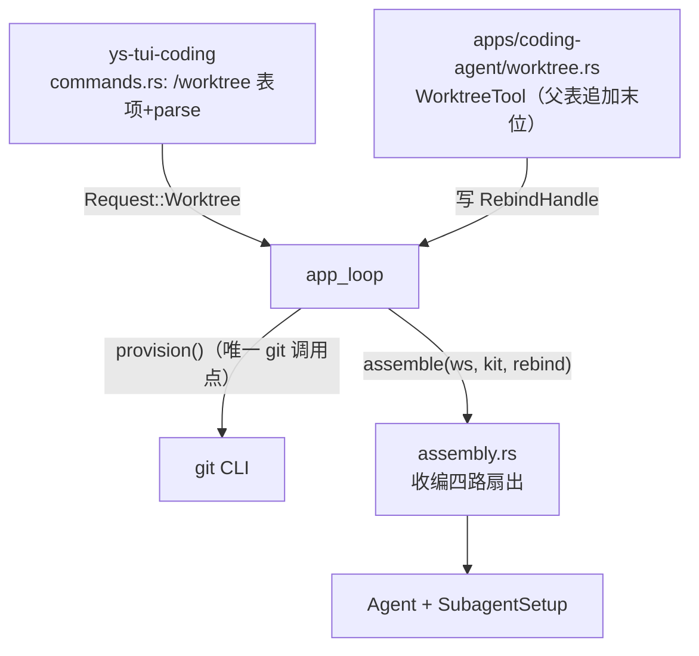

# git worktree 支持 — 架构设计

> 上承 [`context.md`](./context.md)（用户已裁定的范围与约束）。决策记录见
> [`docs/adr/0034-worktree-command.md`](../../adr/0034-worktree-command.md)。
> 三个候选方案由并行 subagent 产出（最小复杂度 / 可扩展优先 / 资源与缓存效率优先），
> 本文取其骨架并记录否决理由。

## 1. 结论先行

**推荐：单函数骨架 + 共享信元上卷 + 仓库外落点 + 只建不回收。**

一句话形态：**两个新函数（`provision` / `assemble`）承载全部逻辑，一个 `Arc<Mutex<Option<PathBuf>>>`
信元把「换工作区」的意图从工具上卷到 app_loop，切换在回合边界重建 Agent。**

选型的三条主判据，全部来自本仓既有约束（不是外部偏好）：

1. **不新增 trait、不改核心 crate。** `worktree` 工具与命令都在 `apps/coding-agent`，工具调用
   `provision()` **不需要任何核心 crate 的能力** ⇒ 照 `SubagentRunner` 加 `ToolContext` 挂载点
   是把字段穿 `ys-runtime::AgentPorts`→`ys-loop`→`ys-tool` 三个 crate，**收益为零**（见 §5.a）。
2. **落点必须在仓库外。** 三条独立理由全部指向仓库外，其中两条是真的 bug（见 §5.b）。
3. **切换必然付一次 prompt cache miss**，且比候选 C 估计的更宽 —— 必须如实计入（见 §5.f）。

## 2. 需求与约束（摘自 context.md，只列设计相关的）

- 一个需求 ⇒ 一个 worktree；**两条口共用一份实现**：`/worktree` 命令（用户）与 `worktree`
  工具（模型，由 skill 正文指示）。
- 职责 **创建 + 切进当前会话**；需求内多 agent 共用同一树，**冲突靠 skill 协商，运行时不做机制兜底**。
- **只隔离不回流**（不自动 merge）；**显式降级**（非 git / git 不可用 / `add` 失败 ⇒ 退回共享工作区）。
- 硬约束（全部带指针）：
  - `Agent` 冻结持有 `registry`/`cwd`/`workspace_root`/`system_prompt`，每回合 clone 进
    `RuntimeContext`（`crates/ys-runtime/src/agent.rs:67-127`）。`AgentPorts` 只传
    model/session/events/boundary/subagent ⇒ **cwd 与工具表都不在可换缝里** ⇒ 换工作区**只能重建 Agent**。
  - 工具**构造期捕获** `workspace`（`tools-basic/src/read.rs:48`、`write.rs:41`、`edit.rs:166`、
    `bash.rs:118`）⇒ 重建 Agent 即重建工具表。
  - `ys-core`/`ys-event`/`ys-protocol` **零 tokio** ⇒ git 子进程只能落在 apps 层。
  - 父表 = 基础 9 元 + 追加末位（`main.rs:1370-1373`）；子表 = 基础 9 元 ⇒ **追加末位的工具子 agent 拿不到**。
  - `capabilities.rs` 绝不 print；输出走 `Outbound::Output`（`docs/architecture.md` §13 输出三分）。
  - 全仓**零 git 调用**；`prompt::build_system_prompt` 从 cwd 逐级向上加载项目上下文
    （`prompt.rs:277`）并把**路径写进文本**（`prompt.rs:60-64`）。

## 3. 同类软件调研（Step 2）

### 3.1 最有价值的一条先例 —— 逐字对应用户口径

`tmp/deepseek-harness/.agents/notes/implemented/feature/2026-08-05-agent-teams.md`：

> "**Worktree isolation is not a harness runtime behavior.** A deployment or prompt may arrange
> separate worktrees, but the Team domain does not infer branches, merge changes, or silently
> change cwd."

其「Alternatives considered」明确否决两条，理由与本需求裁定一致：

- ❌ **Create isolated worktrees automatically** —— worktree 创建、分支命名、合并策略、忽略文件、
  构建产物、清理**都是部署决策**；
- ❌ **Treat task ownership or write scopes as locks** ——「外部写者会绕过锁、崩溃的持有者会永久占位、
  路径前缀重叠**无法证明语义独立**；**假互斥比显式警告更危险**」。

⇒ 支持「运行时不做冲突消解、下放给 skill」，且支持「不自动回收」。

### 3.2 Claude Code —— 形态参照与两个反面 bug

- 形态：`--worktree/-w`；默认落 `.claude/worktrees/<name>/`、分支 `worktree-<name>`；
  `EnterWorktree`(`name` XOR `path`)/`ExitWorktree`；**同一时刻只允许一个活动 worktree**；
  进入仓库外路径需审批；v2.1.198 起进入/退出**迁移会话转录**（类似 `/cd`）；**lazy isolation**
  （后台会话首次写才迁入）；清理：无改动则自动删、有改动则询问。
- ⚠️ **bug #76250**：会话级共享 CWD 槽 ⇒ 并发 subagent 的 `EnterWorktree` **静默改掉整棵会话树的 CWD**，
  跨 worktree 误改。
- ⚠️ **bug #33**：`EnterWorktree` 是**会话级副作用** ⇒ 并行 agent 共享同一 worktree。
- **启示**：这两个 bug 的根因都是「切换是会话级全局副作用、且与子 agent 共享」。本设计用
  **回合末才生效的进程级信元 + 子 agent 结构上拿不到该工具**绕开（§5.a / §5.e）。

### 3.3 本仓两个同技术栈参考实现

- `tmp/Codewhale/crates/lane/src/worktree.rs`（Rust 554 行）：
  - 声明式 `WorktreeProvision{repo_root,branch,path,base_ref}`；`git worktree add -b <branch> <path> <base>`（base 默认 `HEAD`）；
  - **捕获子进程输出而不继承终端** ——「Runtime callers include the raw-mode TUI launch screen,
    where even one inherited progress/error line corrupts the alternate-screen buffer」；
  - 清理前用 `git worktree list --porcelain` + `.git` 的 `gitdir:` **确认 git 认它是本仓托管的
    worktree** 才删（防陈旧记录变无界递归删）；
  - 删分支用 `-d` 不用 `-D` ——「a branch carrying unmerged commits is someone's work, and a TTL
    timer is not a mandate to throw it away」。
  - **不采纳其 TTL**（见 §5.c），**采纳**「捕获输出」「只动 git 认的树」。
- `tmp/pi/packages/coding-agent/src/core/resource-loader.ts` 的 `findShadowedContextFile`：
  嵌套 worktree 的上下文文件会**遮蔽/重复**主仓同名文件 ⇒ 直接支持「落仓库外」（§5.b）。

### 3.4 生态编排器

vmux / dmux / parallel-code / CLITrigger / ace-polyagent / Baton 一律「一任务 = 一分支 = 一 worktree、
**review diff 再合并**」；`pact` 自陈「file-claim coordination is advisory/experimental,
**not yet reliable under concurrency**」⇒ 同 §3.1。

## 4. 三个候选方案与对比

### 4.1 候选

| | 骨架 | 上卷机制 | 落点 | 生命周期 |
|---|---|---|---|---|
| **A 最小复杂度** | `worktree.rs` + `assembly.rs`（2 文件，0 新 trait） | `RebindHandle`（`Arc<Mutex<Option<PathBuf>>>`） | 仓库外 `~/.yushan/worktrees/` | 只建不回收 |
| **B 可扩展优先** | `worktree/{provider,ledger,service}.rs` + `workspace.rs`（2 新 trait） | `ToolContext` 第 4 挂载点 `WorkspaceController` | `<repo>/.yushan/worktrees/` | 状态机 + ledger.jsonl + TTL |
| **C 资源/缓存效率** | `worktree.rs` + `assembly.rs` + `capabilities.rs` 扩（1 新 trait） | `ToolContext` 第 4 挂载点 `WorktreeController` | `<repo>/.worktrees/` | 不回收 |

### 4.2 对比矩阵

| 维度 | A 最小复杂度 | B 可扩展优先 | C 资源/缓存效率 |
|---|---|---|---|
| 新模块/文件 | **2** | 4+ | 3 |
| 新增 trait | **0** | 2 | 1 |
| 改核心 crate | **0** | `ys-tool`(+1 字段) + `ys-runtime`(AgentPorts) + `ys-loop`(透传) | 同 B |
| 新增状态 | **1 个 Arc<Mutex>** | 状态机 + ledger.jsonl | 1 个 Arc<Mutex> |
| 切换成本 | 重建工具表+prompt+agent；复用探测 | 同 + ledger 写 + 状态转换 | 显式核算：µs 重建 + 1 fork |
| prompt cache | 首轮 miss | 首轮 miss | 首轮 miss（**低估了范围**，见 §5.f） |
| 落点正确性 | **仓库外 ✅** | 仓库内 ❌（重复加载 + 搜索遍历） | 仓库内 ❌（同左） |
| 扩展性 | 低（当前够用） | 高 | 中 |
| 运维/排障 | 简单 | ledger 可查但面大 | 简单 |
| 主要风险 | 同回合不生效（已明示） | 重建漏换 `SubagentSetup` 静默写旧树；ledger 一致性 | 缓存论断错误；落点隐患 |

## 5. 推荐方案

**取 A 的骨架 + C 的成本纪律（修正其缓存论断）+ B 的显式降级枚举；否决 B 的状态机/ledger/TTL/双 trait，
否决 C 的仓库内落点。**

### 5.1 模块划分



| 模块 | 位置 | 职责 |
|------|------|------|
| `worktree.rs`（新） | `apps/coding-agent` | **唯一 git 调用点**：`provision()`、`WorktreeTool`、`RebindHandle`、`WorktreeActivation`/`DegradeReason` |
| `assembly.rs`（新） | `apps/coding-agent` | `assemble(ws, &BuildKit, rebind)`：把 `main.rs:1341-1375` 的四路扇出（`build_tools` / `working_dir` / `build_system_prompt` / `SubagentSetup`）收进一处；**启动与重绑共用** |
| `request.rs`（改） | `ys-protocol` | 加 `Request::Worktree { #[serde(default)] name: Option<String> }` |
| `commands.rs`（改） | `ys-tui-coding` | 命令表加 `/worktree` + `parse` 分支（命中内置 ⇒ 不走 skill 兜底，硬序不变） |
| `app_loop.rs`（改） | `apps/coding-agent` | 处理 `Request::Worktree`；`Prompt` 臂末 `take()` 信元并按需重绑 |
| skill（新，非代码） | `~/.yushan/skills` | 提示词层协商协议：需求内多 agent「改动前声明目标文件」的纪律 |

### 5.2 核心接口

```rust
// apps/coding-agent/src/worktree.rs
pub struct Worktree { pub path: PathBuf, pub branch: String }

pub enum DegradeReason { NotARepo, GitUnavailable, AddFailed(String) }

/// 显式降级：绝不静默退回共享工作区。
pub enum WorktreeActivation { Isolated(Worktree), Degraded(DegradeReason) }

/// 唯一的 git 调用点。已登记同名 ⇒ 复用；否则 `add -b worktree-<name> <path> HEAD`。
/// 子进程输出**捕获**、不继承终端（防 TUI raw mode 污染）。
pub fn provision(repo: &Path, name: &str) -> Result<Worktree, DegradeReason>;

/// 工具 → app 的上卷信元，照 `app_loop::SessionPathHandle`（`app_loop.rs:91`）的先例。
pub type RebindHandle = Arc<Mutex<Option<PathBuf>>>;

// apps/coding-agent/src/assembly.rs
pub struct BuildKit { /* web / limits / child_limits / max_turn_duration / catalogue / 探测结果 */ }
pub struct Assembly { pub agent: Agent, pub subagent: SubagentSetup }
pub fn assemble(ws: &Path, kit: &BuildKit, rebind: Option<&RebindHandle>) -> Result<Assembly, BuildError>;

// crates/ys-protocol/src/request.rs
Request::Worktree { #[serde(default)] name: Option<String> }
```

### 5.3 关键数据流

- **用户口**：`/worktree <name>` → `commands.rs` `parse` → `Request::Worktree` → `app_loop` 臂 →
  `provision()` + `assemble()`。
- **模型口**：skill 正文指示模型调 `worktree` 工具 → 工具调**同一个** `provision()`，成功后把路径写进
  `RebindHandle`，并把「自下一回合生效」写进 `ToolResult` → `app_loop` 在 `Prompt` 臂末 `take()` 后
  `assemble()`。
- **共用点 = `provision` + `assemble` 两个函数**（不是两个 trait、不是两份实现）。
- **生效边界 = 下一回合**：`Agent` 的 `registry`/`system_prompt`/`cwd` 构造期冻结
  （`agent.rs:67-75`），且回合中 `&mut Agent` 已借出，无法中途换 ⇒ 与 `/new`（换 Wiring）、
  `/model`（换 model）同层同边界。

### 5.4 关键决策与取舍

#### a. 上卷 = 共享信元，**否决 `ToolContext` 第 4 挂载点**

`subagent`/`summarizer` 挂载点存在，是因为其 runner 持有 `Model`/`Session`/`Agent` 等**核心类型**，
只能经 trait 借给 `ys-tool`。worktree 不同：**工具本身就在 `apps/coding-agent`**，`provision()` 是
本地函数，工具直接调即可；它唯一需要交给外界的只有「请在下回合换工作区」这一个**意图**。
加挂载点要把字段穿 `ys-runtime::AgentPorts` → `ys-loop` → `ys-tool` 三个 crate，而**工具终究无法
重建 app 级 Agent**，收益为零。信元 `Arc<Mutex<Option<PathBuf>>>` 有现成先例
（`app_loop::SessionPathHandle`，`app_loop.rs:91`）。

> **信元须每回合新建或每回合清空** —— 与 `BoundarySource` 同理（`CLAUDE.md` 硬约束）：
> 陈旧意图会污染下一回合。取「回合末 `take()`」的语义，天然自清。

#### b. 落点 = **仓库外** `$HOME/.yushan/worktrees/<repo>-<name>/`（可选 `YUSHAN_WORKTREES_DIR`）

三条独立理由，前两条是真的 bug：

1. **搜索遍历灾难**：降级 POSIX 路径的排除表 `EXCLUDED_DIRS`（`tools-basic/src/lib.rs:44`）只有
   `.git/target/node_modules/dist/build/.venv`，**不含 worktree 根** ⇒ `grep -r`/`find` 会搜进 worktree
   的完整副本。（`rg`/`fd` 靠 `.gitignore` 能挡，降级路径挡不住。）
2. **重复加载项目上下文**：`load_project_context` 逐级向上**全收、按路径去重**（`prompt.rs:277-305`）。
   落在 `<repo>/.worktrees/<name>` 时，worktree 自己 checkout 出的 `AGENTS.md` 与 `<repo>/AGENTS.md`
   **两份都进上下文** —— 正是 `tmp/pi` 用 `findShadowedContextFile` 专门修的问题。
3. **主树零污染**：`.gitignore` 不含 `.worktrees/` / `.yushan/` ⇒ 仓库内落点会让 `git status` 多出
   未跟踪目录。

放仓库外时，worktree 读的是**它自己那份**（跟踪文件，checkout 带来）`AGENTS.md`，单份加载。

#### c. 生命周期 = **只建不回收，无 TTL**

「只隔离不回流」⇒ 自动删会毁掉**尚未被 merge 的工作成果**。采纳 Codewhale 的分支纪律（`-d` 不 `-D`：
未合并分支是人的工作）并**进一步不设 TTL**。回收留给用户显式动作（`/worktree rm` 属后续增量）。

#### d. 降级显式

`WorktreeActivation::Degraded(DegradeReason)` —— 命令路径经 `Outbound::Output` 进 transcript，
工具路径写进 `ToolResult`，**两条路都不得静默**。判定：`git rev-parse --show-toplevel` 不识别
（非 git 仓）⇒ `NotARepo`；git 不可执行 ⇒ `GitUnavailable`；`add` 非零 ⇒ `AddFailed(stderr)`。

#### e. 子表结构上无此工具

追加在 `subagent` 之后（`main.rs:1370-1373`）⇒ 子表仍是「基础 9 元」，**子 agent 拿不到
`worktree` 工具**，结构上不可能自行换工作区。这也正是绕开 Claude Code bug #33 的机制。

#### f. 缓存账要诚实：切换**必然** miss 更大一段

候选 C 断言「树嵌仓内 ⇒ 只差末尾 cwd 一行」。**这不对**（两处已核对）：

- `prompt.rs:60-64` 把路径写进文本：`<project_instructions path="{path}">`。**不论落点**，切换都会让
  `project_context` 段字节改变 ⇒ 缓存分界不在末尾 cwd 行，而在 `Guidelines` 之后。
- 落仓库内时该段还会**翻倍**（§5.b-2），更差。

⇒ 诚实结论：**稳定前缀 = 工具清单 + Guidelines**；`project_context` 起（含 cwd 行、skill 目录段）
每次切换首轮重计一次 —— 量级：无 skill ≈ 1 行；满 skill 目录（固定开销 ~9.6k、目录段 ~8k）⇒ 一次性
~8k input 重计。**换取的诊断确定性远大于这点成本**，但必须记在案。

### 5.5 成本账（back-of-envelope）

| 项 | 值 | 依据 |
|---|---|---|
| 重建 9 个工具 | µs（9 次 `PathBuf` 克隆 + 装箱，**零 fork**） | 工具构造只存路径 |
| 重建 system prompt | µs（新 cwd walk-up、若干 `stat`、拼串） | 无子进程 |
| 重建 Agent | µs | `Agent::new` 只搬所有权 |
| **复用（不重跑）** | `SearchBackends::detect` / `WebConfig` / 模型实例 / `model_cache` / skill catalogue | 存进 `BuildKit` |
| git 冷启 | 1×`rev-parse` + 1×`worktree add` | 稳态仅 `add` 一次 fork |
| `worktree add`（中仓） | ~0.5–2s，I/O bound | 建树即 checkout |

⇒ **最坏路径 = 首次切换首回合**：`add` 0.5–2s + 重建 ~ms + `project_context` 起重计一次。

## 6. 分阶段落地

- **P0（纯重构，行为逐字节不变）**：抽出 `assembly::assemble()` 收编四路扇出；`main` 改调它。
  靠既有顺序/指纹测试守回归。**先做这一步，单独提交**。
- **P1**：`worktree::provision()` + `Request::Worktree` + `/worktree` 命令 + `app_loop` 重绑。
- **P2**：`WorktreeTool`（追加末位）+ 协商 skill 正文。
- **P3（增量，可延后）**：`/worktree rm`（显式回收）、`/status` 显示当前树、`SessionMeta.workspace`
  只读记录（供 `--resume` 提示错位，`#[serde(default)]` 向后兼容）。

## 7. 已知风险与待验证项

- [ ] **同回合内切换未生效**（工具调用后本回合其余写仍落旧树）—— 靠 `ToolResult` 明示 + skill
      「先建树再干活」缓解；运行时不做兜底（符合裁定）。**这是最大风险，须在 skill 与工具文案里写死。**
- [ ] **项目级 `.yushan/` 在 worktree 缺席**（未跟踪 ⇒ `git worktree add` 不搬）：项目 skills 消失、
      `.yushan/SYSTEM.md` 自定义 prompt 短路翻转 ⇒ **跨树行为漂移**。须在切换输出明示（同降级）。
- [ ] **prompt cache 分界**实测（§5.f 是推算，需一次真实 token 读数验证）。
- [ ] **`SubagentSetup` 重建漏换** ⇒ 子 agent 静默写旧树。用变异测试钉住（本项目既有做法）。
- [ ] `git worktree` **共享 common repo 的 config/hooks**（deepseek-harness 有专治 `core.hooksPath`
      被跨 worktree 改写的笔记）⇒ 若将来要做 worktree 级 git 配置，须走 `extensions.worktreeConfig`。
- [ ] 落点 `<repo>-<name>` 在**同名仓库**（不同路径、同名目录）间会撞名 ⇒ 是否加短 hash（待定）。
- [ ] 建议用 `prototype` 验证：① worktree 内 `build_system_prompt` 的实际加载差异（尤其 `.yushan/`）；
      ② 「下一回合生效」在 TUI / `-p` / `--json` 三模式的一致行为。

## 8. 相关文档

- [`context.md`](./context.md) — 上下文与约束
- [`../../adr/0034-worktree-command.md`](../../adr/0034-worktree-command.md) — 决策记录
- [`../../design-final/coding-agent-tui.md`](../../design-final/coding-agent-tui.md) §13 — subagent 派发与 workspace 继承的 as-built
- [`../commands/context.md`](../commands/context.md) — 命令体系（注意其 ADR 为过期稿，以 `crates/ys-tui-coding/src/commands.rs` 为准）
