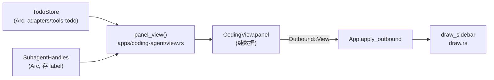

# 设计计划：TUI 右侧双栏（todo 清单 + subagent 运行状态）

> 权威设计：[`docs/arch/tui-right-panel/design.md`](../arch/tui-right-panel/design.md)（下称「设计」）。
> 需求上下文：[`context.md`](../arch/tui-right-panel/context.md)（Q1/Q1b/Q2/Q2b/Q3/Q3b/Q4/Q4b/Q6/Q6b/Q8 已定）。
> 决策记录：[ADR-0075](../adr/0075-tui-right-panel.md)（五条决策，本文**不复述论证**，只引用）。
> 评审：[`review.md`](../arch/tui-right-panel/review.md)（两条 P0 已修进设计，本文按修正后的 §3.1 / §5.1 落地）。
> 执行计划：[`docs/exec-plans/tui-right-panel.md`](../exec-plans/tui-right-panel.md)。
> 核实基线：工作区 HEAD（`design.md` 修正版；本文所有行号经 `rg`/`read` 逐个核对，与设计不符处见 §8）。

---

## 1. 需求与目标

在 TUI 右侧加一条**固定宽度、默认隐藏**的窄栏，栏内纵向切成**固定 50/50** 的两个横栏：
上栏 todo 清单、下栏 subagent 运行状态。

已定的边界（`context.md`，全部为**用户原话答定**，不重新论证）：

| 维度 | 结论 |
|---|---|
| 形态 | 右侧一条靠边窄栏，栏内再分上下横栏（两列 + 右列内 section 栈） |
| 尺寸 | **静态大小**，不自适应、不做窄屏自动隐藏 |
| 空态 | 栏**打开时**框常驻（固定宽 + 固定 50/50 高），内容可以空 |
| 内容 | v1 不展示 harness 状态 ⇒ 与底部 `status_text` 零重叠 |
| 开关 | **默认隐藏、手动打开**，`/panel [on|off]`；开关**不跨重启**、不落盘 |
| subagent | 只展示「谁在跑 + 工作主题」，主题取派发工具入参的 `description` 开头一段 |

**非目标（明确不做）**：新 crate；`ys-protocol` 改动；ADR-0054 的整套可观测层（`SubagentBoard` 不建）；
hook/注册表/生命周期；新增 `Outbound` 变体；新增定时器（ADR-0073）。

**一句话**：数据经 `CodingView` 的新字段（**纯数据，非 trait object**）由 app 侧投影；
几何收敛成**一个纯算术函数**，让今天三处各抄一遍的纵向切分只剩一处；
`truncate_to_width` 是唯一的截断路径。

---

## 2. 关键设计决策（引用 ADR-0075）

| # | 决策 | 落点 | 本文相关章节 |
|---|---|---|---|
| 1 | 开关是**纯 UI 本地状态**，不进视图、不进协议、不落盘 | `LocalAction::Panel(Option<bool>)` → `App.panel_visible: bool` | §5、§6 |
| 2 | 侧栏**只切 Chat 带**，不竖贯到底 | `frame_areas()` 内先整屏宽竖切、再只让位 `v[0]` | §4 |
| 3 | 几何收敛为**单一纯算术函数**；栏宽手写钳制，50/50 不写奇偶补偿 | `frame_areas()` / `side_width()` | §4 |
| 4 | 复用 `Outbound::View`，**只替换 `panel` 字段**再发；不重建整视图 | 回合中事件臂 + `last_view` 基线 | §5.2 |
| 5 | `description` 经 `SubagentRunner::spawn` 加一个 `&str` 形参上传 | `ys-tool` trait + `SubagentHandles` 存 label | §5.3 |

**决策 1 的直接后果**：`CodingView.panel`（数据）与 `App.panel_visible`（开关）名字相近、**语义相反**。
两处都必须写死注释，否则后来者会把开关塞进视图。`CodingView` **不给**启动初值字段
（与 `/thinking`、`/theme` 的区别就在这里，见 ADR-0075 决策 1）。

---

## 3. 模块划分与改动清单

设计 §2 的表格照搬，**补 `panel_view` 的最终形态**（§3.1）与两个新增访问器。

| 位置 | 职责 | 改动 | 生产/测试行 |
|---|---|---|---|
| `crates/ys-tui-coding/src/view.rs` | `PanelView` / `TodoLine` / `RunningLine` / `RowMark`（自建投影类型，owned `String`）+ `CodingView.panel` + `Default` 补字段 | 改 | ~45 / ~10 |
| `crates/ys-tui-coding/src/draw.rs` | **几何唯一来源** `frame_areas()`；`side_width()` / `SIDE_WIDTH`；侧栏两栏绘制 `draw_sidebar` | 改 | ~180 / ~90 |
| `crates/ys-tui-coding/src/app.rs` | `panel_visible: bool`（`App::new` 写 `false` 字面量）；`/panel` 生效时 `selection.clear()` | 改 | ~15 / ~30 |
| `crates/ys-tui-coding/src/commands.rs` | `COMMANDS` 由 19 → 20 条、`LocalAction::Panel(Option<bool>)`、解析臂、`apply_local` 一臂 | 改 | ~30 / ~30 |
| `apps/coding-agent/src/view.rs` | `build_view_with_loop` 加 `panel` 形参（10 → 11）；新增 `panel_view()` 投影；改文件头「形参已达 8 个，不再加参数」注释 | 改 | ~70 / ~40 |
| `apps/coding-agent/src/app_loop.rs` | 六处 `build_view_with_loop` 调用点补 `panel`、**同步写 `last_view`**；回合中事件臂按 §5.2 推送；`TurnCtx` + `run_turn_chain` 加四形参（设计 §5.1） | 改 | ~85 / ~30 |
| `apps/coding-agent/src/subagent.rs` | `SubagentHandles` 的 value 由 `Weak<_>` 改为 `HandleEntry { target, label }`；`live_labels()` 读口；`spawn` 透传 `label`；`register` 加 label 形参 | 改 | ~62 / ~40 |
| `crates/ys-tool/src/subagent.rs` | `spawn` 加一个 `_label: &str` 形参（默认实现逐字不动） | 改 | ~2 / 0 |

**零改动**（列出是为了守住边界）：`ys-protocol`（全部）、`layout.rs`（`width` 已入失效判据）、
`app.rs:743` 的增量补偿（`!width_changed` 恰好抑制）、`chat_viewport` / `chat_inner_rect` 的 8 个消费者、
`chat_block()` 的逐项扣减、`FakeRunner`（`ys-tool/src/context.rs:99`）与 `ProbeRunner`
（`ys-loop/src/basic.rs:2464`）—— 后两者靠默认实现，签名加形参不影响空 impl（已 `rg` 确认它们
**没有**传四参直调 `spawn` 的用例）。



### 3.1 `panel_view` 的最终形态（2 参）

```rust
// apps/coding-agent/src/view.rs

/// 侧栏的**投影**：app 侧只做数据挑选与封顶，不碰显示列（那是 UI 的事，见设计 §3.3）。
///
/// **主题不是形参**：主题是渲染参数，不进投影结果 —— 进了会让「数据」与「怎么画」
/// 混成一个值，而 `PanelView` 要参与 `PartialEq` 变更检测（设计 §5）。
pub fn panel_view(
    todo: &ys_tools_todo::TodoStore,
    subagent: Option<&crate::subagent::SubagentSetup>,
) -> PanelView
```

投影规则（设计 §4 / §7）：

| 输入 | 规则 |
|---|---|
| `todo.snapshot()`（`store.rs:160`） | 逐项映射 `TodoItem { content, status }` → `TodoLine { text, mark }`；`content` 截到 `MAX_TODO_CONTENT_CHARS = 96` **字符**（不是字节、不是列）；取前 `PANEL_TODO_MAX = 24` 条，其余只计数 ⇒ `+N` |
| `subagent.live_labels()`（新增） | `Vec<(String, Arc<str>)>`；label 截到 `MAX_DESCRIPTION_CHARS = 120` 字符；取前 `PANEL_RUNNING_MAX = 8` 条，其余计数 ⇒ `+N 在跑` |
| `TodoStatus` → `RowMark` | `#[non_exhaustive]`（`item.rs:13`）⇒ **必须**带 `_ => RowMark::Plain` 兜底，且注释写明「新增状态会静默显示为 Plain」 |

**`TodoItem` 只有两个字段**（`adapters/tools-todo/src/item.rs:50-53`：`content: String` + `status: TodoStatus`，
**没有 `id`**）⇒ 投影不涉及同一性判定，`content` 即主键（归一化后逐字比较，`normalize_content`）。

**`SubagentSetup` 需要新增一个访问器**（有既有范例但形态不同：`pending_results()` 在 `subagent.rs:1146`
返回 `&Arc<PendingResults>`，而 label 需要现取快照）：

```rust
// apps/coding-agent/src/subagent.rs —— 委托到 self.handles，不新开表
pub fn live_labels(&self) -> Vec<(String, Arc<str>)> { self.handles.live_labels() }
```

### 3.2 线上类型的最终形态

```rust
// crates/ys-tui-coding/src/view.rs
#[derive(Clone, Debug, PartialEq, Eq)]
pub struct PanelView {
    pub todos: Vec<TodoLine>,
    /// 超出 `PANEL_TODO_MAX` 的条数（0 = 没省略）；UI 据此画 `+N`。
    pub todos_hidden: usize,
    pub running: Vec<RunningLine>,
    /// 超出 `PANEL_RUNNING_MAX` 的在跑数（0 = 没省略）。
    pub running_hidden: usize,
}

#[derive(Clone, Debug, PartialEq, Eq)]
pub struct TodoLine { pub text: String, pub mark: RowMark }

#[derive(Clone, Debug, PartialEq, Eq)]
pub struct RunningLine { pub handle: String, pub label: String }

/// 状态字形。UI 侧唯一认这个枚举 —— 不认 `TodoStatus`（那是 adapters 的类型，
/// `ys-tui-coding` 不依赖它）。
#[derive(Clone, Copy, Debug, PartialEq, Eq)]
pub enum RowMark { Plain, Active, Done }
```

`CodingView.panel` 的类型是 `PanelView`（非 `Option`）—— **空态是「两个空 Vec」，不是 `None`**：
Q6b 要求打开时框常驻，`None` 会诱使渲染层做「没数据就不画框」的分支。默认值
`PanelView::default()` 由 `CodingView::default()`（`view.rs:188`）给出。

---

## 4. 几何方案

### 4.1 单一来源 `frame_areas()`

今天同一份纵向 `Layout::vertical` 存在**三份**：画面 `draw.rs:169-174`、`chat_area` `:246-253`、
`input_geom` `:220-245`。收敛为一个纯算术函数（设计 §3.1 的代码逐字照搬，此处只记执行要点）：

```text
side_width(total) = SIDE_WIDTH.min(total.saturating_sub(MIN_WIDTH))     // 30 / 保 Chat 优先
frame_areas(app, total):
    v = Layout::vertical([Min(3), Length(input_height(app, total.width)), Length(1)]).split(total)
    w = app.panel_visible ? side_width(total.width) : 0
    side = (w > 0).then(|| Rect { x: v[0].x + v[0].width - w, width: w, ..v[0] })
    chat = Rect { width: v[0].width - w, ..v[0] }
```

**执行顺序不能反**（设计 §3.1 与 ADR-0075 决策 2 都强调）：先在**整屏宽**上竖切，再只把 `v[0]`
横向让位。若写成「先横切主列、再在主列上竖切」，`input_height` 拿到变窄后的宽 ⇒ 决策 2 声称
消除的反馈环以更隐蔽形式复现。

**不用** `Layout::horizontal([Min(1), Length(30)])`：实测 ratatui 0.30 会优先满足 `Length`，
W=20 时把 Chat 压到 1 列、栏宽 19。`side_width()` 手写钳制才是「保 Chat」的意图。

### 4.2 三处复算的收敛点（签名与调用点全不动）

| 原处 | 改为 |
|---|---|
| `draw.rs:169-174` 的 `chunks` | `let a = frame_areas(app, area);` |
| `draw.rs:180-183` 的 `chunks[0]/[1]/[2]` | `a.chat / a.input / a.status` |
| `draw.rs:195` 补全浮层盖 `chunks[0]` | 盖 **`a.chat`** —— 否则浮层压到栏上 |
| `draw.rs:246-253` `chat_area` 体 | `frame_areas(app, area).chat` |
| `draw.rs:229-236` `input_geom` 内的 `Layout` | `frame_areas(app, Rect::new(0,0,width,height)).input`（**仍传整屏 `width`**） |

`chat_area` **保留不删**（候选 A 主张删）：它是 `chat_inner` 的唯一上游，删掉要改 `chat_viewport` /
`chat_inner_rect` 的 8 个消费者 —— 与需求无关的扩散。

### 4.3 实测结论（不写奇偶补偿）

ratatui 0.30 实测 60+ 组（设计 §3.2）：`Percentage(50)×2` / `Fill(1)×2` / `Ratio(1,2)×2` 三者
**逐格相同**，且**上栏恒多一行**（H=5 ⇒ 3/2、H=7 ⇒ 4/3、H=25 ⇒ 13/12）。⇒ 取 `Percentage(50)`，
不写奇偶补偿；单测断言「和 = 栏高、上 ≥ 下、差 ≤ 1」。

### 4.4 侧栏内容截断（唯一路径）

侧栏必然截断（todo 内容最长 240 字符、description 可能是整句）。**唯一允许的路径**是
`draw.rs:1610` 的私有 `truncate_to_width`（CJK 算 2 列、落字符边界）。

`display_width` 只是 `pub(crate)`（`:1605`）、`apps/coding-agent` 用不了 ⇒ **显示列截断放 UI 侧**
（`draw_sidebar` 画每行时调一次），app 侧只封「条数」与「字符数」两维。
两者正交：字符数管「一个中文算几个」，显示列管「屏幕占多宽」。

**绝不用** `<str>::split_at`：既有前科 `commands.rs:482-487`（`split_at(len - 1)` 落在多字节
字符内部会 panic，而 `install_panic_hook` 有意不 `catch_unwind` ⇒ 丢全部会话现场）。

---

## 5. 数据流与刷新时机

### 5.1 通路

```text
todo 工具被调用 → TodoStore.apply → revision += 1
                                        │
回合中事件转发臂（app_loop.rs:2203 旁）──┤
  next = panel_view(&todo, subagent)    │
  if next != last_panel && 距上次推 ≥ 300ms
      last_view.panel = next
      发 Outbound::View(last_view.clone())
                                        ▼
回合收尾（app_loop.rs:1486）→ build_view_with_loop(..., panel)
                                        │
                    Outbound::View（既有有界信道）
                                        ▼
              run.rs:423 app.apply_outbound(View)  ← 整表替换
                                        ▼
                    draw::ui(frame, app)  ← 仅当帧到期
```

### 5.2 四条硬性质

1. **只推「变了」的**：`PanelView: PartialEq` 做变更检测 ⇒ 无变化零流量，**包括侧栏关着时**
   （app 侧不知道开关，开关是 UI 本地状态）。
2. **不重建整视图**：复用上次已发的 `CodingView`，只替换 `panel` 字段。
   **不得**在事件臂里改调 `build_view_with_loop` —— 它形参含 `&Agent`（回合执行期被 `&mut` 借走），
   且读 `Instant` / `state_store`（把 IO 搬进每个事件的路径）。
3. **节流 `PANEL_THROTTLE = 300ms`**（`app_loop.rs`）：合并一次批量 `apply` 的连跳 `revision`。
   **不是新增定时器**（ADR-0073）—— 由状态变化驱动，`elapsed() >= PANEL_THROTTLE` 只是丢弃，
   不安排下一次。
4. **`last_view` 每次发出 `Outbound::View` 时同步写入**，包括已有的六处调用点
   （`:548`/`:608`/`:646`/`:687`/`:713`/`:1486`）—— 否则回合中复用的是**陈旧基线**。
   这是本设计唯一需要改**顺序语义**（非纯形参穿透）的地方。

### 5.3 四项形参通路（设计 §5.1，review F2 的修复）

`run_turn_chain` 函数体内**没有任何 `CodingView` 局部量**，`TurnCtx` 也没有 `state_store` / `todo_store`
⇒ 必须显式加通路。**最小改动：形参 + 字段，不新增类型、不新增信道。**

| 位置 | 变化 |
|---|---|
| `TurnCtx` 字段（`app_loop.rs:1656`） | `todo: &TodoStore`、`last_view: &mut CodingView`、`last_panel: &mut Option<PanelView>`、`last_push: &mut Instant` |
| `run_turn_chain` 形参（`:1841`，已 16 个 + `#[allow(clippy::too_many_arguments)]`） | 同名四项，保持与 `ctx` 一致的转递惯例 |
| 六个 `run_turn_chain` 调用点（`:526`/`:586`/`:664`/`:822`/`:934`/`:970`） | 传 `&factory.todo()`（`:473` 已持有）与四个 `&mut` 循环局部量 |

四个局部量声明在 `run()` 里、按引用传下 —— 与 `last_injected_rev`（`:461`，回合边界注入的既有范例）
同形。`todo_store` 已在 `:473`，**不重新取**（`/new`/`/resume` 改的是它内部指向）。

### 5.4 `description` → UI（决策 5）

`description` 今天断在两层：`Tool::call` 拿得到（`subagent.rs:2036`），但 `spawn`
（`ys-tool/src/subagent.rs:76-81`）四个形参里没有位置。

- **改 trait**：紧跟 `prompt` 加 `_label: &str`（两者都是「这一次派发的内容」；`model`/`mode`/`boundary`
  是执行参数，排其后）。默认实现逐字不动。用 `&str` 而非 `Option<&str>`：schema 里 `required`，
  缺失即 `ToolError::InvalidInput`，**不设默认值**（默认值会让 UI 出现「无标题项」这种静默）。
- **波及面（已逐处核实）**：生产实现 1 处（`subagent.rs:1171`）、调用点 1 处（`:2042`）、
  用例 1 处（`:4370`）。`FakeRunner` / `ProbeRunner` 零改动。
- **键存在哪**：**不新开表**，扩既有的 `SubagentHandles`：value 由 `Weak<QueueBoundarySource>`
  改为 `HandleEntry { target: Weak<_>, label: Arc<str> }`。「谁在跑」必须只有一个真值 —— 两张表
  会有一张先过期。`live_labels()` 与 `live_handles()`（`:468`）同样先 `retain` 清理死项。
- **锁纪律**：临界区无 `await`，与既有 `send`/`live_handles` 一致。

---

## 6. 开关

- **命令**：`/panel [on|off]`，无参 = toggle。`COMMANDS: [CommandSpec; 19]`（`commands.rs:53`）→ `; 20]`。
  补全浮层 / `/help` / 解析三者都从这张表派生 ⇒ 一处加、三处自动可见（`all_commands_len_is_19`
  用例（`:1331`）须同步改成 20）。
- **`LocalAction::Panel(Option<bool>)`**（`commands.rs:185`），解析臂照抄 `Thinking`（`:294-303`）
  的三分：无参 = 翻转 / `on|off` = 显式 / 其它 = `Hint("用法：/panel [on|off]")`。
- **`apply_local`**（`:1068`）加一臂，与 `Thinking`（`:1094`）同形；`App.panel_visible = explicit.unwrap_or(!panel_visible)`。
- **`App.panel_visible: bool`**，`App::new`（`app.rs:222`）写 `false` 字面量。
- **`events.rs` 零改动**：`Action::Local` 已把动作交给 `apply_local`，而「本地生效 + 单向同步落盘」
  的同步段对侧栏**没有对应的 `Request`** ⇒ 不加分支。

**打开/关闭时必须动与不动**（设计 §6）：`app.selection` **必须 `clear()`**（全局视觉行号空间因
重折行整体作废，残留锚点会高亮到无关文字）；`app.layout` / `app.last_total_rows` / `md_cache` /
`set_theme` / `reset_for_replay` **都不动**（`layout.sync` 的 `width` 判据自己处理、
`app.rs:743` 的 `!width_changed` 恰好抑制增量补偿）。

---

## 7. 测试策略（G1–G12）

设计 §8 的 12 组，全部落单测（无 e2e，不需要凭证）。

| # | 断言 | 落在哪个文件的 `mod tests` |
|---|---|---|
| G1 | `frame_areas` 恒等：同帧多次调用结果相同；`side == None` ⇒ 与「今天的三段切分」逐字段相等 | `draw.rs` |
| G2 | 侧栏关 ⇒ `chat/input/status` 与开之前**逐字段相同**（`input_height` / `input_inner_width` 入参恒为整屏宽） | `draw.rs` |
| G3 | `side_width` 钳制：W=80 ⇒ 30、W=35 ⇒ 25、W=30 ⇒ 20、W≤10 ⇒ 0 且 `side == None` | `draw.rs` |
| G4 | 50/50：多组 H（5/7/25/40）下「和 = 栏高、上 ≥ 下、差 ≤ 1」 | `draw.rs` |
| G5 | `chat_viewport` / `chat_inner_rect` / `input_geom` 在开栏后与 `frame_areas` 同源（`.chat` / `.input` 一致） | `draw.rs` |
| G6 | 补全浮层盖 `a.chat`：开栏时浮层右边界 ≤ `a.chat.right()`（不压到栏上） | `draw.rs` |
| G7 | 回合中推送**只推变了**的：`PanelView` 不变 ⇒ 0 条额外 `View`；变一次 ⇒ 恰 1 条 | `app_loop.rs` |
| G8 | 回合中推送**不调 `build_view_with_loop`**：推送后 `turn_count` / `executed` 与基线逐字相同（变异：改调 ⇒ 红） | `app_loop.rs` |
| G9 | 节流：`last_push` 未到 300ms ⇒ 不发；跨过 ⇒ 发（用注入的 `Instant`，不睡） | `app_loop.rs` |
| G10 | `panel_view` 封顶：25 条 todo ⇒ `todos.len() == 24` 且 `todos_hidden == 1`；9 条 running ⇒ 8 + 1；96 字符截断按**字符**（CJK 不切坏） | `apps/coding-agent/view.rs` |
| G11 | `/panel` 三分解析（无参翻转 / `on` / `off` / 非法 ⇒ Hint 且状态不变）+ `apply_local` 写 `panel_visible` + `all_commands_len_is_20` | `commands.rs` |
| G12 | `live_labels` 只报活项（drop 一个 `QueueBoundarySource` ⇒ 它从结果里消失）+ label 原样透传 | `apps/coding-agent/subagent.rs` |

**补充（设计未列但必须测）**：
- `CodingView::PartialEq` 对 `panel` 敏感（改一个 `TodoLine.text` ⇒ 不等）—— 否则 G7 的变更检测是假的。
- `spawn` 新形参的接线：`SubagentAsyncTool::call` 把入参 `description` 透传到 `spawn`（`subagent.rs:2042`）。
- `app.selection.clear()`：开栏后残留选区为空（变异：不 clear ⇒ 红）。

**变异测试**（关键逻辑，AGENTS.md 要求）：G2（先横切再竖切）、G7（去掉 `PartialEq` 比较）、
G9（去掉 `elapsed` 判据）、G10（改字节截断）、G12（`retain` 前不 `upgrade`）各注入一处，期望变红。

---

## 8. 与设计不符 / 需在执行期钉住的三处

1. **`run_turn_chain` 调用点是六个，设计 §5.1 表里写的是「六个调用点（`:526`/`:586`/`:664`/`:822`/`:934`/`:970`）」
   —— 已核实**正是这六处**，而 `build_view_with_loop` 的六处是另一组行号（`:548`/`:608`/`:646`/`:687`/`:713`/`:1486`）。
   **两组行号不可混用**：前者补四形参，后者补 `panel` 并写 `last_view`。
2. **`register` 的签名也要改**（设计只说「`SubagentHandles` 存 `(Weak, Arc<str>)`」）：唯一的调用点是
   `spawn` 内的 `:1193`，形参加 `label: &str`（内部 `Arc::from`）。
3. **`live_handles()` 的返回类型会跟着变**（`HashMap` 的 value 变成 `HandleEntry`）：它是 `pub fn`
   （`:468`），调用点须一并改（执行期 `rg live_handles` 确认）。

---

## 9. 已知风险（设计 §10）

| 风险 | 判断 |
|---|---|
| **`SIDE_WIDTH = 30` 是魔术数**：80 列终端 Chat 80 → 50，正文折行 +74%（内宽 46 接近可读下限）；40–60 列终端开栏会很难受 | 需求已定「静态大小、不自适应、不窄屏自动隐藏」⇒ **接受的代价**，不是遗漏。太窄改一个常量即可（几何是纯算术，无结构改动） |
| **出站节奏多一个例外**：「每请求刷一次」变成「回合中也可能刷」 | 必须靠 G7/G8 钉住，否则有人图省事在事件臂里改调 `build_view_with_loop` 就会把 IO / `Instant` 读搬进热路径 |
| **`command_in_flight` 被反复清**（`app.rs:270`） | 已核实无实际影响（唯一读者是 Esc 取消分支，回合中走 `is_turning`）⇒ 属**语义噪声**，写进 ADR 供将来参考 |
| **切换那一瞬有一次全量重折行**：宽度变 ⇒ `layout.sync` 全清（`layout.rs:193-196`） | 500 KB~1 MB 会话估 5–30 ms，只发生在手敲命令那一下。**不可消除**（宽度变了必须重排） |
| **`TodoStatus` 是 `#[non_exhaustive]`**（`item.rs:13`） | 生产侧 `match` 必须带 `_ => RowMark::Plain`。代价：将来新增状态会**静默**显示为 Plain（不编译报错）。可接受（`is_terminal()` 仍决定清空语义），**要写在注释里** |
| **建议先验几何**（设计建议用 `prototype`） | 执行计划把它降级为 **G1–G6 的单测**（`frame_areas` 恒等 / 同源），比手工试验更可回归；滚动 / 鼠标命中 / 选区对齐由既有 8 个消费者用例兜底（它们不动） |
| **侧栏内容是否够用**（需实物验证） | 28 列内区里一个中文 todo 项 + 状态字形能显示几个字？太挤的替代方案是只显示 `in_progress` 项（Q5 的另一答案）——**不阻塞本计划**，属上线后调参 |

---

## 10. 相关文档

- [`docs/arch/tui-right-panel/design.md`](../arch/tui-right-panel/design.md) —— 权威设计（§3.1 切分顺序、§5.1 四形参通路）
- [`docs/arch/tui-right-panel/context.md`](../arch/tui-right-panel/context.md) —— 需求上下文
- [`docs/arch/tui-right-panel/review.md`](../arch/tui-right-panel/review.md) —— 质量分析（F1/F2/F3 已修）
- [`docs/adr/0075-tui-right-panel.md`](../adr/0075-tui-right-panel.md) —— 五条决策
- [`docs/exec-plans/tui-right-panel.md`](../exec-plans/tui-right-panel.md) —— 执行计划（波次与任务表）
- `docs/arch/long-horizon-todo/design.md` §7.1 —— todo 真值层（`TodoStore`）
- `docs/adr/0054` —— 未落地的 subagent 可观测层（本设计是其严格子集）
