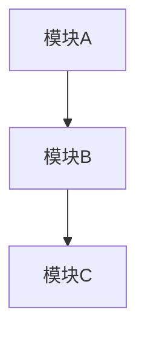

# Arch Design 参考

## 目录

- [完整流程详解](#完整流程详解)
- [模板](#模板)
- [反模式](#反模式)
- [基础软件设计要点](#基础软件设计要点)
- [与现有技能交互细节](#与现有技能交互细节)

---

## 完整流程详解

### Step 1: 需求确认

**目标**：确保设计团队对"要解决什么问题"有共同理解。

**输入**：可从以下来源获取：
- 用户口述需求
- `docs/arch/<需求名>/context.md`（如果已执行 `arch-explore`）
- 已有 PRD 或需求文档

**要确认的信息**（检查清单）：

**场景**：
- 主要用户 / 调用者是谁？
- 关键成功路径是什么？
- 异常路径有哪些？（超时、失败、并发冲突、数据损坏）

**质量目标**（尽可能定量）：
- 预期 QPS / TPS
- P99 延迟要求
- 可用性目标（几个 9）
- 数据一致性要求（强一致 / 最终一致 / 因果一致）

**约束**：
- 语言 / 运行时 / 已有技术栈
- 部署环境（容器、裸机、边缘设备）
- 时间线（原型 vs 生产）
- 团队规模和能力

**非目标**（同样重要——不做什么）：
- 明确不在本轮解决的问题
- 延迟到未来的能力

### Step 2: 调研同类软件

**目标**：在动手设计方案前，了解业界同类解决方案的架构设计和工程取舍，避免重复发明轮子，也让方案有据可依。

**方法**：

1. **确定搜索关键词**（以设计"分布式任务队列"为例）：
   - `"distributed task queue architecture"`
   - `"Celery internals architecture"`
   - `"task queue storage design"`
   - 扩展到不同范式：`"Kafka consumer group vs task queue"`

2. **搜索源**：
   - WebSearch — 搜索设计文档、blog post、技术报告
   - GitHub — 直接看知名项目的架构文档或源码分析
   - 如果项目已在本仓库，直接读代码

3. **每个同类软件需要了解的内容**：

   | 信息 | 说明 |
   |------|------|
   | 解决的问题域 | 与我们场景的匹配度 |
   | 核心抽象 | Entity 划分、数据结构选择 |
   | 数据流 | 关键路径（read/write/调度） |
   | 一致性/容错模型 | 强一致？最终一致？故障恢复？ |
   | 性能特征 | 已知 benchmark、典型瓶颈 |
   | 已知局限 | 社区吐槽、已知 issue、弃用原因 |
   | 工程取舍 | 为什么这么设计？（trade-off 的 explicit 表述） |

4. **调研结果整理**（markdown 格式，作为共享上下文）：

```markdown
## 同类软件调研

### XXX（项目名）
- 解决场景：...
- 核心架构：...
- 关键取舍：...
- 对我们设计的启示：...
- 不适用之处：...

### YYY（项目名）
...
```

**调研范围建议**：

- 至少调研 **2-3 个** 同类软件
- 覆盖不同的实现范式（如：push-based vs pull-based、单机 vs 分布式）
- 保留"不适用"信息——知道为什么不像别人那样做，和知道怎么做同样重要

**常见问题**：

- **问题**：WebSearch 搜索结果不够精准
  **处理**：直接搜索 `"<项目名> architecture"` 或 `"<项目名> design doc"`；对知名项目搜 `"<项目名> internals"`
- **问题**：没有完全对标的同类软件
  **处理**：拆解核心问题（如"调度"、"存储"、"通信"），分别找每个子问题领域的参考
- **问题**：调研结果和需求场景不匹配
  **处理**：重点标注差异点，后续方案可以说明"为什么这里不采用的方式"

### Step 3: 多方案生成

**subagent prompt 结构**（每个 Agent 使用不同倾向，并附带 Step 2 的调研结果）：

```
你是一个软件架构师。请为以下需求设计一个 [最小复杂度/可扩展优先/性能优先] 的架构方案。

需求：
[需求描述]

约束：
[约束清单]

同类软件参考（供参考，不用照搬）：
[Step 2 调研结果摘要]

请输出：
1. 模块划分与职责（2-4 个核心模块）
2. 关键数据流（核心交互路径）
3. 核心接口或抽象（简要，不超过 3-5 个）
4. 该方案受哪些同类软件启发
5. 该方案的主要代价和风险

注意：不要试图面面俱到，坚持你的设计倾向。同类调研结果用于参考和启发，不是让你照抄。

**Agent 倾向详解**：

**Agent 1 — 最小复杂度**（Conway's Law）
- 最少的模块数量
- 最少的抽象层
- 能用数组不用红黑树，能用轮询不用事件驱动
- 优先考虑"移除"而非"抽象"
- 常用于：MVP、工具型软件、需求稳定的内部组件

**Agent 2 — 可扩展优先**（Open-Close Principle）
- 接口抽象，策略模式
- 插件或回调机制
- 配置驱动而非 hardcode
- 预留扩展点
- 常用于：平台型软件、多后端支持、长期演进

**Agent 3 — 性能/资源优先**
- 最小内存分配、零拷贝
- 无锁或细粒度锁
- 零成本抽象
- 资源池、预分配
- 常用于：核心路径、运行时组件、嵌入式/边缘

### Step 4: 对比分析

**对比矩阵模板**：

| 维度 | Agent 1 (最小复杂度) | Agent 2 (可扩展优先) | Agent 3 (性能优先) |
|------|---------------------|--------------------|-------------------|
| 模块数 | N | N | N |
| 代码估算 | ~X 行 | ~Y 行 | ~Z 行 |
| 吞吐上限 | X/s | Y/s | Z/s |
| P99 延迟 | Xms | Yms | Zms |
| 内存开销 | X MB | Y MB | Z MB |
| 新增功能成本 | 高/中/低 | 高/中/低 | 高/中/低 |
| 替换组件成本 | 高/中/低 | 高/中/低 | 高/中/低 |
| 运维复杂度 | 高/中/低 | 高/中/低 | 高/中/低 |
| 风险 | N 个 | N 个 | N 个 |

**Back-of-envelope 估算指导**：

对于基础软件，关键估算包括：

```
吞吐量上限：
- 单线程顺序执行 ≈ 2-5 ns/op (CPU 指令级)
- 函数调用开销 ≈ 5-20 ns
- 系统调用 ≈ 200-500 ns
- 内存随机访问 ≈ 100 ns (DDR5)
- 磁盘随机 I/O ≈ 10-100 us
- 网络 RTT (同机房) ≈ 0.5-1 ms
- 网络 RTT (跨 AZ) ≈ 1-5 ms

内存：
- 小对象结构体 ≈ 64-256 bytes
- 固定缓冲区 / page 大小
- 缓存行友好 vs 随机访问
```

不需要精确数字，量级准确就够。

### Step 5: 推荐与记录

**推荐策略**：
- 明确："推荐方案 X"
- 原因："因为在这个场景下 Y 维度比 Z 更重要，原因是..."
- 代价："选择 X 意味着放弃..."（Trade-off 的诚实表达）
- 如果方案间没有明显胜负，指出关键决策点并推荐先做 prototype

---

## 模板

### design.md 模板

```markdown
# <需求名> — 架构设计

## 概述

[一句话描述这个设计要解决什么问题]

## 设计方案

### 模块划分



| 模块 | 职责 | 核心抽象 |
|------|------|----------|
| A | ... | ... |
| B | ... | ... |

### 关键数据流

[核心交互路径的描述，必要时用 sequence diagram]

### 接口概要

[关键接口或协议格式，详细设计见 design-an-interface]

## 候选方案对比

### 方案 A — 最小复杂度

[简述、适用场景、取舍]

### 方案 B — 可扩展优先

[简述、适用场景、取舍]

### 方案 C — 性能优先

[简述、适用场景、取舍]

### 对比矩阵

| 维度 | A | B | C |
|------|---|---|---|

## 选择理由

[推荐方案 + 原因 + 代价]

## 已知风险与待验证项

- [ ] 风险项 1
- [ ] 待验证假设 1
- [ ] 建议用 `prototype` 先行验证的部分

## 相关文档

- context.md — 上下文与约束
- adr-<slug>.md — 决策记录
```

### ADR 模板

```markdown
# ADR-<nnn>: <标题>

## 状态

[提议 / 已接受 / 已废弃]

## 上下文

[什么问题？什么约束？什么背景？]

## 方案对比

| 方案 | 描述 | 优点 | 代价 |
|------|------|------|------|
| A | ... | ... | ... |
| B | ... | ... | ... |
| C | ... | ... | ... |

## 决策

选择 **[方案 X]**。

理由：[为什么在这个上下文中 X 是最合适的]

## 后果

[接受这个选择带来的正面和负面后果]

## 关联

- [design.md](./design.md)
```

---

## 反模式

### ❌ 方案趋同

3 个 Agent 产出相似方案 → 说明设计空间中缺乏多样性。重新审视 Agent 提示：
Agent 1 是否真的简化了？Agent 2 是否真的灵活了？Agent 3 是否真的优先了性能？

调整方法：
- 给每个 Agent 一个具体的约束（"不能用第三方库"、"必须是纯 async"、"必须 stream 友好"）
- 给每个 Agent 一个范式借鉴（"像 Redis 那样"、"像 Kafka 那样"、"像 SQLite 那样"）

### ❌ 跳过对比直接推荐

生成方案后直接选了一个顺眼的 → 没有系统对比。强制走对比矩阵，至少填完矩阵再做决定。

### ❌ 用实现复杂度掩盖其他维度

工程师倾向选择"最熟悉"或"最简单"的方案，而忽略性能、运维等维度。对比矩阵确保每个维度都被关注。

### ❌ 让候选 Agent 写设计文档

三个并行 Agent 写同一个 `design.md` ⇒ **后写者静默覆盖先写者**，前两个方案丢失。
文件未跟踪时 `git status` 也看不出冲突；等第三个返回后才发现，已无法从工作区找回。

根因：subagent 运行时可能被注入「列出你创建的文件」这类提示，
「输出方案」由此被理解成「落盘」。

正确做法：**候选 Agent 一律不创建、不修改任何文件**，方案以回复正文返回；
`design.md` / `adr-*.md` / `context.md` 由主 agent 在所有候选返回后写入一次。
派发提示里必须显式写「不要创建或修改任何文件」。

### ❌ 不记录被否方案

被否的方案及其理由包含了有价值的决策上下文。不记录的话，几个月后没人知道为什么没选 B。

注意与上一条的分界：**候选不落盘 ≠ 不记录**。被否方案的摘要与理由仍要写进 `design.md`
的对比节与 ADR —— 只是由主 agent 写，不是让候选自己开文件。

### ❌ 过早精细化

在架构层面做接口级细节设计 → 如果架构选择错了，接口细节全是废的。Step 2 仅输出"关键接口"（不超过 3-5 个），详细的接口设计留给后续的 `design-an-interface`。

---

## 基础软件设计要点

### 正确性
- 数据竞争与竞态条件
- 状态机的一致性（非法状态转换）
- 资源泄漏（内存、句柄、FD）
- 并发安全边界

### 错误处理
- 每个错误：发生 → 传播 → 处理/恢复 → 记录
- 是否可重试？（幂等性）
- 是否可降级？（partial failure）
- 是否有错误预算？

### 资源管理
- 谁分配谁释放？（RAII / defer / GC）
- 池化 vs 按需分配
- Backpressure 机制

### 可观测性
- 关键路径是否有 tracing span？
- 核心指标是否暴露 metrics？
- 错误是否带了足够上下文 log？

---

## 与现有技能交互细节

### 调用 design-an-interface

在 Step 2 之后，如果某个模块的接口设计需要精化：

> "现在用 `design-an-interface` 来设计模块 X 的接口。需求见 Step 2 Agent N 的输出。"

### 调用 ubiquitous-language

如果设计过程中引入了新的领域术语：

> "现在用 `ubiquitous-language` 提取本次设计的新术语，更新术语表。"

### 调用 fireworks-tech-graph-main

在产出 `design.md` 时，对关键架构图调用：

> "用 `fireworks-tech-graph-main` 生成架构图：模块关系、数据流、部署拓扑。"
